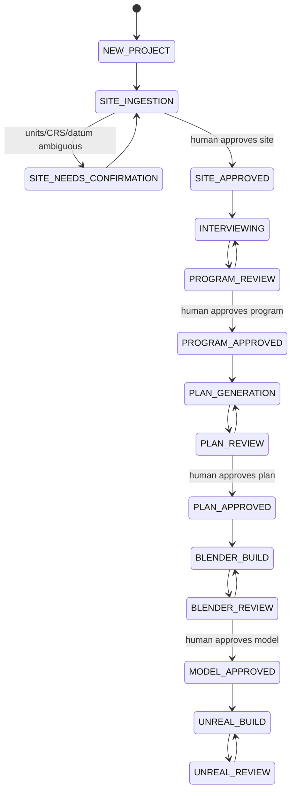

# Architecture

Status: Milestones A, B (site ingestion), C (agent-first owner interview and
space program) and D (solver-backed plan concepts, evaluation and revisions)
complete. Active development follows the stage roadmap in
[docs/PROJECT_TRACKER.md](PROJECT_TRACKER.md) (Stages S1–S9). Sections marked
*planned* describe interfaces planned for later stages.

## Principles

1. **One model, many views.** A single canonical semantic house model is the
   source of truth. Every 2D plan, schedule, IFC file, Blender scene and
   Unreal level is derived from it, never edited in parallel
   ([ADR 0001](adr/0001-canonical-semantic-model.md)).
2. **Deterministic where correctness is measurable.** Geometry, areas,
   containment, connectivity and workflow rules are plain code with tests.
   AI is used for reasoning (interviews, topology proposals, critique) and
   its output is validated before it can change project state.
3. **Humans approve; agents propose.** Four gates (site, program, plan,
   model) can only be crossed by a human, and approvals pin exact artifact
   versions by content hash.
4. **Unknown stays unknown.** Missing facts are modelled explicitly instead
   of being filled with plausible defaults.
5. **Agent-first and vendor-neutral.** The primary AI interfaces are coding
   agents (Claude Code, Gemini CLI, OpenAI Codex) operating `house-ai` via
   documented CLI commands and structured interfaces without requiring a paid
   API key ([ADR 0011](adr/0011-agent-first-interview-interface.md)). Direct
   SDK adapters ([ADR 0010](adr/0010-claude-adapter-for-the-interview.md)) are
   optional, and no AI vendor SDK, CAD backend or game engine is a dependency
   of the domain.

## Layers

```
            ┌─────────────────────────────────────────────────────────┐
  agents    │ Claude Code / Gemini CLI / Codex + agents/roles.yaml    │
            └───────────────┬─────────────────────────────────────────┘
                            │ schema-valid writes only
            ┌───────────────▼─────────────────────────────────────────┐
  interface │ cli/ (A-D)            apps/reviewer/ (planned, S4)      │
            └───────────────┬─────────────────────────────────────────┘
            ┌───────────────▼─────────────────────────────────────────┐
  workflow  │ orchestration/workflow.py: states, guards, gates (A)     │
            └───────────────┬─────────────────────────────────────────┘
            ┌───────────────▼─────────────────────────────────────────┐
  storage   │ storage/: write-once artifacts, sources, event log (A)   │
            └───────────────┬─────────────────────────────────────────┘
            ┌───────────────▼─────────────────────────────────────────┐
  domain    │ domain/: canonical schemas + integrity checks (A)        │
            └───────────────▲─────────────────────────────────────────┘
                            │ produce / consume canonical objects
  pipeline  cad/ geospatial/ (B)  interview/ program/ (C)
            constraints/ generation/ evaluation/ render2d/ (D)
            blender/ (F)  unreal/ (G)  bim/ (later)
```

Dependencies point downward only. The domain imports nothing from the
packages above it. Pipeline packages depend on the domain and are called by
the orchestration layer.

## Package map

| Package | Milestone | Contents |
|---|---|---|
| `house_ai.domain` | A | Pydantic models for every canonical schema, units, geometry, coordinate frames, integrity checks, compliance language, schema registry |
| `house_ai.storage` | A | `ProjectStore` (write-once artifacts, immutable sources, hash-chained event log), canonical hashing, folder importer |
| `house_ai.orchestration` | A-D | Workflow state machine, transition guards, approval gates, reopen; site ingestion, human site confirmation, read-only survey inspection; agent-first interview service (store, workflow, site context, checklist, structured slot interpretations), optional LLM assist through `providers.base.send`; plan service (`plans.py`: gated or exploratory generation, evaluation, revisions, exports, plan review request) |
| `house_ai.cli` | A-D | `house-ai` command, a thin layer over the library with `--json` and `--set` for coding agents; `plan` commands in `cli/plan_cmds.py` |
| `house_ai.providers` | A, C | `ModelProvider` protocol, `DataFlowPolicy`, `send()`; `ScriptedProvider` for tests; optional `ClaudeProvider` (`providers/claude.py`, ADR 0010) |
| `house_ai.cad` | B | `CadAdapter` / `CadSiteExtractor` protocols; format detection from bytes; ezdxf DXF adapter; DWG via ODA File Converter; layer roles from a human mapping; raw SOURCE-frame extraction and site interpretation with explicit ambiguity |
| `house_ai.geospatial` | B | CRS lookup and validation (pyproj/PROJ), UTM candidates, grid-to-true-north, Delaunay TIN, parcel measurements and frontage, site validation report |
| `house_ai.render2d` | B (site), D (plans) | Site plan SVG, terrain slope SVG and the static site review page from the canonical site; dimensioned plan SVG per level with a terrain section (`plan_svg.py`) |
| `house_ai.interview` | C | Question bank (completeness checklist) with conditions and follow-ups, deterministic answer parsers, slot types, contradiction rules with options, session fold and planner, brief builder, summary (pure, domain only) |
| `house_ai.program` | C | Brief → space program, adjacencies, zones, assumptions (including steep-hillside engineering assumptions) and open questions; program validation (missing information, unconfirmed interpretations, conflicts, sizes, totals, site fit); review sheet |
| `house_ai.constraints` | D | Program + brief + site + CodePack → HARD/SOFT `ConstraintSet`; CodePack rules it cannot express are reported as not checked |
| `house_ai.generation` | D | Design frame and envelope fitting, program → rooms and hard-connected clusters, six massing strategies (compact, split_level, linear, two_wing, courtyard, split_walkout), OR-Tools CP-SAT layout, canonical model assembly (walls derived from space edges, openings, stairs, slabs), `CpSatPlanGenerator` ([ADR 0013](adr/0013-solver-backed-plan-generation.md)); Revision operations → solver input and the unmet-request check (`revision.py`, [ADR 0030](adr/0030-revision-operation-module.md)) |
| `house_ai.evaluation` | D, S6 | Six baseline evaluators plus eight usability critics; finish-face net floor, door sweeps, cited furniture studies, stairs/slab headroom, portal visibility routes, privacy, sampled daylight opportunity and conservative vehicle arrival (ADR 0019); reports, explanation, comparison and revision diff |
| `house_ai.blender` | F | Deterministic canonical-plan → Blender scripts (planned, stage F) |
| `house_ai.unreal` | G | FBX + `scene_manifest.json` → Unreal importer (planned, stage G) |
| `house_ai.bim` | later | IFC mapping via IfcOpenShell (planned) |

The spec's suggested tree did not include `domain/`, `storage/` or a home
for the state machine; [ADR 0004](adr/0004-repository-layout.md) explains
the additions.

## Project storage

A project is a directory (by default under the git-ignored
`project-data/`):

```
project.json                       identity only (id, name, classification)
events.jsonl                       append-only event log, SHA-256 hash chain
source/<sha12>-<name>.<ext>        original inputs, byte-for-byte, read-only
artifacts/<kind>/<id>/v0001.json   validated artifact versions, read-only
```

- **The event log is the single source of truth.** Every artifact version is
  registered by an `artifact_written` event that carries its content hash.
  The workflow state is not stored anywhere; it is replayed from the log.
- **Write-once.** A version file is created with an atomic hard link that
  fails if the file exists. A change is a new version. Writing identical
  content returns the existing version instead of creating a duplicate.
- **Content hashes** are SHA-256 over the canonical JSON of the *validated
  model* (sorted keys, no whitespace, defaults included). The same content
  from YAML or JSON hashes the same.
- **Tamper evidence.** `house-ai project verify` re-checks the hash chain,
  re-validates and re-hashes every artifact, flags unregistered files and
  re-hashes every source file.

Details and trade-offs: [ADR 0003](adr/0003-file-based-store-and-event-log.md).

## Workflow



**Transitions** follow the table in `orchestration/workflow.py`. A transition
can never target a gated state (`SITE_APPROVED`, `PROGRAM_APPROVED`,
`PLAN_APPROVED`, `MODEL_APPROVED`). Guards: program review needs a program,
concept review needs a plan, Blender/Unreal review need a build record made
from the approved plan.

**Gates** are crossed only by `Workflow.approve`, which:

1. refuses any actor that is not human;
2. requires the gate's review state;
3. loads the exact artifact version and re-verifies its hash;
4. re-runs the gate's checks on that artifact:
   - *site*: `site_verification_blockers` (units, elevation units, CRS and
     vertical datum confirmed by a human, local frame present, boundary
     verified, no open blocking issues);
   - *program*: site approved, no blocking open questions, no unresolved
     contradictions in the cited brief;
   - *plan*: site and program approved, the plan pins exactly those
     versions, `check_model` reports no errors, no stored evaluation reports
     hard violations for this version;
   - *model*: plan approved, a Blender build record made from that plan.
5. appends an `approval_granted` event holding the `Approval` record.

**Reopen** returns to a gate's review state and supersedes that approval and
every later one. The superseded approvals stay in the log.

The CLI `approve` command additionally requires an interactive terminal and
a typed confirmation phrase. This stops an agent in a non-interactive shell
from crossing a gate by accident. It is not a security boundary: any local
process can call the library or edit files. The event log makes such edits
visible but cannot prevent them.

## Site ingestion (Milestone B)

```
survey file ──source add──▶ source/ (immutable, SHA-256)
   │ site inspect (read-only, no project)          ▲ re-read on confirm
   ▼                                               │
detect format ─▶ CAD adapter (ezdxf | ODA→ezdxf) ─▶ raw entities, SOURCE frame
   ─▶ declared_frame ($INSUNITS, GEODATA EPSG; nothing inferred)
   ─▶ layer mapping (human) ─▶ SurveyTransform SOURCE→GRID→LOCAL
   ─▶ boundary · contours · spots · features · ambiguous entities
   ─▶ TIN, frontage, issues ─▶ cad_import + site artifacts
   ─▶ workflow assess-site ─▶ SITE_NEEDS_CONFIRMATION
   ─▶ site confirm (human, TTY) ─▶ new site version ─▶ site gate (human)
site report ─▶ validation report (JSON/Markdown) + site SVG, derived on demand
```

Details: [ADR 0006](adr/0006-site-ingestion-pipeline.md).

## Integrity checks

`domain/integrity.py` decides whether a model is a coherent building at
all. Errors block the plan gate; nothing stores a "passed" flag.

- unique ids across all entity types; `exterior` reserved
- every reference resolves (levels, spaces, walls, zones, materials, …)
- polygons valid (checked at schema level with Shapely)
- spaces on the same level do not overlap (shared edges are fine)
- each opening fits along and within the height of its host wall
- each opening actually lies between the two things it claims to connect,
  found by probing just beyond both wall faces
- every space reachable from outside through doors, openings and stairs
- every space inside the site's buildable envelope (or boundary, with a
  warning), in the same local coordinate system as the site

## Plan generation (Milestone D)

`house-ai plan generate` compiles constraints from the approved program,
brief, site and any CodePack, then runs each strategy: a massing of
double-loaded bars (rows either side of a corridor) whose cross positions,
row depths and level elevations come from the strategy, the envelope and the
surveyed terrain; CP-SAT then decides each bar's position and length and each
room cluster's row, order and widths on a 10 cm grid. The result is assembled
into a canonical `HouseModel`: walls are derived from space edges so every
wall segment has one space (or the outside) per side, exterior faces against
the ground become retaining walls without windows, and stairs join levels.
`check_model` runs on every candidate; one with errors is kept and reported
as invalid, never dropped. Six evaluators then measure it. Plans, evaluation
reports, constraint sets and revision reports are stored as new immutable
versions; the workflow moves PROGRAM_APPROVED → PLAN_GENERATION →
PLAN_REVIEW and the plan gate stays human-only. Details and limits:
[ADR 0013](adr/0013-solver-backed-plan-generation.md), [Milestone D](milestones/D.md).

## Boundaries kept open

| Boundary | Interface | Milestone |
|---|---|---|
| CAD ingestion | `cad.base.CadAdapter`, `cad.dwg_oda.adapter_for` (ezdxf, ODA) | B |
| Terrain | `geospatial.base.TerrainBuilder` (`DelaunayTerrainBuilder`) | B |
| Plan generation | `generation.generator.CpSatPlanGenerator.candidates` (one generator; a protocol returns with a second, [ADR 0027](adr/0027-deep-modules-at-the-human-and-private-data-seams.md)) | D |
| Evaluation | `evaluation.base.Evaluator` + `EvaluationReport` schema; future evaluators reported as not run | D, later |
| AI providers | `providers.base.ModelProvider`, `DataFlowPolicy` | C |
| Blender / Unreal builds | `domain.build.BuildRecord` (input plan pinned) | F, G |
| Code rules | `domain.codepack.CodePack`, `ComplianceStatement` | D |

## Schemas

Pydantic models in `house_ai.domain` are the source of truth. JSON Schema
(draft 2020-12) files in `schemas/` are generated from them with
`house-ai schemas export` and committed so non-Python consumers (the web
reviewer, other agents) can validate data. A test fails if the committed
files drift from the code ([ADR 0002](adr/0002-pydantic-schemas-json-schema-export.md)).

## Testing

`tests/` runs without any private data, network or paid API. It covers
schema strictness and drift, units and CRS rules, local frame transforms,
polygon validity and areas, every integrity check with deliberately broken
variants of the golden plan, store immutability and tamper detection,
serialisation round trips, every workflow gate and guard, the CLI including
the non-interactive approval refusal, the provider data-flow policy and the
agent roster. The golden synthetic project lives in
`examples/projects/synthetic-bungalow/`. Milestone B adds CAD parsing,
format detection, coordinate transforms and CRS lookups, terrain, parcel
measurements, ambiguous and malformed input, provenance, the human site
confirmation, the CLI, a DWG round trip through ODA (skipped without it),
and snapshot checks of the committed example outputs, all against the
synthetic survey in `examples/surveys/synthetic/` with known ground truth.

## Hillside geometry (S8)

`geospatial/earthworks.py` integrates clipped TIN triangles exactly for the
chosen terrain model and design planes. `geospatial/mesh.py` isolates the
Trimesh/Manifold adapter and independently cross-checks analytical fixtures.
Slab undersides, explicit formation pads and surveyed ground distinguish cut,
fill and underfloor void. `generation/terrain_levels.py` couples bar start,
length and level elevations in the same CP-SAT solve through terrain lookup.
It preserves stair/link topology and has no excavation or void-volume cost.
Free 2D placement still has fixed stacked offsets and explicitly refuses
sectional intents; it is not advertised as using the joint terrain solve.

`geospatial/sections.py` derives true vertical cuts and separately labelled
facade projections. `render2d/hillside_export.py` exports these alongside
`hillside.json` and a per-concept professional-risk register. The inline plan
SVG uses a true longitudinal cut, replacing schematic projected level bands.
`plan sections` exposes configurable cuts on exported canonical plans.
Mapped 3D breaklines constrain TIN cells; no layer-role or elevation inference
is introduced. Algorithms, discretisation and limitations: ADR 0022.
