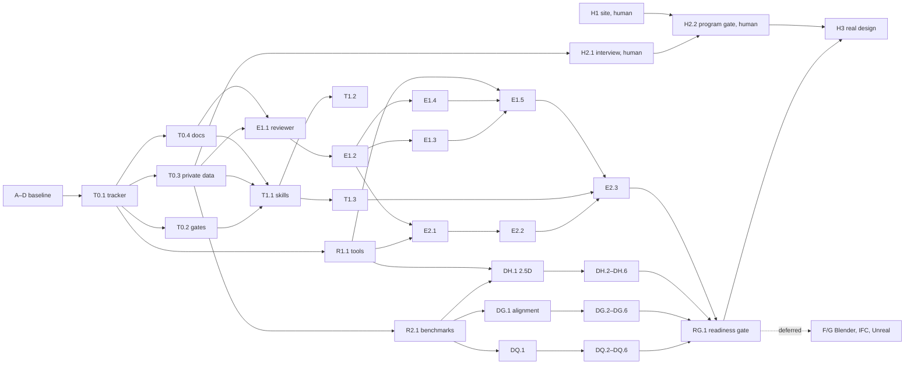

# Project tracker

The one authoritative roadmap, task register, stage lifecycle and progress
record for HOUSE DESIGN AI ([ADR 0014](adr/0014-project-tracker-and-stage-lifecycle.md)).
No other TODO, roadmap or stage-status file is kept. Format and update rules
are in [§P](#p-rules-for-updating-the-tracker); `python tools/check_tracker.py`
checks them.

Last updated: 2026-10-17, stage T0.1 (branch `stage/T0.1-project-tracker`),
by `agent:claude-code`.

## A. Mission and immediate objective

**Mission** ([MASTER_SPEC](MASTER_SPEC.md) "Mission", [AGENT_CONTRACT §1](AGENT_CONTRACT.md)):
a personal-first, agent-operated architectural design system whose first
purpose is the homeowner's own family house on a real, steep, surveyed
hillside (`projects/my-house/`), reusable for other projects. The homeowner
talks to Claude Code, Codex or Antigravity/Gemini through their existing
subscriptions; no separately billed LLM API key is needed for the core
workflow. Agents reason, propose and critique; deterministic tools verify
measurable claims; the canonical semantic `HouseModel` is the only design
truth; humans approve the site, program, plan and model gates. Nothing this
system produces is permit-ready, construction-ready or professionally
certified ([PROFESSIONAL_HANDOFF](PROFESSIONAL_HANDOFF.md)).

**Immediate objective:** excellent, usable residential floor plans for the
steep site: verified site, approved program, several genuinely different
concepts, usability and hillside checks, visual inspection by agents, and
homeowner review and revision. Photorealism, Blender and Unreal come later
(decision DEC-01). The bar is the
[floor-plan readiness gate](#h-floor-plan-readiness-gate), not "tests pass".

## B. Authority map

| Document | Holds | Wins over |
|---|---|---|
| [MASTER_SPEC.md](MASTER_SPEC.md) | Product mission, requirements, intended capabilities | everything, on product scope |
| [AGENT_CONTRACT.md](AGENT_CONTRACT.md) | Binding rules for every coding and design agent | entry files, tracker, on agent behaviour |
| [ARCHITECTURE.md](ARCHITECTURE.md), [DOMAIN_MODEL.md](DOMAIN_MODEL.md) | Technical architecture, canonical representations | tracker, on technical design |
| [adr/](adr/) | Decisions and rationale (0001–0014) | stays in force until a later ADR revises it |
| **PROJECT_TRACKER.md** (this file) | Roadmap, stages, tasks, status, evidence, reviews, open issues | milestone reports and handoffs, on what is done and what comes next |
| [milestones/](milestones/) A–D | Historical reports (what was delivered, with test results) | nothing; history |
| `AGENTS.md`, `CLAUDE.md`, `GEMINI.md` | Tool-specific loading of the contract (ADR 0005) | nothing |

When documents disagree: name the exact inconsistency, classify it (stale
documentation, requirement conflict or changed priority), record it in
[§K](#k-open-issues-risks-and-uncertainties) with a proposed resolution, and
ask the homeowner before any significant scope change. Never edit
MASTER_SPEC to make the implementation look compliant. Existing ADRs stay
in force unless a new ADR revises them.

## C. Verified implementation baseline

Verified 2026-10-17 on `main` at `a9b68fe` (merge of `milestone-d`) by
`agent:claude-code` (task T0.1-01). Historical reports are evidence of what
was claimed; the facts below were re-checked.

| Fact | Evidence |
|---|---|
| Milestones A, B, C, D merged into `main` | `git log`: `ef414ec` (A), `73523a8` (B), `2ecb587` (C), `b636164` (PR #1 survey evidence), `a9b68fe` (D) |
| CI green on `main` (Python 3.11 and 3.13) | GitHub Actions run 39046442142, push of `a9b68fe`, success |
| Repository is private | `gh repo view --json visibility` → `PRIVATE` |
| ~21,900 lines of Python in `src/`, ~7,100 in `tests/` | `wc -l` over `src/**/*.py`, `tests/**/*.py` |
| 22 JSON Schemas, in sync with the code | `house-ai schemas check` → "22 schemas up to date" |
| 483 tests pass locally (Python 3.13.3, macOS arm64) | `pytest -q` → "483 passed in 53.22s"; 396 test functions, the rest parametrised |
| Lint clean | `ruff check src tests examples` → "All checks passed!" |
| `my-house` store intact | `house-ai project verify my-house` → "intact: 13 events, 10 artifact versions" |
| `my-house` state `SITE_NEEDS_VERIFICATION`, 5 site blockers, no approvals | `house-ai project status my-house --json` (read-only) |
| `my-house` interview not started, no brief, program or plans | `house-ai interview status my-house --json`: 0 turns; `design/` holds only a README |
| `my-house` owner statements at v5 | `projects/my-house/artifacts/owner_statements/owner-statements/v0005.json` |
| Plan generation: OR-Tools CP-SAT, six strategies (`compact`, `split_level`, `split_walkout`, `linear`, `two_wing`, `courtyard`) | `src/house_ai/constants/strategies.py:5-10`, `generation/massing.py:282-290` |
| Six evaluators (Geometry, Program, Adjacency, Circulation, Privacy, Site); nine future evaluators listed as not run | `src/house_ai/evaluation/evaluators.py:165,268,461,591,750,853`, `evaluation/base.py:53-63` |
| Four human approval gates (site, program, plan, model) | `src/house_ai/domain/workflow.py:36-51`, `orchestration/workflow.py:76-83` |
| Hash-chained, write-once `ProjectStore` | `src/house_ai/storage/project_store.py:74-89,192-222,410-460`; `tests/test_storage.py` |
| No reviewer code, no JavaScript/TypeScript, no Playwright anywhere | `apps/reviewer/` holds only `README.md`; no `package.json` in the repository |
| No project-local agent skills | `skills/` holds only `README.md` ("none exist yet") |
| Blender, IFC, Unreal packages are empty boundaries | `src/house_ai/{blender,bim,unreal}/__init__.py` only |

**Known limitations of the baseline** (each is a tracked task, not a reason
to reopen A–D):

- Massing is fixed rectangular bars: front row, full-length corridor, back
  row (`generation/massing.py:165`, `assemble.py:255-257`). Rooms are packed
  in 1D rows with `AddNoOverlap` and exact tiling (`solver.py:377,395-396`);
  `NoOverlap2D` is not used. → DG.3, DG.4
- The solver reads the compiled `ConstraintSet` only for objective weights
  (`generator.py:118-125,174`). CodePack hard rules are checked only after
  solving. Seven compiled soft objectives are ignored (circulation
  efficiency, site response, views, cross-ventilation, indoor/outdoor,
  kitchen functionality, storage). → DG.1
- Solver and evaluator relation semantics differ for ADJACENT, soft
  CONNECTED, NEAR, SEPARATED, ACOUSTIC_SEPARATION, intra-cluster pairs,
  hall/EXTERIOR pairs and VISUAL (`solver.py:470,540-549,576-580`;
  `evaluators.py:545-556`; `rooms.py:183-193`). → DG.1
- No furniture entity; fixtures, terraces and parapets are never populated;
  outdoor items are skipped (`rooms.py:163-165`). → DQ.1, DG.5
- Walls are centrelines; areas are measured to centrelines (no net area).
  → DQ.1
- Stairs carry risers and tread but there is no headroom, landing or
  arrival check. → DQ.2
- Levels: entry level from mean ground along the road face, others stepped
  in 1.5 m or 3.0 m increments clamped to ±3.0 m (`massing.py:234-273`);
  levels and terrain are not optimised together. → DH.3
- The terrain section is schematic (projected level bands and a terrain
  polyline, `render2d/plan_svg.py:374-470`), not a true cut. → DH.2
- Cut/fill sampled on a 0.5 m grid; "fill" is underfloor void, labelled as
  such (`evaluators.py:943-1018`). No analytical validation fixture. → DH.1
- Walking distance from the entrance is straight-line and `inferred`.
  → DQ.5
- Daylight is a window count; no orientation, daylight or ventilation
  analysis. → DQ.6
- `combine` revisions are refused (`cli/plan_cmds.py:269`). → DG.6
- Passing tests show the software does what it claims; they do not show the
  plans are good architecture.

## D. Dashboard

| | |
|---|---|
| **Current stage** | T0.1 Project tracker and stage protocol: implementation complete, review **PENDING** |
| **Awaiting review** | T0.1 on `stage/T0.1-project-tracker` |
| **Next eligible stage** (after T0.1 is closed) | T0.2 Human-authorization and approval-gate hardening |
| **Then** | T0.3 Private-data isolation, T0.4 Documentation reconciliation, T1.1 Skill packaging |
| **Blocked** | H1 site facts (owner/surveyor input), H2.2-05 program gate (needs site gate), H3 real design (needs readiness gate and approvals) |
| **Human parallel tracks** | H1.1/H1.2 site verification with the owner; H2.1 interview may start after T0.3-01 |
| **`main` health** | `a9b68fe`, CI run 39046442142 green; 483 tests pass locally |
| **Homeowner gates on `my-house`** | site: not approved (5 blockers) · program: none · plan: none · model: none |

Counts come from `python tools/check_tracker.py --summary`, never from a
hand count.

## E. Stage execution order and dependency graph

"Next stage" picks the first stage in this order whose status is not `DONE`
or `DEFERRED` and whose dependencies are all `DONE`. Human-dependent stages
(H1, H2, H3) are not picked by "Next stage"; they run when the homeowner
asks, in parallel with software stages. Evaluation stages R1.x may run
alongside the engineering stage that needs them.

| # | Stage | Depends on |
|---|---|---|
| 1 | T0.1 Project tracker and stage protocol | D |
| 2 | T0.2 Human-authorization and approval-gate hardening | T0.1 |
| 3 | T0.3 Private-data isolation | T0.1 |
| 4 | T0.4 Documentation reconciliation | T0.1 |
| 5 | T1.1 Skill packaging and discovery | T0.2, T0.3, T0.4 |
| 6 | T1.2 Site and programming skills | T1.1 |
| 7 | T1.3 Concept and critique skills | T1.1 |
| 8 | R1.1 Near-term tool evaluations | T0.1 |
| 9 | E1.1 Reviewer foundation | T0.3, T0.4 |
| 10 | E1.2 Plan view and inspection | E1.1 |
| 11 | E1.3 Analysis overlays | E1.2 |
| 12 | E1.4 Comparison and history | E1.2 |
| 13 | E1.5 Feedback capture and browser tests | E1.3, E1.4, R1.1-01 |
| 14 | E2.1 Agent browser inspection | E1.2, R1.1-01 |
| 15 | E2.2 Grounded visual critique | E2.1 |
| 16 | E2.3 Inspect, critique, revise loop | E2.2, T1.3, E1.5 |
| 17 | R2.1 Benchmark harness and steep reference fixture | T0.3 |
| 18 | DQ.1 Model foundations for usability checks | R2.1 |
| 19 | DQ.2 Door and stair critics | DQ.1 |
| 20 | DQ.3 Furniture feasibility critics | DQ.1 |
| 21 | DQ.4 Wet rooms, storage and garage critics | DQ.1 |
| 22 | DQ.5 Circulation and privacy critics | DQ.1 |
| 23 | DQ.6 Daylight and ventilation opportunity | DQ.1 |
| 24 | R2.2 Terrain and parcel scenarios | R2.1 |
| 25 | R2.3 Household scenarios | R2.1 |
| 26 | R2.4 Defect-seeded scenarios | R2.1, DQ.2, DQ.3, DQ.5, DQ.6 |
| 27 | DG.1 Solver and evaluator semantic alignment | R2.1 |
| 28 | DG.2 Typed topology proposals | DG.1 |
| 29 | DG.3 Two-dimensional placement engine | DG.1 |
| 30 | DG.4 Massing and organisation variety | DG.3 |
| 31 | DG.5 Outdoor and terrace integration | DG.3 |
| 32 | DG.6 Topology revisions and diversity | DG.2, DG.4 |
| 33 | DH.1 Robust 2.5D geometry and volume validation | R2.1, R1.1-02, R1.1-03 |
| 34 | DH.2 True sections and elevations | DH.1 |
| 35 | DH.3 Joint level and terrain optimisation | DH.1, DG.1 |
| 36 | DH.4 Earthworks and retaining walls | DH.1 |
| 37 | DH.5 Access and terrain-contact connections | DH.3 |
| 38 | DH.6 Terrain data quality and risk register | R2.1 |
| 39 | R1.2 CAD, BIM and environment tool evaluations | T0.1 |
| 40 | R1.3 Research generator evaluations | T0.1 |
| 41 | RG.1 Floor-plan readiness assessment | E2.3, DQ.2–DQ.6, DG.6, DG.5, DH.2–DH.6, R2.2–R2.4, T1.2, T1.3 |
| — | H1.1, H1.2 Real site verification (human) | none / H1.1 |
| — | H2.1, H2.2 Real interview and program (human) | T0.3-01 / H2.1, H1.2 |
| — | H3.1, H3.2 Real house design and iteration (human) | RG.1, H1.2, H2.2 |
| — | F.1, F.2, G.1, G.2 Blender, IFC, Unreal, advanced (deferred) | RG.1 and owner decision |

DG.1 fixes a correctness gap (solver and evaluator disagree) and may be
pulled ahead of the DQ stages if the owner prefers (issue ISS-12).



## F. Stage and task register

Every stage and task appears here exactly once; other sections refer to
their IDs. Workstream codes: A–D completed milestones; T0 governance; T1
agent skills; E1 interactive reviewer (MASTER_SPEC Milestone E); E2 agent
visual inspection; DQ usability and quality critics ("D+1"); DG flexible
generation ("D+2"); DH hillside 2.5D geometry ("D+3"); R1 third-party tool
evaluation; R2 architectural benchmarks; RG floor-plan readiness gate; H1–H3
real house (human-dependent); F Blender and IFC (MASTER_SPEC Milestone F,
deferred); G Unreal and advanced features (Milestone G, deferred).

Task line format: `` - [ ] **ID** title — `STATUS` · priority · deps: IDs ``.
The parent stage is the ID before the last hyphen (`E1.2-03` belongs to
stage `E1.2`). Priorities: P0 safety or blocking, P1 needed for the
readiness gate, P2 valuable, P3 optional.

### Workstream A–D: completed baseline

Historical milestones, merged before this tracker existed. Their reviews
were ad hoc (recorded in the milestone reports), not under §N. Their
limitations are tracked as new tasks in later stages, not by reopening them.

### Stage A — Domain foundation, schemas, project store and provenance

| Field | Value |
|---|---|
| Kind | historical baseline |
| Status | DONE |
| Review | NOT_REQUESTED — predates the stage protocol; see [milestones/A.md](milestones/A.md) |
| Branch | `milestone-a` (merged `ef414ec`) |
| Depends on | none |
| Tasks | A-01, A-02, A-03, A-04, A-05 |
| Objective | Canonical schemas, write-once project storage with provenance, workflow with human gates, integrity checks |
| Scope | MASTER_SPEC "Milestone A" |
| Acceptance | As reported in milestones/A.md |
| Tests | `tests/test_schemas.py`, `test_storage.py`, `test_workflow.py`, `test_integrity.py`, `test_domain_rules.py` |
| Demonstration | `house-ai example load project-data/demo`; `house-ai project verify project-data/demo` |
| Artifacts | `src/house_ai/domain/`, `src/house_ai/storage/`, `src/house_ai/orchestration/workflow.py`, `schemas/` |
| Review requirements | n/a (historical) |
| Evidence | merge `ef414ec`; CI run 38993582485 success |

- [x] **A-01** Canonical Pydantic schemas exported to JSON Schema with drift check — `DONE` · P0 · deps: none
  - Accept: every canonical kind has a schema in `schemas/`; `schemas check` fails on drift
  - Verify: `house-ai schemas check`; `tests/test_cli.py::test_schemas_check_fails_on_drift`
  - Evidence: `src/house_ai/domain/registry.py:71-90`; 22 schemas up to date on `a9b68fe` (T0.1-01)
- [x] **A-02** Write-once ProjectStore with hash-chained event log and immutable sources — `DONE` · P0 · deps: none
  - Accept: artifacts cannot be overwritten; tampering with artifacts, events or sources is detected
  - Verify: `tests/test_storage.py` (10 tamper and immutability tests); `house-ai project verify`
  - Evidence: `src/house_ai/storage/project_store.py:74-89,192-277,410-460`; commit `ef414ec`
- [x] **A-03** Workflow state machine with four human-only approval gates — `DONE` · P0 · deps: none
  - Accept: 15 MASTER_SPEC states; gates approvable only by a human actor; approvals pin artifact hashes
  - Verify: `tests/test_workflow.py` (30 tests)
  - Evidence: `src/house_ai/domain/workflow.py:18-67`; `orchestration/workflow.py:49-408`
- [x] **A-04** Integrity checks on the canonical HouseModel — `DONE` · P0 · deps: none
  - Accept: ids, references, polygon validity, overlap, openings, reachability, stairs, envelope checked
  - Verify: `tests/test_integrity.py` (28 tests)
  - Evidence: `src/house_ai/domain/integrity.py`; milestones/A.md "Integrity checks"
- [x] **A-05** CI on Python 3.11 and 3.13 and one shared agent contract — `DONE` · P1 · deps: none
  - Accept: CI runs lint, schema check and tests; entry files load `docs/AGENT_CONTRACT.md`
  - Verify: `.github/workflows/ci.yml`; `tests/test_agent_instructions.py`
  - Evidence: commit `f80cca3`; ADR 0005; CI run 38993582485

### Stage B — CAD and survey ingestion, coordinates and terrain

| Field | Value |
|---|---|
| Kind | historical baseline |
| Status | DONE |
| Review | NOT_REQUESTED — predates the stage protocol; see [milestones/B.md](milestones/B.md) |
| Branch | `milestone-b` (merged `73523a8`); PR #1 (merged `b636164`) |
| Depends on | A |
| Tasks | B-01, B-02, B-03, B-04, B-05, B-06 |
| Objective | Survey DWG/DXF to a validated site model with human-confirmed units and CRS |
| Scope | MASTER_SPEC "CAD / Site ingestion" and "Milestone B" |
| Acceptance | As reported in milestones/B.md |
| Tests | `tests/test_cad.py`, `test_site_pipeline.py`, `test_geospatial.py`, `test_units_coordinates.py`, `test_site_review_fixes.py` |
| Demonstration | README "Run the site pipeline on the synthetic survey" |
| Artifacts | `src/house_ai/cad/`, `src/house_ai/geospatial/`, `render2d/site_svg.py`, `examples/surveys/synthetic/` |
| Review requirements | n/a (historical) |
| Evidence | merges `73523a8`, `b636164`; CI runs 39027912807, 39035256427 success |

- [x] **B-01** DXF (ezdxf) and DWG (ODA File Converter) adapters behind a CAD abstraction — `DONE` · P0 · deps: none
  - Accept: format detected from bytes; DWG optional and skipped without ODA
  - Verify: `tests/test_cad.py`; `test_site_pipeline.py:593` (ODA skip)
  - Evidence: `src/house_ai/cad/dwg_oda.py`, `dxf_ezdxf.py`, `formats.py`; commit `49e07b4`
- [x] **B-02** Human layer mapping and raw SOURCE-frame extraction — `DONE` · P0 · deps: none
  - Accept: raw coordinates kept in source units; layer roles only from a human mapping
  - Verify: `tests/test_site_pipeline.py`
  - Evidence: `src/house_ai/cad/layers.py`, `site_extract.py`
- [x] **B-03** Human confirmation of units, CRS and vertical datum; reversible SOURCE→GRID→LOCAL transform — `DONE` · P0 · deps: none
  - Accept: CRS never inferred from magnitudes; ambiguous sites stop in SITE_NEEDS_VERIFICATION
  - Verify: `tests/test_units_coordinates.py`, `test_geospatial.py`, `test_site_pipeline.py::test_cli_site_confirm_refuses_a_non_interactive_shell`
  - Evidence: `src/house_ai/domain/coordinates.py`, `geospatial/crs.py`, `orchestration/site_ingestion.py:764`
- [x] **B-04** Boundary, frontage, Delaunay TIN terrain and site validation report — `DONE` · P0 · deps: none
  - Accept: parcel area, frontage and terrain from survey with explicit ambiguity
  - Verify: `tests/test_geospatial.py`, `examples/surveys/synthetic/make_expected.py --check`
  - Evidence: `src/house_ai/geospatial/parcel.py`, `terrain.py`, `validation.py`
- [x] **B-05** Personal-first project folders and verbatim owner statements — `DONE` · P1 · deps: none
  - Accept: `projects/<name>/` record; statements stored verbatim
  - Verify: `tests/test_projects.py`
  - Evidence: ADR 0009; commit `48b40b4`
- [x] **B-06** Survey evidence correction for `my-house` (parcel slope vs survey terrain) — `DONE` · P1 · deps: none
  - Accept: site figures traced to source entities; retracted values marked unsupported
  - Verify: `tools/audit_site.py`; `tests/test_site_review_fixes.py:303-333`
  - Evidence: PR #1, commit `710e624`; `projects/my-house/reviews/survey-audit/REPORT.md`; ADR 0012

### Stage C — Homeowner interview, architectural brief and space program

| Field | Value |
|---|---|
| Kind | historical baseline |
| Status | DONE |
| Review | NOT_REQUESTED — predates the stage protocol; see [milestones/C.md](milestones/C.md) |
| Branch | `milestone-c` (merged `2ecb587`) |
| Depends on | B |
| Tasks | C-01, C-02, C-03, C-04, C-05 |
| Objective | Agent-first adaptive interview producing a brief and a validated space program behind the program gate |
| Scope | MASTER_SPEC "Owner interview", ADR 0008, ADR 0011 |
| Acceptance | As reported in milestones/C.md |
| Tests | `tests/test_interview.py`, `test_ai_interview.py` |
| Demonstration | `examples/interviews/synthetic-family/run_example.py` |
| Artifacts | `src/house_ai/interview/`, `src/house_ai/program/`, `orchestration/interview.py` |
| Review requirements | n/a (historical) |
| Evidence | merge `2ecb587`; CI run 39027912807 success |

- [x] **C-01** Agent-operated interview CLI with 30-question checklist and adaptive follow-ups — `DONE` · P0 · deps: none
  - Accept: agents run the interview with `--json`, `--set`, `--question-text`; no API key needed
  - Verify: `tests/test_interview.py`
  - Evidence: `src/house_ai/cli/main.py` interview commands; ADR 0011; commit `cec2565`
- [x] **C-02** Verbatim owner words, agent inferences and owner confirmation — `DONE` · P0 · deps: none
  - Accept: owner text stored as `owner_answer`; slot values are `inference` until confirmed
  - Verify: `tests/test_interview.py`
  - Evidence: `src/house_ai/orchestration/interview.py:899-916`; DOMAIN_MODEL "Interview session"
- [x] **C-03** Contradiction detection, resolution and revision history — `DONE` · P1 · deps: none
  - Accept: contradictions listed with options; owner choice recorded verbatim
  - Verify: `tests/test_interview.py`
  - Evidence: `src/house_ai/interview/` contradiction rules; milestones/C.md
- [x] **C-04** Brief and space program builder with deterministic validation — `DONE` · P0 · deps: none
  - Accept: `design_brief`, `space_program`, `assumptions`, `open_questions` written and validated
  - Verify: `examples/interviews/synthetic-family/run_example.py`; `tests/test_interview.py`
  - Evidence: `src/house_ai/program/builder.py`, `validation.py`
- [x] **C-05** Optional Claude SDK adapter behind DataFlowPolicy and human consent — `DONE` · P2 · deps: none
  - Accept: private data reaches a provider only after human consent
  - Verify: `tests/test_providers_agents.py` (6 data-flow tests), `test_ai_interview.py`
  - Evidence: `src/house_ai/providers/base.py:55-110`; ADR 0010

### Stage D — Floor-plan generator, evaluators, revisions and SVG

| Field | Value |
|---|---|
| Kind | historical baseline |
| Status | DONE |
| Review | NOT_REQUESTED — predates the stage protocol; see [milestones/D.md](milestones/D.md) |
| Branch | `milestone-d` (merged `a9b68fe`) |
| Depends on | C |
| Tasks | D-01, D-02, D-03, D-04, D-05, D-06 |
| Objective | Solver-backed concepts from an approved program, evaluated, rendered and versioned behind the plan gate |
| Scope | MASTER_SPEC "Floor-plan generation", "Plan evaluation", "Revision system"; ADR 0013 |
| Acceptance | As reported in milestones/D.md |
| Tests | `tests/test_plan_generation.py`, `test_plan_evaluation.py`, `test_plan_workflow.py`, `test_plan_svg.py`, `test_plan_provenance_revisions.py`, `test_plan_architectural_review.py` |
| Demonstration | `house-ai plan generate <synthetic-hillside> --exploratory` (AGENT_WORKFLOWS.md) |
| Artifacts | `src/house_ai/constraints/`, `generation/`, `evaluation/`, `render2d/plan_svg.py`, `orchestration/plans.py` |
| Review requirements | n/a (historical) |
| Evidence | merge `a9b68fe`; CI run 39046442142 success |

- [x] **D-01** Constraint compiler: program, brief, site and CodePack to HARD/SOFT ConstraintSet — `DONE` · P0 · deps: none
  - Accept: hard and soft constraints compiled; unknown CodePack rules reported not checked
  - Verify: `tests/test_plan_evaluation.py`
  - Evidence: `src/house_ai/constraints/compiler.py`; commit `09bd428`
- [x] **D-02** OR-Tools CP-SAT generator with six massing strategies — `DONE` · P0 · deps: none
  - Accept: at least three valid, structurally different concepts or a reason per infeasible strategy
  - Verify: `tests/test_plan_generation.py`
  - Evidence: `src/house_ai/generation/solver.py`, `massing.py:282-490`; commit `247a52b` (split_walkout)
- [x] **D-03** Terrain-derived level elevations, retaining walls and inferred earthwork metrics — `DONE` · P1 · deps: none
  - Accept: levels from surveyed TIN; cut, void and retaining reported as `inferred`
  - Verify: `tests/test_plan_architectural_review.py`, `test_plan_generation.py`
  - Evidence: `src/house_ai/generation/massing.py:234-273`; `evaluation/evaluators.py:943-1018`
- [x] **D-04** Six evaluators with per-metric method and status — `DONE` · P0 · deps: none
  - Accept: no single score; each metric measured, inferred or not checked
  - Verify: `tests/test_plan_evaluation.py`
  - Evidence: `src/house_ai/evaluation/evaluators.py:165-1018`
- [x] **D-05** Dimensioned plan SVG with schematic terrain section — `DONE` · P1 · deps: none
  - Accept: byte-exact golden for the bungalow plan; north arrow only with confirmed CRS
  - Verify: `tests/test_plan_svg.py`
  - Evidence: `src/house_ai/render2d/plan_svg.py`; `examples/projects/synthetic-bungalow/expected/plan-a.svg`
- [x] **D-06** Plan versioning, structured revisions, exploratory preview and plan gate — `DONE` · P0 · deps: none
  - Accept: revisions store owner words and explicit ops; approved plans frozen; preview stores nothing
  - Verify: `tests/test_plan_workflow.py`, `test_plan_provenance_revisions.py`
  - Evidence: `src/house_ai/orchestration/plans.py`, `cli/plan_cmds.py:109-288`

### Workstream T0: governance, safety and maintenance

### Stage T0.1 — Project tracker and stage protocol

| Field | Value |
|---|---|
| Kind | governance |
| Status | IN_PROGRESS |
| Review | PENDING |
| Branch | `stage/T0.1-project-tracker` |
| Depends on | D |
| Tasks | T0.1-01, T0.1-02, T0.1-03, T0.1-04, T0.1-05, T0.1-06, T0.1-07 |
| Objective | One authoritative tracker, a reviewed stage lifecycle, and a check that keeps the tracker honest |
| Scope | In: tracker, ADR 0014, AGENT_CONTRACT pointer, `tools/check_tracker.py` and its test. Out: any feature, generator, reviewer, dependency or private-data change; fixing stale docs (T0.4) |
| Acceptance | Tracker covers sections A–P; every stage and task has the required fields; checker passes; contract below 12,000 characters; full checks green |
| Tests | `tests/test_project_tracker.py`; `tests/test_agent_instructions.py`; full suite |
| Demonstration | `python tools/check_tracker.py --summary` prints the counts; a fresh session can answer "Project status" from the repository alone |
| Artifacts | `docs/PROJECT_TRACKER.md`, `docs/adr/0014-project-tracker-and-stage-lifecycle.md`, `docs/AGENT_CONTRACT.md` §1 and §10, `tools/check_tracker.py`, `tests/test_project_tracker.py` |
| Review requirements | Independent agent re-verifies the §C baseline facts, spot-checks evidence references, runs the checks, confirms no scope creep |
| Evidence | branch `stage/T0.1-project-tracker`; see §N |

- [ ] **T0.1-01** Verify repository, CI and project-store state against historical reports — `IN_PROGRESS` · P0 · deps: none
  - Accept: §C lists each fact with a command or file reference; discrepancies go to §K
  - Verify: reviewer re-runs `git log`, `gh run list`, `pytest -q`, `schemas check`, `project verify my-house`
  - Evidence: §C (2026-10-17); 483 passed; CI run 39046442142; `project verify my-house` intact
  - Notes: implemented, awaiting stage review
- [ ] **T0.1-02** Create docs/PROJECT_TRACKER.md with sections A–P — `IN_PROGRESS` · P0 · deps: T0.1-01
  - Accept: every workstream of the governance request has stages and atomic tasks with acceptance, verification and evidence fields
  - Verify: checker passes; reviewer reads sections A–P
  - Evidence: `docs/PROJECT_TRACKER.md`
  - Notes: implemented, awaiting stage review
- [ ] **T0.1-03** Stage execution protocol (Project status, Next stage, Review, Close) — `IN_PROGRESS` · P0 · deps: T0.1-02
  - Accept: §O defines the four commands; AGENT_CONTRACT §10 points to it; entry files unchanged (ADR 0005)
  - Verify: `tests/test_agent_instructions.py`; reviewer reads §O and contract §10
  - Evidence: §O; `docs/AGENT_CONTRACT.md` §1, §10
  - Notes: implemented, awaiting stage review
- [ ] **T0.1-04** Tracker consistency check run by the test suite — `IN_PROGRESS` · P0 · deps: T0.1-02
  - Accept: detects duplicate IDs, unknown dependencies, bad statuses, checkbox mismatch, DONE without evidence, BLOCKED without a blocker, stage task-list drift
  - Verify: `tests/test_project_tracker.py` including negative cases
  - Evidence: `tools/check_tracker.py`, `tests/test_project_tracker.py`; full suite 497 passed on the branch (483 + 14 new)
  - Notes: implemented, awaiting stage review
- [ ] **T0.1-05** Reconcile documented state and record documentation conflicts — `IN_PROGRESS` · P0 · deps: T0.1-01
  - Accept: each conflict in §K names files, lines, classification and proposed resolution; nothing silently rewritten
  - Verify: reviewer checks two or more §K entries against the files
  - Evidence: §K ISS-01 to ISS-16
  - Notes: implemented, awaiting stage review
- [ ] **T0.1-06** ADR 0014: tracker authority, stage lifecycle, implementation order — `IN_PROGRESS` · P0 · deps: T0.1-02
  - Accept: ADR states decision, consequences, and that stage closure is not a homeowner gate approval
  - Verify: reviewer reads ADR 0014 against §L and §O
  - Evidence: `docs/adr/0014-project-tracker-and-stage-lifecycle.md`
  - Notes: status "proposed" until the owner closes T0.1
- [ ] **T0.1-07** Stage-completion checks, reviewer evidence and branch/CI/merge procedure — `IN_PROGRESS` · P0 · deps: T0.1-03
  - Accept: §O lists required checks, branch naming, CI on a stage branch via `gh workflow run CI --ref <branch>`, merge procedure; §N defines review records
  - Verify: reviewer reads §N, §O, §P
  - Evidence: §N, §O, §P
  - Notes: implemented, awaiting stage review

### Stage T0.2 — Human-authorization and approval-gate hardening

| Field | Value |
|---|---|
| Kind | implementation |
| Status | NOT_STARTED |
| Review | NOT_REQUESTED |
| Branch | `stage/T0.2-gate-hardening` |
| Depends on | T0.1 |
| Tasks | T0.2-01, T0.2-02, T0.2-03, T0.2-04, T0.2-05, T0.2-06, T0.2-07, T0.2-08 |
| Objective | Every human-only action is enforced the same way in the CLI and library, and covered by regression tests |
| Scope | In: `cli/main.py`, `orchestration/workflow.py`, `orchestration/interview.py`, `storage/project_store.py` guards and tests. Out: new workflow states, changes to `my-house` records |
| Acceptance | `workflow reopen`, `site confirm`, `interview consent`, `program reject`, `workflow approve` all refuse non-terminals with exit 2 and require a typed phrase where destructive; agent-looking human ids refused; gaps in §K ISS-01 to ISS-05 closed or decided |
| Tests | New CLI tests per human-only command (non-TTY, wrong phrase, agent actor); store tail-truncation test; post-approval write test |
| Demonstration | Transcript of each command refusing in a non-interactive shell with exit code 2 |
| Artifacts | Code and tests above; AGENT_CONTRACT §8 wording if commands change |
| Review requirements | Reviewer runs each refused command non-interactively and confirms exit 2 and no new events |
| Evidence | — |

- [ ] **T0.2-01** `workflow reopen` requires an interactive terminal and a typed confirmation phrase — `NOT_STARTED` · P0 · deps: none
  - Accept: non-TTY run exits 2 and appends nothing, even with `--actor human:owner`; agent actor exits 2 (today: exit 1); phrase like `reopen <gate> <id>`
  - Verify: new subprocess test in `tests/test_cli.py`; event count unchanged after refusal
  - Evidence: pending — today `cmd_reopen` (`cli/main.py:406-410`) has no TTY or phrase check (ISS-01)
- [ ] **T0.2-02** Refuse agent-looking ids for `--approver` and `--confirmer` — `NOT_STARTED` · P0 · deps: none
  - Accept: ids starting `agent:` or `system:` (or equal to a known tool name) rejected before any write
  - Verify: tests for `workflow approve` and `site confirm` with `--approver agent:gemini`
  - Evidence: pending — `cli/main.py:397,484` wrap any string as a human (ISS-02)
- [ ] **T0.2-03** Close the `program reject` bypass through `workflow transition PROGRAM_REVIEW→INTERVIEWING` — `NOT_STARTED` · P1 · deps: none
  - Accept: leaving PROGRAM_REVIEW back to INTERVIEWING requires the same human path as `program reject`, or the transition is removed
  - Verify: test that an agent-actor transition is refused
  - Evidence: pending — `orchestration/workflow.py:55` (ISS-03)
- [ ] **T0.2-04** CLI regression tests for all five human-only commands — `NOT_STARTED` · P0 · deps: T0.2-01, T0.2-02
  - Accept: for approve, reopen, site confirm, interview consent, program reject: non-TTY exit 2, wrong phrase refused, agent actor refused, nothing written
  - Verify: `pytest -q tests/test_cli.py tests/test_human_gates.py`
  - Evidence: pending
- [ ] **T0.2-05** Owner decision on agent-recorded `interview confirm` provenance strength — `NOT_STARTED` · P1 · deps: none
  - Accept: owner chooses: keep agent-recorded confirmation (ADR 0011) with owner words, or require a human-terminal confirm before the program gate; decision recorded in §L and implemented
  - Verify: decision entry in §L; test matching the decision
  - Evidence: pending — `orchestration/interview.py:899-916` accepts `agent:` actors by design (ISS-04)
  - Notes: needs the homeowner's choice; not a defect until decided
- [ ] **T0.2-06** Guard or flag artifact writes after a gate approval — `NOT_STARTED` · P1 · deps: none
  - Accept: writing a new site or program version after approval either refuses or marks the gate stale in `project status`
  - Verify: test writing program v2 after approval
  - Evidence: pending — `cli/main.py:280-296` and `interview.py:941` have no state guard (ISS-05)
- [ ] **T0.2-07** Detect truncation of the event-log tail — `NOT_STARTED` · P1 · deps: none
  - Accept: `project verify` fails when the last N events are removed (head anchor in `project.json` or equivalent)
  - Verify: new test removing the last event
  - Evidence: pending — `test_verify_detects_a_deleted_event` removes only a middle line (ISS-06)
- [ ] **T0.2-08** Re-verify consent, source immutability, hash chain and schema drift invariants — `NOT_STARTED` · P2 · deps: T0.2-07
  - Accept: one test module lists each invariant with the test that covers it; any gap gets a test
  - Verify: `pytest -q`; reviewer reads the invariant list
  - Evidence: pending — existing coverage in `tests/test_storage.py`, `test_providers_agents.py`, `test_cli.py`

### Stage T0.3 — Private-data isolation in tests, CI and docs

| Field | Value |
|---|---|
| Kind | implementation |
| Status | NOT_STARTED |
| Review | NOT_REQUESTED |
| Branch | `stage/T0.3-private-data-isolation` |
| Depends on | T0.1 |
| Tasks | T0.3-01, T0.3-02, T0.3-03, T0.3-04, T0.3-05 |
| Objective | Tests and CI use synthetic data only, and real survey values stop spreading into public-facing files |
| Scope | In: tests, CI workflow, a leak scan, doc policy decision. Out: changing `projects/my-house` records |
| Acceptance | No test reads `projects/my-house` or hard-codes its values; CI step name is true; leak scan passes; owner decided the doc policy |
| Tests | Synthetic replacement tests; leak-scan test |
| Demonstration | `pytest -q` passes with `projects/my-house` temporarily moved away (local check) |
| Artifacts | `tests/` changes, `tools/` leak scan, `.github/workflows/ci.yml` |
| Review requirements | Reviewer greps tests for private values and runs the suite without `projects/my-house` |
| Evidence | — |

- [ ] **T0.3-01** Replace the real-project interview test with a synthetic project — `NOT_STARTED` · P0 · deps: none
  - Accept: `tests/test_interview.py::test_agent_inspects_real_my_house_project_without_modifying_it` (lines 1024-1047) reads a synthetic project; the same read-only guarantees are asserted
  - Verify: test passes with `projects/my-house` absent; CI green
  - Evidence: pending — today it runs in CI against real data and will fail once the real interview starts (ISS-07)
  - Notes: blocks H2.1-01
- [ ] **T0.3-02** Remove real site values from tests — `NOT_STARTED` · P0 · deps: none
  - Accept: no real area, relief, slope, frontage or spot elevation in `tests/` (today `test_interview.py:983-986`, `test_site_review_fixes.py:529-533`, `test_plan_generation.py:71`)
  - Verify: leak scan T0.3-03 passes
  - Evidence: pending (ISS-08)
- [ ] **T0.3-03** Local leak scan comparing tracked public files with private project values — `NOT_STARTED` · P1 · deps: T0.3-02
  - Accept: `tools/` script reports any `projects/*` coordinate, elevation or hash appearing in `tests/`, `examples/`, `docs/` without printing the values
  - Verify: seeded leak is detected in a synthetic test
  - Evidence: pending
- [ ] **T0.3-04** Make the CI synthetic-only claim true — `NOT_STARTED` · P1 · deps: T0.3-01
  - Accept: either CI excludes `projects/` (sparse checkout) or the step name changes; tests never need `projects/my-house`
  - Verify: CI run on the stage branch
  - Evidence: pending — `.github/workflows/ci.yml:32` says "synthetic data only" (ISS-07)
- [ ] **T0.3-05** Owner decision on real values in docs and handoffs — `NOT_STARTED` · P2 · deps: none
  - Accept: owner decides whether approximate site figures may stay in AGENT_CONTRACT §7 and milestone reports; precise values and hashes move to `projects/my-house/` only
  - Verify: decision in §L; leak scan configured accordingly
  - Evidence: pending — `MILESTONE_D_HANDOFF.md:66-81`, `milestones/B.md:243-248`, `milestones/C.md:93-94,250-251` (ISS-09)
  - Notes: needs the homeowner's choice

### Stage T0.4 — Documentation reconciliation

| Field | Value |
|---|---|
| Kind | documentation |
| Status | NOT_STARTED |
| Review | NOT_REQUESTED |
| Branch | `stage/T0.4-doc-reconciliation` |
| Depends on | T0.1 |
| Tasks | T0.4-01, T0.4-02, T0.4-03, T0.4-04, T0.4-05, T0.4-06 |
| Objective | No document contradicts the verified baseline or the tracker |
| Scope | In: README, PRODUCT_SPEC, ARCHITECTURE, milestones/C.md and D.md annotations, MILESTONE_D_HANDOFF, skills/ and apps/reviewer READMEs. Out: MASTER_SPEC requirement text; ADR decisions |
| Acceptance | Every documentation issue in §K marked for T0.4 is resolved or explicitly deferred with the owner's consent |
| Tests | `tests/test_agent_instructions.py`; link check of edited docs |
| Demonstration | `grep` for "not yet merged", "five massing strategies" and a "next" status on D returns nothing stale |
| Artifacts | Edited documentation only |
| Review requirements | Reviewer compares each edited claim with §C |
| Evidence | — |

- [ ] **T0.4-01** README current state and next steps point to the tracker — `NOT_STARTED` · P1 · deps: none
  - Accept: README no longer says "branch milestone-d, not yet merged; next: Milestone E"
  - Verify: reviewer reads README.md lines 9-10
  - Evidence: pending (ISS-10)
- [ ] **T0.4-02** PRODUCT_SPEC milestone table matches the baseline — `NOT_STARTED` · P1 · deps: none
  - Accept: D shown done; E–G link to tracker stages; order change noted with DEC-01
  - Verify: reviewer reads PRODUCT_SPEC "Milestones"
  - Evidence: pending (ISS-10)
- [ ] **T0.4-03** Annotate stale statements in milestones/C.md and D.md — `NOT_STARTED` · P2 · deps: none
  - Accept: D.md "Not merged", "five structural strategies", "combining split-level with walk-out is next" and C.md retracted slope/relief figures carry a dated correction note, history otherwise preserved
  - Verify: reviewer reads the notes
  - Evidence: pending (ISS-10, ISS-11)
- [ ] **T0.4-04** ARCHITECTURE package map: six strategies and current stages — `NOT_STARTED` · P2 · deps: none
  - Accept: "five massing strategies" corrected; planned items reference tracker stages
  - Verify: reviewer reads ARCHITECTURE "Package map"
  - Evidence: pending (ISS-10)
- [ ] **T0.4-05** Retire MILESTONE_D_HANDOFF.md as a competing roadmap — `NOT_STARTED` · P1 · deps: T0.3-05
  - Accept: file removed or reduced to a pointer to the tracker and milestones/D.md, per the owner's T0.3-05 decision; no inbound links break
  - Verify: link check; `grep -r MILESTONE_D_HANDOFF`
  - Evidence: pending (ISS-13)
- [ ] **T0.4-06** skills/ and apps/reviewer/ READMEs point to their tracker stages — `NOT_STARTED` · P3 · deps: none
  - Accept: READMEs name T1.x and E1.x as the plan
  - Verify: reviewer reads both files
  - Evidence: pending

### Workstream T1: agent skills and operational integration

Skills teach agents how to combine existing `house-ai` commands; the CLI
stays the deterministic interface. No large agent framework, no MCP wrapper
around CLI commands without a demonstrated need, no runtime subagents unless
useful. One canonical copy of each skill; provider-specific installation
only where a tool cannot read the canonical location.

### Stage T1.1 — Skill packaging and discovery

| Field | Value |
|---|---|
| Kind | implementation |
| Status | NOT_STARTED |
| Review | NOT_REQUESTED |
| Branch | `stage/T1.1-skill-packaging` |
| Depends on | T0.2, T0.3, T0.4 |
| Tasks | T1.1-01, T1.1-02, T1.1-03, T1.1-04, T1.1-05, T1.1-06 |
| Objective | A single canonical skill source that Claude Code, Codex and Antigravity/Gemini can each discover |
| Scope | In: ADR revising ADR 0005's "no skills directories" clause, canonical layout under `skills/`, minimal sync or link mechanism, drift test, discovery checks. Out: the skills' content (T1.2, T1.3, E2.3) |
| Acceptance | ADR accepted by the owner; discovery evidenced in Claude Code and Codex; Gemini/Antigravity checked or recorded as unavailable |
| Tests | Drift test: provider copies or links match the canonical skill; skill front-matter schema test |
| Demonstration | A placeholder skill listed by Claude Code and by Codex in a fresh session |
| Artifacts | `skills/<name>/SKILL.md` layout, ADR 0015, sync script or links, tests |
| Review requirements | Reviewer repeats the discovery check in at least one agent the implementer did not use |
| Evidence | — |

- [ ] **T1.1-01** Decide canonical skill location and per-tool discovery; ADR revising ADR 0005 — `NOT_STARTED` · P1 · deps: none
  - Accept: ADR names where Claude Code (`.claude/skills/`), Codex and Antigravity/Gemini look for skills, verified against current vendor docs, and the minimal mechanism (links, copy script or none)
  - Verify: owner approves the ADR; reviewer checks the cited docs
  - Evidence: pending — ADR 0005 currently says "No `.claude/`, `.agents/` or `.gemini/` rules or skills directories are added" (ISS-14)
- [ ] **T1.1-02** Canonical skill layout and authoring template — `NOT_STARTED` · P1 · deps: T1.1-01
  - Accept: template fields: purpose, when to invoke, inputs, outputs, exact commands, required validations, human-approval boundaries, failure handling
  - Verify: front-matter and section test over `skills/*/SKILL.md`
  - Evidence: pending
- [ ] **T1.1-03** Minimal provider installation or sync with a drift test — `NOT_STARTED` · P1 · deps: T1.1-02
  - Accept: no hand-maintained second copy; test fails if a provider copy diverges
  - Verify: `pytest -q tests/test_skills.py`
  - Evidence: pending
- [ ] **T1.1-04** Discovery verified in Claude Code — `NOT_STARTED` · P1 · deps: T1.1-03
  - Accept: a fresh Claude Code session in the repository lists the project skills
  - Verify: session transcript excerpt or `/skills` output recorded in §N
  - Evidence: pending
- [ ] **T1.1-05** Discovery verified in Codex — `NOT_STARTED` · P1 · deps: T1.1-03
  - Accept: Codex shows the skills in a fresh session (e.g. `codex debug prompt-input` or skill listing)
  - Verify: command output recorded in §N
  - Evidence: pending — Codex CLI installed (`codex` on PATH, 2026-10-17)
- [ ] **T1.1-06** Discovery checked in Antigravity or Gemini CLI — `NOT_STARTED` · P2 · deps: T1.1-03
  - Accept: discovery shown, or recorded as not possible with the reason
  - Verify: screenshot or transcript in §N
  - Evidence: pending — `gemini` not on PATH; Antigravity.app and Antigravity IDE.app present in /Applications (2026-10-17)
  - Notes: if neither tool can be run, set DEFERRED with the owner's agreement

### Stage T1.2 — Site and programming skills

| Field | Value |
|---|---|
| Kind | implementation |
| Status | NOT_STARTED |
| Review | NOT_REQUESTED |
| Branch | `stage/T1.2-site-programming-skills` |
| Depends on | T1.1 |
| Tasks | T1.2-01, T1.2-02, T1.2-03 |
| Objective | Agents run site review and architectural programming the same way every time |
| Scope | In: `site-survey-review`, `architectural-programming` skills and synthetic workflow tests. Out: running them on `my-house` (H1, H2) |
| Acceptance | Each skill names only real commands, stops at every human gate, records verbatim words and inferences per AGENT_CONTRACT §4 and §9 |
| Tests | Scripted synthetic workflow per skill asserting store state after each step |
| Demonstration | Each skill exercised on the synthetic survey and synthetic-family interview by an agent |
| Artifacts | `skills/site-survey-review/`, `skills/architectural-programming/`, tests |
| Review requirements | Reviewer follows each skill on synthetic data in a different agent |
| Evidence | — |

- [ ] **T1.2-01** site-survey-review skill — `NOT_STARTED` · P1 · deps: none
  - Accept: covers inspect, ingest, assess-site, blockers, owner questions, CONFIRM-SITE sheet; never runs `site confirm` or `workflow approve`
  - Verify: synthetic workflow test; every command in the skill exists in `house-ai --help`
  - Evidence: pending
- [ ] **T1.2-02** architectural-programming skill (English, Persian, mixed) — `NOT_STARTED` · P1 · deps: none
  - Accept: a few high-information questions per round, verbatim recording, `--set` inferences, confirm/reject/revise, contradictions, `program build`, `program review`; hillside questions included
  - Verify: synthetic interview replay test reaches a valid program
  - Evidence: pending
- [ ] **T1.2-03** Synthetic workflow tests for both skills — `NOT_STARTED` · P1 · deps: T1.2-01, T1.2-02
  - Accept: tests run the skill command sequences on synthetic data and assert outputs, no network
  - Verify: `pytest -q tests/test_skills_workflows.py`
  - Evidence: pending

### Stage T1.3 — Concept and critique skills

| Field | Value |
|---|---|
| Kind | implementation |
| Status | NOT_STARTED |
| Review | NOT_REQUESTED |
| Branch | `stage/T1.3-concept-critique-skills` |
| Depends on | T1.1 |
| Tasks | T1.3-01, T1.3-02, T1.3-03, T1.3-04 |
| Objective | Agents generate, compare and critique concepts with grounded, labelled claims |
| Scope | In: `generate-concepts`, `critique-plan` skills; tests; evidence of use in two agents. Out: visual-review (E2.3); new critics (DQ) |
| Acceptance | Skills never present one concept as "the answer"; critique claims cite metric IDs or canonical element IDs and carry status `ai_judgment` unless measured |
| Tests | Synthetic generate, revise and critique workflow tests |
| Demonstration | Two different agents each run generate-concepts and critique-plan on synthetic-hillside |
| Artifacts | `skills/generate-concepts/`, `skills/critique-plan/`, tests |
| Review requirements | Reviewer checks every claim in a sample critique against the evaluation report |
| Evidence | — |

- [ ] **T1.3-01** generate-concepts skill — `NOT_STARTED` · P1 · deps: none
  - Accept: covers exploratory vs gated generation, strategies, infeasible reasons, revise ops, review request; refuses on unapproved real projects
  - Verify: synthetic workflow test
  - Evidence: pending
- [ ] **T1.3-02** critique-plan skill — `NOT_STARTED` · P1 · deps: none
  - Accept: reads evaluation reports, separates measured from inferred from AI judgment, names canonical IDs, proposes explicit revise ops
  - Verify: test that a critique with an unknown ID is rejected by the grounding check (shared with E2.2-02 when available)
  - Evidence: pending
- [ ] **T1.3-03** Synthetic workflow tests for both skills — `NOT_STARTED` · P1 · deps: T1.3-01, T1.3-02
  - Accept: generate → critique → revise → compare runs offline on synthetic-hillside
  - Verify: `pytest -q`
  - Evidence: pending
- [ ] **T1.3-04** Skills used successfully by two agent environments — `NOT_STARTED` · P1 · deps: T1.3-03, T1.1-04, T1.1-05
  - Accept: transcripts from two agents (expected: Claude Code and Codex) completing the synthetic workflow
  - Verify: transcripts linked in §N
  - Evidence: pending

### Workstream E1: interactive floor-plan reviewer (MASTER_SPEC Milestone E)

The reviewer is local-first, read-only on the project store, and draws only
what the canonical model contains: every door, window, stair or terrace on
screen corresponds to a canonical element ID. No illustration stands in for
geometry. It cannot approve anything; it shows the command a human runs.

### Stage E1.1 — Reviewer foundation and canonical data loading

| Field | Value |
|---|---|
| Kind | implementation |
| Status | NOT_STARTED |
| Review | NOT_REQUESTED |
| Branch | `stage/E1.1-reviewer-foundation` |
| Depends on | T0.3, T0.4 |
| Tasks | E1.1-01, E1.1-02, E1.1-03, E1.1-04, E1.1-05, E1.1-06 |
| Objective | A React/TypeScript app in `apps/reviewer/` that loads canonical plan data, validated against the JSON Schemas |
| Scope | In: architecture ADR, scaffold, generated TS types, read-only export bundle, loader, synthetic demo data, CI job. Out: interactions (E1.2+) |
| Acceptance | `npm test` and type-check pass in CI; loader rejects schema-invalid input; export bundle writes nothing into the store |
| Tests | Loader unit tests (valid, invalid, missing fields); bundle export test in Python |
| Demonstration | Reviewer opens the synthetic-hillside bundle and lists concepts and levels |
| Artifacts | `apps/reviewer/` (package.json, src/), `house-ai review export` (or equivalent), ADR, CI job |
| Review requirements | Reviewer runs the app locally on the synthetic bundle and checks it never writes to the store |
| Evidence | — |

- [ ] **E1.1-01** ADR: reviewer architecture — `NOT_STARTED` · P1 · deps: none
  - Accept: decides React + TypeScript + bundler, where SVG geometry is computed (browser from canonical model vs exported SVG), D3 only where justified, data delivery (static bundle vs read-only local server), offline operation
  - Verify: owner reads the ADR; reviewer checks it against MASTER_SPEC "2D reviewer"
  - Evidence: pending
- [ ] **E1.1-02** Scaffold apps/reviewer with strict TypeScript, lint, unit tests and a CI job — `NOT_STARTED` · P1 · deps: E1.1-01
  - Accept: lockfile committed; versions pinned; CI runs type-check, lint and tests
  - Verify: CI run on the stage branch
  - Evidence: pending — Node v24.16.0, npm and pnpm present locally (2026-10-17); no `package.json` exists yet
- [ ] **E1.1-03** TypeScript types generated from `schemas/` with a drift check — `NOT_STARTED` · P1 · deps: E1.1-02
  - Accept: types regenerate from the 22 schemas; CI fails on drift like `schemas check`
  - Verify: drift test
  - Evidence: pending
- [ ] **E1.1-04** Read-only export bundle of plans, evaluations, revision reports and site — `NOT_STARTED` · P1 · deps: E1.1-01
  - Accept: CLI writes a bundle outside the store; event log and artifacts unchanged; works for exploratory output too, stamped as such
  - Verify: Python test comparing `project verify` before and after
  - Evidence: pending
- [ ] **E1.1-05** Schema-validated loading of PlanVersion and HouseModel with clear errors — `NOT_STARTED` · P1 · deps: E1.1-03, E1.1-04
  - Accept: invalid bundle shows the failing path; nothing renders from invalid data
  - Verify: loader unit tests
  - Evidence: pending
- [ ] **E1.1-06** Synthetic demonstration bundles — `NOT_STARTED` · P1 · deps: E1.1-04
  - Accept: bundles for synthetic-bungalow and synthetic-hillside are generated by a script, not hand-written
  - Verify: `--check` mode regenerates identically
  - Evidence: pending

### Stage E1.2 — Plan view and element inspection

| Field | Value |
|---|---|
| Kind | implementation |
| Status | NOT_STARTED |
| Review | NOT_REQUESTED |
| Branch | `stage/E1.2-plan-view` |
| Depends on | E1.1 |
| Tasks | E1.2-01, E1.2-02, E1.2-03, E1.2-04, E1.2-05, E1.2-06 |
| Objective | Accurate, inspectable semantic SVG plans with stable canonical IDs |
| Scope | In: plan rendering, floors, zoom/pan, selection, dimensions, schedules, site overlays. Out: analysis overlays (E1.3), comparison (E1.4) |
| Acceptance | Every rendered element carries `data-id` equal to its canonical ID; displayed dimensions and areas equal model values to the stated precision |
| Tests | Component tests comparing displayed values with model values; ID round-trip test |
| Demonstration | Click a room, door, window, stair in the synthetic-hillside concept; panel shows its canonical properties |
| Artifacts | `apps/reviewer/src/` plan components |
| Review requirements | Reviewer checks five random elements' displayed values against `plan.json` |
| Evidence | — |

- [ ] **E1.2-01** Semantic SVG renderer from the canonical model with stable `data-id` — `NOT_STARTED` · P1 · deps: none
  - Accept: spaces, walls by kind, doors with swing, windows, stairs, slabs drawn only from model data
  - Verify: test that every SVG element with `data-id` maps to a model element and vice versa for drawable kinds
  - Evidence: pending
- [ ] **E1.2-02** Floor switching, zoom and pan — `NOT_STARTED` · P1 · deps: E1.2-01
  - Accept: per-level view at a common scale; keyboard and pointer controls
  - Verify: component test
  - Evidence: pending
- [ ] **E1.2-03** Selection of rooms, doors, windows and stairs with a property panel — `NOT_STARTED` · P1 · deps: E1.2-01
  - Accept: selection highlights the element; panel lists canonical properties and relationships
  - Verify: component test
  - Evidence: pending
- [ ] **E1.2-04** Dimensions computed from model geometry — `NOT_STARTED` · P1 · deps: E1.2-01
  - Accept: room and overall dimensions match model coordinates; no invented values
  - Verify: test against hand-computed synthetic-bungalow values
  - Evidence: pending
- [ ] **E1.2-05** Room schedule with gross area and, once DQ.1-01 lands, net area — `NOT_STARTED` · P1 · deps: E1.2-01
  - Accept: area basis labelled (centreline gross; net when available); totals match the Geometry evaluator
  - Verify: schedule test against evaluation report
  - Evidence: pending
- [ ] **E1.2-06** Parcel, envelope and building overlays; north arrow only with a confirmed CRS — `NOT_STARTED` · P1 · deps: E1.2-01
  - Accept: overlays from site data; north hidden and labelled unknown when unconfirmed
  - Verify: tests with confirmed and unconfirmed synthetic sites
  - Evidence: pending

### Stage E1.3 — Analysis overlays

| Field | Value |
|---|---|
| Kind | implementation |
| Status | NOT_STARTED |
| Review | NOT_REQUESTED |
| Branch | `stage/E1.3-analysis-overlays` |
| Depends on | E1.2 |
| Tasks | E1.3-01, E1.3-02, E1.3-03, E1.3-04 |
| Objective | Show evaluator findings on the plan, each with its epistemic status |
| Scope | In: violations, status labels, circulation and privacy overlays, terrain and section views. Out: new evaluators |
| Acceptance | Every overlay item links to an evaluation metric or violation and its subject IDs; status labels shown for every metric |
| Tests | Overlay tests with seeded violations |
| Demonstration | Synthetic concept with known soft violations shows them on the right elements |
| Artifacts | Overlay components |
| Review requirements | Reviewer checks overlays against `violations.json` and `metrics.json` |
| Evidence | — |

- [ ] **E1.3-01** Violation and warning overlays linked to subject IDs — `NOT_STARTED` · P1 · deps: none
  - Accept: hard and soft violations distinguished; clicking selects the subject element
  - Verify: test with seeded violations
  - Evidence: pending
- [ ] **E1.3-02** Measured, inferred, simulated, AI-judgment and not-checked labels on every metric — `NOT_STARTED` · P0 · deps: none
  - Accept: no metric shown without its status and method
  - Verify: test over all metrics in a synthetic evaluation
  - Evidence: pending
- [ ] **E1.3-03** Circulation and privacy overlays from evaluator data — `NOT_STARTED` · P2 · deps: none
  - Accept: circulation tree from the entrance and private/public zones drawn from evaluation output only
  - Verify: overlay test
  - Evidence: pending
- [ ] **E1.3-04** Site and terrain view with the existing terrain section — `NOT_STARTED` · P1 · deps: none
  - Accept: TIN contours or shading and the section from canonical data; schematic section labelled schematic until DH.2
  - Verify: test on synthetic-hillside
  - Evidence: pending

### Stage E1.4 — Comparison and revision history

| Field | Value |
|---|---|
| Kind | implementation |
| Status | NOT_STARTED |
| Review | NOT_REQUESTED |
| Branch | `stage/E1.4-comparison-history` |
| Depends on | E1.2 |
| Tasks | E1.4-01, E1.4-02, E1.4-03, E1.4-04 |
| Objective | Compare alternatives and versions without collapsing them into one score |
| Scope | In: comparison table, side-by-side plans, version diff, history. Out: feedback capture (E1.5) |
| Acceptance | Comparison values equal stored metrics; version diff equals the stored RevisionReport |
| Tests | Comparison and diff tests against stored reports |
| Demonstration | Two synthetic concepts and a revised version compared on screen |
| Artifacts | Comparison components |
| Review requirements | Reviewer checks a diff against `revision_report` |
| Evidence | — |

- [ ] **E1.4-01** Alternative comparison table of individual metrics — `NOT_STARTED` · P1 · deps: none
  - Accept: metrics side by side with status; no aggregate score
  - Verify: test against `comparison.md` data
  - Evidence: pending
- [ ] **E1.4-02** Side-by-side plan view with synchronised floors and zoom — `NOT_STARTED` · P2 · deps: none
  - Accept: two concepts at the same scale
  - Verify: component test
  - Evidence: pending
- [ ] **E1.4-03** Version comparison from RevisionReport — `NOT_STARTED` · P1 · deps: none
  - Accept: changed rooms, areas, metrics, new and resolved violations highlighted
  - Verify: test with a synthetic revision
  - Evidence: pending
- [ ] **E1.4-04** Revision history timeline with owner words and ops — `NOT_STARTED` · P2 · deps: none
  - Accept: each version shows parent, verbatim request and operations
  - Verify: component test
  - Evidence: pending

### Stage E1.5 — Feedback capture and browser regression tests

| Field | Value |
|---|---|
| Kind | implementation |
| Status | NOT_STARTED |
| Review | NOT_REQUESTED |
| Branch | `stage/E1.5-feedback-browser-tests` |
| Depends on | E1.3, E1.4, R1.1-01 |
| Tasks | E1.5-01, E1.5-02, E1.5-03, E1.5-04 |
| Objective | The homeowner's feedback becomes structured revision operations; the reviewer is covered by browser tests |
| Scope | In: entity-linked comments, revision-op export, `plan revise` import of that export, approval-boundary display, browser and visual tests. Out: approving from the browser |
| Acceptance | An exported op file replays through `plan revise` and produces the expected version; browser tests run in CI headless |
| Tests | Browser tests (tool chosen in R1.1-01); op-file round-trip test in Python |
| Demonstration | Comment on a synthetic room, export ops, run `plan revise --ops-file`, see the new version in the reviewer |
| Artifacts | Feedback components, op-file schema, CLI option, browser tests |
| Review requirements | Reviewer performs the round trip and inspects the stored revision |
| Evidence | — |

- [ ] **E1.5-01** Entity-linked homeowner comments — `NOT_STARTED` · P1 · deps: none
  - Accept: comments reference canonical IDs and plan version; stored as an exported file, never written into the store by the browser
  - Verify: component test
  - Evidence: pending
- [ ] **E1.5-02** Structured revision-operation export and `plan revise` import — `NOT_STARTED` · P1 · deps: E1.5-01
  - Accept: op file schema-validated; owner words verbatim; ops limited to supported revise operations
  - Verify: Python round-trip test
  - Evidence: pending
- [ ] **E1.5-03** Approval boundaries shown, never exercised, by the reviewer — `NOT_STARTED` · P0 · deps: none
  - Accept: the reviewer shows the human command for a gate and has no approve action
  - Verify: test that no approve endpoint or button exists
  - Evidence: pending
- [ ] **E1.5-04** Browser and visual regression tests in CI — `NOT_STARTED` · P1 · deps: none
  - Accept: headless tests over synthetic bundles; screenshots compared with a tolerance; runs on CI
  - Verify: CI run
  - Evidence: pending

### Workstream E2: AI visual inspection

Visual review supplements deterministic checks; it never replaces them
(MASTER_SPEC "Blender" visual-review loop, applied here to 2D). Every
visual claim must point at a canonical element ID; ungrounded claims are
rejected.

### Stage E2.1 — Agent browser inspection setup

| Field | Value |
|---|---|
| Kind | implementation |
| Status | NOT_STARTED |
| Review | NOT_REQUESTED |
| Branch | `stage/E2.1-agent-browser-inspection` |
| Depends on | E1.2, R1.1-01 |
| Tasks | E2.1-01, E2.1-02, E2.1-03, E2.1-04 |
| Objective | Coding agents can open the reviewer, capture screenshots and read semantic element IDs |
| Scope | In: browser tool configuration chosen in R1.1-01, screenshot command, accessible names, static SVG rasterisation. Out: critique records (E2.2) |
| Acceptance | One documented command produces screenshots of every level of a synthetic concept with an ID map |
| Tests | Screenshot capture test on synthetic fixtures |
| Demonstration | An agent captures and describes a synthetic plan citing element IDs |
| Artifacts | Config, scripts, docs |
| Review requirements | Reviewer repeats the capture in a different agent |
| Evidence | — |

- [ ] **E2.1-01** Configure the chosen browser tool for coding agents — `NOT_STARTED` · P1 · deps: none
  - Accept: setup documented; works offline against the local reviewer; MCP only if R1.1-01 justified it
  - Verify: fresh-session run by an agent
  - Evidence: pending
- [ ] **E2.1-02** Screenshot capture of reviewer views on stable synthetic fixtures — `NOT_STARTED` · P1 · deps: E2.1-01
  - Accept: deterministic viewport, fonts and data; output paths and hashes recorded
  - Verify: repeated capture gives identical or within-tolerance images
  - Evidence: pending
- [ ] **E2.1-03** Semantic SVG and DOM identifiers readable by agents — `NOT_STARTED` · P1 · deps: none
  - Accept: accessible names and `data-id` expose element kind and canonical ID
  - Verify: accessibility-tree snapshot test
  - Evidence: pending
- [ ] **E2.1-04** Static plan rasterisation with rsvg-convert or Inkscape — `NOT_STARTED` · P2 · deps: none
  - Accept: `plan.svg` to PNG without a browser for quick inspection; optional when tools are missing
  - Verify: test skipped without the tool
  - Evidence: pending — rsvg-convert 2.60.0 and Inkscape 1.4.4 installed (2026-10-17); not yet used by the project

### Stage E2.2 — Grounded visual critique records

| Field | Value |
|---|---|
| Kind | implementation |
| Status | NOT_STARTED |
| Review | NOT_REQUESTED |
| Branch | `stage/E2.2-grounded-critique` |
| Depends on | E2.1 |
| Tasks | E2.2-01, E2.2-02, E2.2-03, E2.2-04 |
| Objective | Visual critiques are structured, linked to canonical IDs and screenshots, and validated |
| Scope | In: critique schema, grounding validator, seeded visual-defect fixtures, regression tests. Out: automatic revisions (E2.3) |
| Acceptance | Ungrounded critiques are rejected; seeded defects are detectable and reported against the right IDs |
| Tests | Schema tests; grounding tests; seeded-defect tests |
| Demonstration | Agent critique of a seeded synthetic plan stored as a validated record |
| Artifacts | Domain schema (with `schemas export`), validator, fixtures |
| Review requirements | Reviewer submits an ungrounded critique and sees it rejected |
| Evidence | — |

- [ ] **E2.2-01** VisualCritique schema — `NOT_STARTED` · P1 · deps: none
  - Accept: element IDs, plan version, screenshot hash, claim text, status `ai_judgment`, suggested revise ops; exported schema and DOMAIN_MODEL updated
  - Verify: `schemas check`; schema tests
  - Evidence: pending
- [ ] **E2.2-02** Grounding validator for critiques — `NOT_STARTED` · P0 · deps: E2.2-01
  - Accept: every referenced ID exists in the stated plan version; measurable claims must cite a metric or are rejected
  - Verify: negative tests
  - Evidence: pending
- [ ] **E2.2-03** Seeded visual-defect fixtures and detection tests — `NOT_STARTED` · P1 · deps: E2.2-01
  - Accept: fixtures with overlapping labels, door into wall, window on retaining wall, missing stair arrival; tests assert detection by deterministic or visual checks with correct IDs
  - Verify: `pytest -q`
  - Evidence: pending
- [ ] **E2.2-04** Screenshot and semantic regression tests — `NOT_STARTED` · P2 · deps: none
  - Accept: screenshot diffs and ID-map diffs fail on unintended changes
  - Verify: CI run
  - Evidence: pending

### Stage E2.3 — Inspect, critique, revise, re-render loop

| Field | Value |
|---|---|
| Kind | implementation |
| Status | NOT_STARTED |
| Review | NOT_REQUESTED |
| Branch | `stage/E2.3-visual-review-loop` |
| Depends on | E2.2, T1.3, E1.5 |
| Tasks | E2.3-01, E2.3-02, E2.3-03, E2.3-04 |
| Objective | Agents iterate on a plan visually and prove each claimed fix |
| Scope | In: loop procedure, fix verification, `visual-review` skill, documented demonstration. Out: real-house use (H3) |
| Acceptance | A claimed fix is accepted only when the deterministic check or re-captured view confirms it |
| Tests | Loop test on a seeded synthetic defect |
| Demonstration | Seeded defect found, revised, re-rendered and verified, with all records stored |
| Artifacts | `skills/visual-review/`, loop docs, tests |
| Review requirements | Reviewer replays the demonstration and checks each fix claim |
| Evidence | — |

- [ ] **E2.3-01** Loop procedure from critique to revise operations to re-render — `NOT_STARTED` · P1 · deps: none
  - Accept: critiques map to explicit `plan revise` ops; new version re-captured
  - Verify: loop test
  - Evidence: pending
- [ ] **E2.3-02** Fix verification — `NOT_STARTED` · P0 · deps: E2.3-01
  - Accept: each "fixed" claim is checked by the evaluator or a new capture; unverified claims stay open
  - Verify: test where a fake fix is rejected
  - Evidence: pending
- [ ] **E2.3-03** visual-review skill — `NOT_STARTED` · P1 · deps: E2.3-01
  - Accept: follows the T1.1 template; forbids ungrounded claims
  - Verify: skill drift and workflow tests
  - Evidence: pending
- [ ] **E2.3-04** Documented synthetic demonstration — `NOT_STARTED` · P1 · deps: E2.3-02
  - Accept: before/after screenshots, critique records and revision report for synthetic-hillside
  - Verify: reviewer replays it
  - Evidence: pending

### Workstream DQ: architectural usability and quality critics ("D+1")

Proven geometric checks, not vague AI scores. "Usable" means a room can
hold its furniture with clearances and doors that swing freely, not only
that it meets a minimum area. Every dimension used as a threshold is a
labelled assumption with a cited source until a CodePack or professional
supplies it. Critics report per-element findings with method and status.

### Stage DQ.1 — Model foundations for usability checks

| Field | Value |
|---|---|
| Kind | implementation |
| Status | NOT_STARTED |
| Review | NOT_REQUESTED |
| Branch | `stage/DQ.1-usability-foundations` |
| Depends on | R2.1 |
| Tasks | DQ.1-01, DQ.1-02, DQ.1-03, DQ.1-04 |
| Objective | The canonical model and geometry helpers can express net areas, door swings and furniture clearances |
| Scope | In: net area, furniture/clearance representation (domain extension with ADR and schema export), door-swing geometry, template library. Out: individual critics (DQ.2–DQ.6) |
| Acceptance | Net vs gross area computed from wall thickness; furniture templates placed as canonical elements or derived checks per ADR; schemas exported; DOMAIN_MODEL updated |
| Tests | Analytical tests on synthetic rooms with known net areas and swing arcs |
| Demonstration | Synthetic-bungalow room schedule with gross and net areas |
| Artifacts | `domain/` extension, `geometry` helpers, `constants/` templates, ADR |
| Review requirements | Reviewer hand-checks two net areas and one swing polygon |
| Evidence | — |

- [ ] **DQ.1-01** Net usable area from wall thickness and openings — `NOT_STARTED` · P1 · deps: none
  - Accept: per-space net area and net dimensions; gross and net both reported with basis
  - Verify: analytical test: 4.0×3.0 m centreline room with 0.15 m partitions gives the hand-computed net area
  - Evidence: pending — today areas are centreline only (PROFESSIONAL_HANDOFF "Areas")
- [ ] **DQ.1-02** ADR and domain extension for furniture and clearance zones — `NOT_STARTED` · P1 · deps: none
  - Accept: decision whether furniture is a canonical element or a derived check; stable IDs; schema exported
  - Verify: `schemas check`; owner reads the ADR
  - Evidence: pending — no furniture entity in `domain/model.py`
- [ ] **DQ.1-03** Door-swing and clearance polygon geometry helpers — `NOT_STARTED` · P1 · deps: none
  - Accept: swing arc, leaf, approach zones per door side; sliding doors handled
  - Verify: analytical tests
  - Evidence: pending
- [ ] **DQ.1-04** Furniture and fixture template library with cited dimensions — `NOT_STARTED` · P1 · deps: DQ.1-02
  - Accept: bed, wardrobe, desk, chair, dining set, sofa group, kitchen run, appliances, WC, basin, shower, bath, vehicle; each dimension an assumption with source
  - Verify: template schema test
  - Evidence: pending

### Stage DQ.2 — Door and stair critics

| Field | Value |
|---|---|
| Kind | implementation |
| Status | NOT_STARTED |
| Review | NOT_REQUESTED |
| Branch | `stage/DQ.2-door-stair-critics` |
| Depends on | DQ.1 |
| Tasks | DQ.2-01, DQ.2-02, DQ.2-03, DQ.2-04 |
| Objective | Doors open freely and stairs fit, with headroom and usable landings |
| Scope | In: door swing conflicts, stair geometry, headroom, arrival and departure. Out: changing the generator to avoid them (DG) |
| Acceptance | Each critic flags its seeded defect in R2.4 fixtures and passes the clean synthetic plans |
| Tests | Seeded-defect tests; clean-plan tests |
| Demonstration | Critic output on synthetic-hillside concepts |
| Artifacts | `evaluation/` critics, tests |
| Review requirements | Reviewer verifies one finding by hand geometry |
| Evidence | — |

- [ ] **DQ.2-01** Door swing clearance and conflicts — `NOT_STARTED` · P1 · deps: none
  - Accept: door vs door, door vs wall end, door vs fixture or furniture zone, door vs stair top
  - Verify: seeded-defect test
  - Evidence: pending
- [ ] **DQ.2-02** Stair rise, going, width, run length and landing checks — `NOT_STARTED` · P1 · deps: none
  - Accept: configurable thresholds as assumptions; finds stairs whose run does not fit their footprint
  - Verify: analytical test
  - Evidence: pending
- [ ] **DQ.2-03** Stair headroom against the slab above — `NOT_STARTED` · P1 · deps: DQ.2-02
  - Accept: headroom along the walking line using slab openings and floor-to-floor heights
  - Verify: seeded low-headroom fixture
  - Evidence: pending
- [ ] **DQ.2-04** Stair arrival and departure clearances — `NOT_STARTED` · P1 · deps: DQ.2-02
  - Accept: clear zone at top and bottom, no door swinging into it
  - Verify: seeded fixture
  - Evidence: pending

### Stage DQ.3 — Furniture feasibility critics

| Field | Value |
|---|---|
| Kind | implementation |
| Status | NOT_STARTED |
| Review | NOT_REQUESTED |
| Branch | `stage/DQ.3-furniture-critics` |
| Depends on | DQ.1 |
| Tasks | DQ.3-01, DQ.3-02, DQ.3-03, DQ.3-04, DQ.3-05 |
| Objective | Each room can hold the furniture its function needs, with clearances and without blocking doors or windows |
| Scope | In: bedrooms, study, dining, living, kitchen. Out: interior design or styling |
| Acceptance | Feasibility found or a specific reason reported (which item, which clearance, which element blocks it) |
| Tests | Positive and negative synthetic rooms per room type |
| Demonstration | Furniture layout overlay data for a synthetic concept |
| Artifacts | Placement search, critics, tests |
| Review requirements | Reviewer checks one infeasible verdict by hand |
| Evidence | — |

- [ ] **DQ.3-01** Bed and wardrobe placement with clearances — `NOT_STARTED` · P1 · deps: none
  - Accept: double and single bed variants; access sides; wardrobe door or drawer clearance
  - Verify: a 2.6 m wide room fails a double bed with two-side access; a 3.4 m room passes
  - Evidence: pending
- [ ] **DQ.3-02** Desk and chair clearances — `NOT_STARTED` · P2 · deps: none
  - Accept: chair pull-out zone kept clear of door swing
  - Verify: synthetic tests
  - Evidence: pending
- [ ] **DQ.3-03** Dining table and chairs — `NOT_STARTED` · P1 · deps: none
  - Accept: table size from household size in the program; chair zones and passage
  - Verify: synthetic tests
  - Evidence: pending
- [ ] **DQ.3-04** Living-room arrangement — `NOT_STARTED` · P1 · deps: none
  - Accept: seating group with circulation not crossing the group
  - Verify: synthetic tests
  - Evidence: pending
- [ ] **DQ.3-05** Kitchen counters, appliances, work zones and circulation conflicts — `NOT_STARTED` · P1 · deps: none
  - Accept: counter run length, appliance clearances, aisle widths, through-traffic crossing the work zone flagged
  - Verify: seeded heavy-cooking fixture (R2.3-03)
  - Evidence: pending

### Stage DQ.4 — Wet rooms, storage and garage critics

| Field | Value |
|---|---|
| Kind | implementation |
| Status | NOT_STARTED |
| Review | NOT_REQUESTED |
| Branch | `stage/DQ.4-wet-storage-garage` |
| Depends on | DQ.1 |
| Tasks | DQ.4-01, DQ.4-02, DQ.4-03, DQ.4-04 |
| Objective | Bathrooms, storage and garages are usable, not just present |
| Scope | In: WC, basin, shower, bath clearances; storage and service rooms; vehicle envelopes and doors; arrival where modelled. Out: plumbing design |
| Acceptance | Seeded defects found; clean synthetic plans pass |
| Tests | Synthetic tests per item |
| Demonstration | Critic output on synthetic concepts |
| Artifacts | Critics, tests |
| Review requirements | Reviewer checks one garage finding by hand |
| Evidence | — |

- [ ] **DQ.4-01** Bathroom fixture placement and WC, shower and basin clearances — `NOT_STARTED` · P1 · deps: none
  - Accept: fixtures fit with front clearances and the door does not hit them
  - Verify: seeded fixtures
  - Evidence: pending
- [ ] **DQ.4-02** Storage and service-space usability — `NOT_STARTED` · P2 · deps: none
  - Accept: shelf depth and access zone; laundry appliance and folding space
  - Verify: synthetic tests
  - Evidence: pending
- [ ] **DQ.4-03** Garage vehicle envelopes, vehicle door and pedestrian door clearances — `NOT_STARTED` · P1 · deps: none
  - Accept: vehicle count and size from the program; car doors can open; pedestrian route to the house door
  - Verify: seeded garage fixture
  - Evidence: pending
- [ ] **DQ.4-04** Vehicle arrival and turning where the road and drive are modelled — `NOT_STARTED` · P2 · deps: DQ.4-03
  - Accept: swept path or reported "not checked" when the road geometry is unknown
  - Verify: synthetic road fixture
  - Evidence: pending

### Stage DQ.5 — Circulation and privacy critics

| Field | Value |
|---|---|
| Kind | implementation |
| Status | NOT_STARTED |
| Review | NOT_REQUESTED |
| Branch | `stage/DQ.5-circulation-privacy` |
| Depends on | DQ.1 |
| Tasks | DQ.5-01, DQ.5-02, DQ.5-03, DQ.5-04, DQ.5-05, DQ.5-06 |
| Objective | Measured routes, efficient circulation, and privacy that matches the owner's stated priorities |
| Scope | In: corridor and residual space, path-based routes, daily routes, guest vs family circulation, acoustic separation incl. vertical, bathroom entrance privacy. Out: generator changes |
| Acceptance | Route lengths measured along walkable paths (status `measured`); straight-line metrics retired or relabelled |
| Tests | Analytical route tests; seeded privacy fixtures |
| Demonstration | Daily-route report on a synthetic concept |
| Artifacts | Critics, path graph, tests |
| Review requirements | Reviewer checks one route length by hand |
| Evidence | — |

- [ ] **DQ.5-01** Excess corridor and residual-space detection — `NOT_STARTED` · P1 · deps: none
  - Accept: circulation share, dead-end length, filler space reported per level
  - Verify: seeded poor-corridor fixture (R2.4-03)
  - Evidence: pending
- [ ] **DQ.5-02** Path-based route measurement through doors — `NOT_STARTED` · P1 · deps: none
  - Accept: shortest walkable path including stairs; replaces the straight-line `max_walk_from_entrance_m` (`inferred` today)
  - Verify: analytical L-shaped route test
  - Evidence: pending
- [ ] **DQ.5-03** Daily routes between garage, kitchen, entrance and family areas — `NOT_STARTED` · P1 · deps: DQ.5-02
  - Accept: route lengths, level changes and rooms crossed for each named route
  - Verify: synthetic tests
  - Evidence: pending
- [ ] **DQ.5-04** Guest versus family-private circulation — `NOT_STARTED` · P1 · deps: DQ.5-02
  - Accept: guest routes that pass private rooms flagged with the rooms named
  - Verify: family-privacy fixture (R2.3-01)
  - Evidence: pending
- [ ] **DQ.5-05** Bedroom acoustic and privacy separation including vertical stacking — `NOT_STARTED` · P1 · deps: none
  - Accept: noisy rooms above, below or beside bedrooms flagged (today only same row or level is considered)
  - Verify: seeded stacked fixture
  - Evidence: pending
- [ ] **DQ.5-06** Bathroom entrance privacy — `NOT_STARTED` · P2 · deps: none
  - Accept: bathroom doors visible from entrance or living areas flagged
  - Verify: synthetic tests
  - Evidence: pending

### Stage DQ.6 — Daylight and ventilation opportunity

| Field | Value |
|---|---|
| Kind | implementation |
| Status | NOT_STARTED |
| Review | NOT_REQUESTED |
| Branch | `stage/DQ.6-daylight-ventilation` |
| Depends on | DQ.1 |
| Tasks | DQ.6-01, DQ.6-02, DQ.6-03 |
| Objective | Honest, geometry-based daylight and ventilation opportunity without orientation claims while north is unknown |
| Scope | In: window-capable wall length, window-to-floor ratios, cross-ventilation potential, quality regression suite. Out: simulation (R1.2-03) |
| Acceptance | Orientation-dependent metrics are `not_checked` without a confirmed CRS; buried walls never count as window-capable |
| Tests | Analytical tests; regression suite over R2 fixtures |
| Demonstration | Daylight-opportunity report on synthetic-hillside |
| Artifacts | Critics, regression suite |
| Review requirements | Reviewer checks a buried-wall case |
| Evidence | — |

- [ ] **DQ.6-01** Window-capable external wall length and daylight opportunity per room — `NOT_STARTED` · P1 · deps: none
  - Accept: exterior, unburied wall length and window area to floor area per habitable room
  - Verify: analytical tests including a retaining wall
  - Evidence: pending — today `required_daylight_exterior_windows` counts windows only
- [ ] **DQ.6-02** Cross-ventilation potential — `NOT_STARTED` · P2 · deps: DQ.6-01
  - Accept: openings on different facades of a space or connected zone, reported as opportunity, not airflow
  - Verify: synthetic tests
  - Evidence: pending
- [ ] **DQ.6-03** Architectural quality regression suite over all critics — `NOT_STARTED` · P1 · deps: DQ.6-01
  - Accept: every critic runs over the R2 fixtures with expected findings checked in CI
  - Verify: `pytest -q tests/benchmarks`
  - Evidence: pending

### Workstream DG: flexible architectural generation ("D+2")

The AI proposes spatial ideas; the geometry engine constructs and validates
them. Raw LLM coordinates never replace the canonical model.

### Stage DG.1 — Solver and evaluator semantic alignment

| Field | Value |
|---|---|
| Kind | implementation |
| Status | NOT_STARTED |
| Review | NOT_REQUESTED |
| Branch | `stage/DG.1-semantic-alignment` |
| Depends on | R2.1 |
| Tasks | DG.1-01, DG.1-02, DG.1-03, DG.1-04, DG.1-05 |
| Objective | What the solver optimises is what the evaluator measures, and compiled constraints are actually used |
| Scope | In: relation semantics spec, solver reads ConstraintSet, ignored objectives wired or reported, soft CONNECTED doors, regression tests. Out: new massing (DG.3+) |
| Acceptance | For every relation the solver reports satisfied, the evaluator agrees, on all synthetic fixtures |
| Tests | Property test: solver-satisfied relation ⇒ evaluator-satisfied |
| Demonstration | Before/after table of relation agreement on synthetic-hillside |
| Artifacts | ADR for relation semantics; solver and evaluator changes; tests |
| Review requirements | Reviewer runs the agreement test and reads the ADR |
| Evidence | — |

- [ ] **DG.1-01** One relation-semantics definition shared by solver and evaluator — `NOT_STARTED` · P0 · deps: none
  - Accept: ADR defines ADJACENT, CONNECTED, NEAR, SEPARATED, ACOUSTIC_SEPARATION, VISUAL, hall and EXTERIOR pairs; both sides import it
  - Verify: owner reads ADR; agreement test
  - Evidence: pending — mismatches listed in §C (ISS-12)
- [ ] **DG.1-02** Solver enforces compiled hard constraints from the ConstraintSet — `NOT_STARTED` · P1 · deps: DG.1-01
  - Accept: CodePack min area and width rules enforced in the solver, not only checked afterwards
  - Verify: test with a CodePack minimum the old solver violated
  - Evidence: pending — `generator.py:118-125,174` reads only weights
- [ ] **DG.1-03** Wire or explicitly report the ignored soft objectives — `NOT_STARTED` · P1 · deps: DG.1-01
  - Accept: circulation efficiency, site response, views, cross-ventilation, indoor/outdoor, kitchen functionality, storage are optimised or reported as `not_optimised` in the explanation
  - Verify: test over the compiled objective list
  - Evidence: pending
- [ ] **DG.1-04** Soft CONNECTED relations produce doors when satisfied — `NOT_STARTED` · P1 · deps: DG.1-01
  - Accept: touching rooms with a soft CONNECTED request get a door or the relation is reported unmet consistently
  - Verify: agreement test
  - Evidence: pending — `assemble.py:642-650`
- [ ] **DG.1-05** Agreement regression tests across all strategies — `NOT_STARTED` · P0 · deps: DG.1-02, DG.1-03, DG.1-04
  - Accept: zero disagreements on synthetic fixtures
  - Verify: `pytest -q`
  - Evidence: pending

### Stage DG.2 — Typed topology proposals

| Field | Value |
|---|---|
| Kind | implementation |
| Status | NOT_STARTED |
| Review | NOT_REQUESTED |
| Branch | `stage/DG.2-topology-proposals` |
| Depends on | DG.1 |
| Tasks | DG.2-01, DG.2-02, DG.2-03 |
| Objective | Agents propose spatial concepts as typed, validated topology instead of coordinates |
| Scope | In: ConceptProposal schema, validator, CLI. Out: placement engine (DG.3) |
| Acceptance | A proposal is stored as an `inference` with agent provenance and rejected when inconsistent with the program |
| Tests | Schema and validator tests with malformed proposals |
| Demonstration | An agent proposes a topology for synthetic-hillside and the solver uses it |
| Artifacts | Domain schema, validator, CLI command |
| Review requirements | Reviewer submits an inconsistent proposal |
| Evidence | — |

- [ ] **DG.2-01** ConceptProposal schema — `NOT_STARTED` · P1 · deps: none
  - Accept: zones, adjacency graph, level assignment, stair-core position, outdoor links, intent text
  - Verify: `schemas check`
  - Evidence: pending
- [ ] **DG.2-02** Formal validation of topology proposals — `NOT_STARTED` · P1 · deps: DG.2-01
  - Accept: program coverage, connectivity, hard adjacencies, level feasibility checked before solving
  - Verify: negative tests
  - Evidence: pending
- [ ] **DG.2-03** CLI to submit a proposal and generate from it — `NOT_STARTED` · P1 · deps: DG.2-02
  - Accept: `plan propose` (or equivalent) records the proposal and runs generation; exploratory mode supported
  - Verify: workflow test
  - Evidence: pending

### Stage DG.3 — Two-dimensional placement engine

| Field | Value |
|---|---|
| Kind | implementation |
| Status | NOT_STARTED |
| Review | NOT_REQUESTED |
| Branch | `stage/DG.3-2d-placement` |
| Depends on | DG.1 |
| Tasks | DG.3-01, DG.3-02, DG.3-03, DG.3-04, DG.3-05 |
| Objective | Rooms placed freely in 2D within the envelope, with compact or corridor-free circulation where the program allows |
| Scope | In: NoOverlap2D (or alternative) evaluation, 2D placement, corridor-free and open-plan, performance budget. Out: courtyards and multi-wing (DG.4) |
| Acceptance | Valid plans without a mandatory full-length corridor; solve time within a stated budget on the synthetic steep fixture |
| Tests | Validity, determinism and performance tests |
| Demonstration | Corridor-free concept on synthetic-bungalow and synthetic steep fixture |
| Artifacts | New generator path, benchmark notes, tests |
| Review requirements | Reviewer runs the performance test and inspects plans visually (E2) |
| Evidence | — |

- [ ] **DG.3-01** Evaluate CP-SAT NoOverlap2D and alternatives — `NOT_STARTED` · P1 · deps: none
  - Accept: benchmark on synthetic programs: solve time, optimality gap, determinism; decision recorded
  - Verify: benchmark script and results in the stage evidence
  - Evidence: pending — `NoOverlap2D` unused today
- [ ] **DG.3-02** 2D room placement with topology constraints — `NOT_STARTED` · P1 · deps: DG.3-01
  - Accept: rooms placed in x and y; adjacency by shared wall length; canonical model assembled and `check_model` clean
  - Verify: generation tests
  - Evidence: pending
- [ ] **DG.3-03** Corridor-free and compact circulation patterns — `NOT_STARTED` · P1 · deps: DG.3-02
  - Accept: circulation only where needed; circulation share reported lower than the bar strategies on the same program
  - Verify: comparison test
  - Evidence: pending
- [ ] **DG.3-04** Meaningful open-plan arrangements — `NOT_STARTED` · P1 · deps: DG.3-02
  - Accept: living, kitchen and dining as zones of one composite space with furniture feasibility (DQ.3) passing
  - Verify: synthetic tests
  - Evidence: pending
- [ ] **DG.3-05** Solver performance and reproducibility budget — `NOT_STARTED` · P2 · deps: DG.3-02
  - Accept: time limit, seed and platform recorded; tests assert properties, not bytes
  - Verify: performance test
  - Evidence: pending

### Stage DG.4 — Massing and organisation variety

| Field | Value |
|---|---|
| Kind | implementation |
| Status | NOT_STARTED |
| Review | NOT_REQUESTED |
| Branch | `stage/DG.4-massing-variety` |
| Depends on | DG.3 |
| Tasks | DG.4-01, DG.4-02, DG.4-03, DG.4-04, DG.4-05 |
| Objective | Genuinely different organisations: L-shapes, multi-wing, courtyards, alternative stair cores and zoning |
| Scope | In: new massing families and floor organisations. Out: terraces (DG.5), terrain optimisation (DH.3) |
| Acceptance | Each family produces valid plans on at least one R2 fixture or reports a precise infeasibility reason |
| Tests | Generation tests per family |
| Demonstration | Comparison of families on synthetic steep fixture |
| Artifacts | Generator code, tests |
| Review requirements | Reviewer checks diversity metrics (DG.6-04) once available, otherwise visual comparison |
| Evidence | — |

- [ ] **DG.4-01** L-shaped and multi-wing arrangements on the 2D engine — `NOT_STARTED` · P1 · deps: none
  - Accept: wings at free positions, not a fixed offset behind the entry bar
  - Verify: generation tests
  - Evidence: pending
- [ ] **DG.4-02** Courtyard geometry with an open court — `NOT_STARTED` · P2 · deps: none
  - Accept: polygon with a hole or enclosing wings; court as an outdoor space
  - Verify: generation tests
  - Evidence: pending — `courtyard` today is two bars and a gallery
- [ ] **DG.4-03** Alternative stair-core locations and floor organisations — `NOT_STARTED` · P1 · deps: none
  - Accept: stair position is a variable or a proposal input; floors organised by zone (day, night, guest)
  - Verify: tests
  - Evidence: pending
- [ ] **DG.4-04** Privacy-driven zoning — `NOT_STARTED` · P1 · deps: none
  - Accept: guest, family and service zones separated per program priorities
  - Verify: family-privacy fixture
  - Evidence: pending
- [ ] **DG.4-05** Non-rectangular and composite spaces where justified — `NOT_STARTED` · P3 · deps: none
  - Accept: L-shaped rooms or composite open-plan spaces pass `check_model`
  - Verify: tests
  - Evidence: pending

### Stage DG.5 — Outdoor and terrace integration

| Field | Value |
|---|---|
| Kind | implementation |
| Status | NOT_STARTED |
| Review | NOT_REQUESTED |
| Branch | `stage/DG.5-outdoor-terraces` |
| Depends on | DG.3 |
| Tasks | DG.5-01, DG.5-02 |
| Objective | Terraces and gardens become real geometry with real relationships to rooms and ground |
| Scope | In: terrace slabs and parapets, outdoor items from the program, indoor/outdoor relationships. Out: landscape design |
| Acceptance | Outdoor program items placed or reported with a reason; their adjacencies measured instead of `not_checked` |
| Tests | Generation and evaluation tests |
| Demonstration | Large-terrace hillside fixture (R2.3-04) |
| Artifacts | Generator and evaluator changes |
| Review requirements | Reviewer checks terrace levels against terrain |
| Evidence | — |

- [ ] **DG.5-01** Terrace geometry and placement — `NOT_STARTED` · P1 · deps: none
  - Accept: TERRACE slabs and parapets populated with levels and edges
  - Verify: generation tests
  - Evidence: pending — `domain/model.py:137-152` supports TERRACE; generator never populates it
- [ ] **DG.5-02** Indoor/outdoor relationships evaluated — `NOT_STARTED` · P1 · deps: DG.5-01
  - Accept: room-to-terrace door connections and level differences measured
  - Verify: evaluation tests
  - Evidence: pending

### Stage DG.6 — Topology revisions and diversity

| Field | Value |
|---|---|
| Kind | implementation |
| Status | NOT_STARTED |
| Review | NOT_REQUESTED |
| Branch | `stage/DG.6-revisions-diversity` |
| Depends on | DG.2, DG.4 |
| Tasks | DG.6-01, DG.6-02, DG.6-03, DG.6-04, DG.6-05 |
| Objective | Revisions can change topology and combine alternatives without losing intent; diversity is measured |
| Scope | In: topology revisions, combine, intent preservation, diversity metrics, adversarial tests. Out: real-house use |
| Acceptance | "Combine the entrance of B with the courtyard of A" supported via proposals; superficially different concepts detected |
| Tests | Revision, combine, diversity and adversarial tests |
| Demonstration | Combine two synthetic concepts and show the revision report |
| Artifacts | Revision ops, diversity metrics, tests |
| Review requirements | Reviewer constructs two near-identical concepts and checks they are flagged |
| Evidence | — |

- [ ] **DG.6-01** Revisions that change architectural topology — `NOT_STARTED` · P1 · deps: none
  - Accept: revise accepts a topology proposal delta; history preserved
  - Verify: revision tests
  - Evidence: pending
- [ ] **DG.6-02** Combine compatible features from alternatives — `NOT_STARTED` · P2 · deps: DG.6-01
  - Accept: `combine` no longer refused; feature mapping explicit and owner-confirmed
  - Verify: combine test
  - Evidence: pending — refused today at `cli/plan_cmds.py:269`
- [ ] **DG.6-03** Preserve owner design intent across revisions — `NOT_STARTED` · P1 · deps: DG.6-01
  - Accept: earlier owner requests are re-checked on every new version; regressions reported
  - Verify: multi-step revision test
  - Evidence: pending — partial coverage in `tests/test_plan_provenance_revisions.py`
- [ ] **DG.6-04** Quantitative diversity metrics and superficial-variant detection — `NOT_STARTED` · P1 · deps: none
  - Accept: topology graph distance, zoning, level assignment and footprint overlap; threshold flags near-duplicates
  - Verify: test with a mirrored or shifted duplicate
  - Evidence: pending — `comparison.md` has footprint overlap and level differences only
- [ ] **DG.6-05** Adversarial generation tests — `NOT_STARTED` · P2 · deps: none
  - Accept: contradictory, oversized, undersized and pathological programs fail clearly without invalid models
  - Verify: `pytest -q`
  - Evidence: pending

### Workstream DH: hillside architecture and 2.5D geometry ("D+3")

Homeowner requirement (DEC-04): deep excavation, including more than 4 m,
is an acceptable design option; minimising excavation is not automatically
the priority. The earlier 4 m concern was about large empty voids under
elevated floors. Neither excavation nor elevation is preferred
automatically; options are compared on comfort, function, beauty,
circulation, daylight, construction complexity and engineering risk. No
structural, foundation, geotechnical or drainage suitability is ever
claimed without a recorded professional verification.

### Stage DH.1 — Robust 2.5D geometry and volume validation

| Field | Value |
|---|---|
| Kind | implementation |
| Status | NOT_STARTED |
| Review | NOT_REQUESTED |
| Branch | `stage/DH.1-2.5d-geometry` |
| Depends on | R2.1, R1.1-02, R1.1-03 |
| Tasks | DH.1-01, DH.1-02, DH.1-03 |
| Objective | Terrain and building volumes computed robustly and proven against analytical answers |
| Scope | In: analytical fixtures, TIN-to-mesh, building/terrain intersection, separated cut/fill/void. Out: sections (DH.2) |
| Acceptance | Volumes within a stated tolerance of analytical values; cut, engineered fill and void never mixed |
| Tests | Analytical fixture tests |
| Demonstration | Metrics table on analytical and synthetic-hillside fixtures |
| Artifacts | Geometry module behind an adapter, tests |
| Review requirements | Reviewer recomputes one analytical case |
| Evidence | — |

- [ ] **DH.1-01** Analytical terrain and volume fixtures — `NOT_STARTED` · P1 · deps: none
  - Accept: planar slope, wedge, pyramid and stepped pad with closed-form cut and void volumes
  - Verify: fixture tests
  - Evidence: pending
- [ ] **DH.1-02** TIN-to-mesh and terrain/building intersection — `NOT_STARTED` · P1 · deps: DH.1-01
  - Accept: closed meshes, intersection volumes; library chosen in R1.1-02/03 behind an adapter, domain untouched
  - Verify: analytical tests
  - Evidence: pending
- [ ] **DH.1-03** Separate cut, engineered fill and underfloor void metrics — `NOT_STARTED` · P1 · deps: DH.1-02
  - Accept: three distinct metrics with method and status; replaces the 0.5 m grid sampling or proves equivalence
  - Verify: analytical tests within tolerance
  - Evidence: pending — `evaluators.py:943-1018`

### Stage DH.2 — True sections and elevations

| Field | Value |
|---|---|
| Kind | implementation |
| Status | NOT_STARTED |
| Review | NOT_REQUESTED |
| Branch | `stage/DH.2-sections` |
| Depends on | DH.1 |
| Tasks | DH.2-01, DH.2-02, DH.2-03 |
| Objective | Real cut sections and elevations that show how floors meet the ground |
| Scope | In: configurable section lines, longitudinal, transverse, through stairs, garage and entrances, elevations. Out: rendering polish |
| Acceptance | Section geometry derived from the model and the terrain mesh; ground line and floors agree with metrics |
| Tests | Section geometry tests on analytical fixtures |
| Demonstration | Four sections of a synthetic hillside concept |
| Artifacts | Section generator, SVG output, reviewer integration hook |
| Review requirements | Reviewer checks one section height against `plan.json` levels |
| Evidence | — |

- [ ] **DH.2-01** Configurable section lines and true cut sections — `NOT_STARTED` · P1 · deps: none
  - Accept: any line across the parcel; walls, slabs, stairs and ground cut and projected
  - Verify: analytical tests
  - Evidence: pending — today schematic only (`render2d/plan_svg.py:374-470`)
- [ ] **DH.2-02** Standard sections: longitudinal, transverse, through stairs, through garage and entrances — `NOT_STARTED` · P1 · deps: DH.2-01
  - Accept: generated automatically per concept
  - Verify: test that each section exists and intersects the named element
  - Evidence: pending
- [ ] **DH.2-03** Building and platform elevations — `NOT_STARTED` · P2 · deps: DH.2-01
  - Accept: facade elevations with ground line and openings
  - Verify: tests
  - Evidence: pending

### Stage DH.3 — Joint level and terrain optimisation

| Field | Value |
|---|---|
| Kind | implementation |
| Status | NOT_STARTED |
| Review | NOT_REQUESTED |
| Branch | `stage/DH.3-level-optimisation` |
| Depends on | DH.1, DG.1 |
| Tasks | DH.3-01, DH.3-02, DH.3-03, DH.3-04 |
| Objective | Floor levels chosen together with the terrain, comparing embedded, walk-out, split, stepped, elevated and hybrid solutions |
| Scope | In: level variables in the solver, buried floors and daylight, alternative sectional strategies, void reporting. Out: structural design |
| Acceptance | Concepts for each sectional strategy compared on the same criteria; no automatic preference for excavation or elevation |
| Tests | Generation tests on R2.2 terrain fixtures |
| Demonstration | Sectional-strategy comparison on the synthetic steep fixture |
| Artifacts | Solver and evaluator changes, comparison output |
| Review requirements | Reviewer confirms deep excavation is not penalised by default and voids are reported |
| Evidence | — |

- [ ] **DH.3-01** Floor-to-ground relationship model and joint level optimisation — `NOT_STARTED` · P1 · deps: none
  - Accept: level elevations are decision variables bounded by terrain; replaces the ±3.0 m clamp heuristic (`massing.py:251-255`)
  - Verify: tests on road-high and road-low fixtures
  - Evidence: pending
- [ ] **DH.3-02** Embedded and partially buried floors with daylight consequences — `NOT_STARTED` · P1 · deps: DH.3-01
  - Accept: buried faces lose window capability (DQ.6-01); habitable rooms on buried faces flagged
  - Verify: tests
  - Evidence: pending
- [ ] **DH.3-03** Walk-out, split-level, stepped, elevated and hybrid alternatives compared — `NOT_STARTED` · P1 · deps: DH.3-01
  - Accept: each produced where feasible; trade-offs shown per DEC-04 without a default preference
  - Verify: comparison test
  - Evidence: pending
- [ ] **DH.3-04** Underfloor void reporting with large-void flags — `NOT_STARTED` · P1 · deps: DH.3-01
  - Accept: void volume and maximum clear height per elevated area; voids deeper than a configurable height flagged (the owner's 4 m concern)
  - Verify: tests
  - Evidence: pending

### Stage DH.4 — Earthworks and retaining walls

| Field | Value |
|---|---|
| Kind | implementation |
| Status | NOT_STARTED |
| Review | NOT_REQUESTED |
| Branch | `stage/DH.4-earthworks` |
| Depends on | DH.1 |
| Tasks | DH.4-01, DH.4-02, DH.4-03 |
| Objective | Candidate retaining walls and earthwork quantities, clearly labelled as conceptual |
| Scope | In: retaining-wall candidates, retained height and face area, excavation and fill estimates, drainage and waterproofing conflict flags. Out: engineering design |
| Acceptance | Quantities labelled `simulated` or `inferred`, never as construction estimates; risks listed |
| Tests | Analytical tests |
| Demonstration | Earthworks report on the synthetic steep fixture |
| Artifacts | Evaluator changes, risk output |
| Review requirements | Reviewer checks labels and the absence of engineering claims |
| Evidence | — |

- [ ] **DH.4-01** Retaining-wall candidate geometry with retained height and face area — `NOT_STARTED` · P1 · deps: none
  - Accept: per wall: length, maximum and mean retained height, face area
  - Verify: analytical tests
  - Evidence: pending — today length and face area only, `RETAINING` above 0.6 m retained
- [ ] **DH.4-02** Excavation and fill estimates — `NOT_STARTED` · P1 · deps: none
  - Accept: excavation and engineered fill separated from void; labelled not a construction estimate
  - Verify: analytical tests
  - Evidence: pending
- [ ] **DH.4-03** Drainage and waterproofing conflict flags — `NOT_STARTED` · P2 · deps: DH.4-01
  - Accept: buried habitable walls, uphill retaining faces and terrain-contact doors listed as risks needing a professional
  - Verify: tests
  - Evidence: pending

### Stage DH.5 — Access and terrain-contact connections

| Field | Value |
|---|---|
| Kind | implementation |
| Status | NOT_STARTED |
| Review | NOT_REQUESTED |
| Branch | `stage/DH.5-access-connections` |
| Depends on | DH.3 |
| Tasks | DH.5-01, DH.5-02, DH.5-03, DH.5-04 |
| Objective | Every exterior door, garage and terrace meets the ground or the road at a plausible level |
| Scope | In: door thresholds vs ground, road-level garage and ramps, indoor vs outdoor stairs, outdoor connections. Out: landscape design |
| Acceptance | Doors above or below grade flagged with the height difference; garage ramp grade reported |
| Tests | Seeded fixtures (R2.4-06) |
| Demonstration | Access report on the synthetic steep fixture |
| Artifacts | Evaluator changes, tests |
| Review requirements | Reviewer checks one door threshold against terrain |
| Evidence | — |

- [ ] **DH.5-01** Terrain-contact doors: threshold versus ground — `NOT_STARTED` · P1 · deps: none
  - Accept: per exterior door, ground level outside and difference; steps or ramp needed reported
  - Verify: seeded fixture
  - Evidence: pending — `exterior_door_ground_delta_m` exists as an `inferred` metric
- [ ] **DH.5-02** Road-level garage access, vehicle ramps and grades — `NOT_STARTED` · P1 · deps: none
  - Accept: garage floor vs road level at the frontage; ramp grade and length reported
  - Verify: road-high and road-low fixtures
  - Evidence: pending
- [ ] **DH.5-03** Indoor versus outdoor stair requirements — `NOT_STARTED` · P2 · deps: DH.5-01
  - Accept: outdoor level changes needing stairs identified and counted
  - Verify: tests
  - Evidence: pending
- [ ] **DH.5-04** Outdoor connections and terraces against terrain — `NOT_STARTED` · P1 · deps: DH.5-01
  - Accept: terrace edges vs ground; garden access from living levels
  - Verify: large-terrace fixture
  - Evidence: pending

### Stage DH.6 — Terrain data quality and engineering-risk register

| Field | Value |
|---|---|
| Kind | implementation |
| Status | NOT_STARTED |
| Review | NOT_REQUESTED |
| Branch | `stage/DH.6-terrain-quality-risk` |
| Depends on | R2.1 |
| Tasks | DH.6-01, DH.6-02, DH.6-03, DH.6-04, DH.6-05 |
| Objective | Terrain uncertainty is visible and engineering risks are listed, not hidden |
| Scope | In: breaklines, sliver detection, unknown coverage, risk register output, hillside stress tests. Out: geotechnical judgment |
| Acceptance | Each concept carries a risk register; terrain areas without survey support are marked unknown |
| Tests | Breakline, sliver and coverage fixtures; stress tests |
| Demonstration | Risk register for the synthetic steep fixture |
| Artifacts | Geospatial and evaluation changes |
| Review requirements | Reviewer checks that no risk is phrased as resolved |
| Evidence | — |

- [ ] **DH.6-01** Terrain breaklines in the TIN — `NOT_STARTED` · P2 · deps: none
  - Accept: constrained edges from survey lines (walls, kerbs, banks) when mapped
  - Verify: breakline fixture
  - Evidence: pending
- [ ] **DH.6-02** Suspicious and sliver triangle detection — `NOT_STARTED` · P1 · deps: none
  - Accept: thin or steep-artifact triangles listed with location; extends the existing `steep_triangle` warning
  - Verify: noisy TIN fixture (R2.2-05)
  - Evidence: pending
- [ ] **DH.6-03** Unknown terrain coverage reporting — `NOT_STARTED` · P1 · deps: none
  - Accept: footprint and section parts outside surveyed support marked unknown, not interpolated silently
  - Verify: tests
  - Evidence: pending
- [ ] **DH.6-04** Unresolved engineering-risk register per concept — `NOT_STARTED` · P1 · deps: none
  - Accept: structure, foundations, retaining, drainage, waterproofing, slope stability listed as "needs professional" with triggers
  - Verify: tests; PROFESSIONAL_HANDOFF updated
  - Evidence: pending
- [ ] **DH.6-05** Synthetic hillside stress tests — `NOT_STARTED` · P2 · deps: none
  - Accept: extreme slopes and irregular parcels fail clearly or produce valid output
  - Verify: `pytest -q`
  - Evidence: pending

### Workstream R1: third-party tool and skill evaluation

Each candidate has a row and a detail block in the
[tool register](#g-tool-and-skill-evaluation-register). An evaluation task
is DONE only when the register row has a decision backed by a recorded
experiment. Nothing is installed into the project environment just because
research recommends it; experiments run in throwaway environments and only
an ADOPT or ADAPT decision, approved in review, adds a dependency.

### Stage R1.1 — Near-term tool evaluations

| Field | Value |
|---|---|
| Kind | evaluation |
| Status | NOT_STARTED |
| Review | NOT_REQUESTED |
| Branch | `stage/R1.1-near-term-tools` |
| Depends on | T0.1 |
| Tasks | R1.1-01, R1.1-02, R1.1-03, R1.1-04, R1.1-05, R1.1-06 |
| Objective | Decide which browser and geometry tools the reviewer, visual inspection and hillside stages will use |
| Scope | In: Playwright, Trimesh, Manifold, ArchLang, Anatomy, intake of further candidates. Out: integration (done in E1, E2, DH) |
| Acceptance | Each register row filled with evidence and a decision; experiments reproducible from notes |
| Tests | Experiment scripts kept outside the package or under `tools/experiments/` |
| Demonstration | Each experiment's output summarised in the register |
| Artifacts | Register updates; experiment notes |
| Review requirements | Reviewer reruns at least one experiment and checks licences at the source |
| Evidence | — |

- [ ] **R1.1-01** Evaluate Playwright CLI and its agent skill (TOOL-PLAYWRIGHT) — `NOT_STARTED` · P1 · deps: none
  - Accept: CLI vs MCP vs Playwright Test compared for agent inspection and CI tests; macOS arm64 and offline verified; decision
  - Verify: register row; screenshot of a local static page taken by an agent through the chosen route
  - Evidence: pending — mentioned in research only; not installed
- [ ] **R1.1-02** Evaluate Trimesh (TOOL-TRIMESH) — `NOT_STARTED` · P1 · deps: none
  - Accept: TIN-to-mesh, volume and section accuracy on DH.1-01 analytical fixtures; licence and wheels for Python 3.11/3.13 arm64
  - Verify: register row; experiment numbers vs analytical values
  - Evidence: pending — not installed in `.venv` (`pip list`, 2026-10-17)
- [ ] **R1.1-03** Evaluate Manifold / manifold3d (TOOL-MANIFOLD) — `NOT_STARTED` · P1 · deps: none
  - Accept: robust boolean volumes on the same fixtures; comparison with Trimesh
  - Verify: register row
  - Evidence: pending — not installed in `.venv`
- [ ] **R1.1-04** Evaluate ArchLang as an independent diagnostic (TOOL-ARCHLANG) — `NOT_STARTED` · P2 · deps: none
  - Accept: export a synthetic HouseModel to ArchLang, compare geometry and semantics, run its lint on clean and seeded-defect plans, decide integrate, adapt checks or reject; never replace HouseModel without explicit approval
  - Verify: register row with seeded-defect results
  - Evidence: pending — mentioned in research only; sources disagree on version and MCP support
- [ ] **R1.1-05** Study Anatomy for SVG interaction and skill packaging patterns (TOOL-ANATOMY) — `NOT_STARTED` · P3 · deps: none
  - Accept: list of patterns borrowed or rejected for E1/T1; not treated as an architecture engine
  - Verify: register row
  - Evidence: pending — mentioned in research only
- [ ] **R1.1-06** Intake process for further candidates (TOOL-OTHER) — `NOT_STARTED` · P3 · deps: none
  - Accept: new candidates get a register row with the same fields before any install
  - Verify: register has the template row
  - Evidence: pending

### Stage R1.2 — CAD, BIM and environment tool evaluations

| Field | Value |
|---|---|
| Kind | evaluation |
| Status | NOT_STARTED |
| Review | NOT_REQUESTED |
| Branch | `stage/R1.2-cad-bim-tools` |
| Depends on | T0.1 |
| Tasks | R1.2-01, R1.2-02, R1.2-03, R1.2-04 |
| Objective | Know which CAD, BIM and simulation tools actually work here before F, G or DQ.6 rely on them |
| Scope | In: Blender MCP, FreeCAD MCP, Ladybug Tools, IfcOpenShell/Bonsai, smoke tests on synthetic data. Out: production integration |
| Acceptance | Register rows show installed, configured, connected and tested as separate facts |
| Tests | Smoke-test scripts on synthetic data |
| Demonstration | Each tool's smoke-test output |
| Artifacts | Register updates |
| Review requirements | Reviewer repeats one connection test |
| Evidence | — |

- [ ] **R1.2-01** Blender MCP: verify the Codex installation, connection and operation on synthetic data (TOOL-BLENDER-MCP) — `NOT_STARTED` · P2 · deps: none
  - Accept: Codex connects, creates and reads a synthetic object; later canonical-model integration assessed
  - Verify: register row with session evidence
  - Evidence: pending — configured in Codex `config.toml` (`[mcp_servers.blender]`, package blender-mcp 1.0.0); Blender.app present; connection not verified
- [ ] **R1.2-02** FreeCAD MCP: verify installation, Python compatibility, connection and operation (TOOL-FREECAD-MCP) — `NOT_STARTED` · P2 · deps: none
  - Accept: connection works; independent solid or CAD check of a synthetic plan assessed
  - Verify: register row
  - Evidence: pending — configured in Codex (`[mcp_servers.freecad]`, freecad-mcp 0.1.20, venv Python 3.13.3); FreeCAD 1.1.3 present; connection not verified
- [ ] **R1.2-03** Ladybug Tools for solar and daylight opportunity (TOOL-LADYBUG) — `NOT_STARTED` · P3 · deps: none
  - Accept: offline sun-path and daylight experiment on a synthetic site with assumed north; orientation claims deferred until north is verified (H1.1-05)
  - Verify: register row
  - Evidence: pending — not installed
- [ ] **R1.2-04** IfcOpenShell and Bonsai for semantic IFC round trip (TOOL-IFCOPENSHELL) — `NOT_STARTED` · P2 · deps: none
  - Accept: synthetic HouseModel to IFC and back with canonical IDs preserved; production integration deferred to F.2
  - Verify: register row with round-trip diff
  - Evidence: pending — not installed

### Stage R1.3 — Research generator evaluations

| Field | Value |
|---|---|
| Kind | evaluation |
| Status | NOT_STARTED |
| Review | NOT_REQUESTED |
| Branch | `stage/R1.3-research-generators` |
| Depends on | T0.1 |
| Tasks | R1.3-01, R1.3-02, R1.3-03 |
| Objective | Learn what research floor-plan generators offer, in isolation, without adding them to the product |
| Scope | In: isolated benchmarks in a separate environment. Out: any dependency in `house-ai` |
| Acceptance | Maturity, reproducibility, licence and runtime recorded; useful ideas mapped to DG tasks |
| Tests | none in the main suite |
| Demonstration | Benchmark notes per candidate |
| Artifacts | Register updates |
| Review requirements | Reviewer checks licence findings at the source |
| Evidence | — |

- [ ] **R1.3-01** Graph2Plan (TOOL-GRAPH2PLAN) — `NOT_STARTED` · P3 · deps: none
  - Accept: research maturity and reproducibility assessed in an isolated environment
  - Verify: register row
  - Evidence: pending
- [ ] **R1.3-02** House-GAN and House-GAN++ (TOOL-HOUSEGAN) — `NOT_STARTED` · P3 · deps: none
  - Accept: topology-generation ideas relevant to DG.2 listed; isolated only
  - Verify: register row
  - Evidence: pending
- [ ] **R1.3-03** HouseDiffusion (TOOL-HOUSEDIFFUSION) — `NOT_STARTED` · P3 · deps: none
  - Accept: vector geometry potential, GPL licence implications and runtime (GPU) constraints recorded; isolated only
  - Verify: register row
  - Evidence: pending

### Workstream R2: architectural quality benchmarks

Synthetic projects that expose architectural mistakes. Measurable evidence
is kept separate from subjective judgment; no single opaque quality score.
No private coordinates or site data are copied.

### Stage R2.1 — Benchmark harness and synthetic steep reference fixture

| Field | Value |
|---|---|
| Kind | implementation |
| Status | NOT_STARTED |
| Review | NOT_REQUESTED |
| Branch | `stage/R2.1-benchmark-harness` |
| Depends on | T0.3 |
| Tasks | R2.1-01, R2.1-02, R2.1-03 |
| Objective | A fixture format and runner that every critic and generator stage can extend |
| Scope | In: harness, acceptance categories, the synthetic steep reference fixture. Out: individual scenarios (R2.2–R2.4) |
| Acceptance | Runner reports per-category results; the steep fixture matches its targets within tolerance and shares no data with `my-house` |
| Tests | Harness tests; fixture `--check` regeneration |
| Demonstration | Runner output for synthetic-bungalow, synthetic-hillside and the new steep fixture |
| Artifacts | `tests/benchmarks/` or `examples/benchmarks/`, generator scripts |
| Review requirements | Reviewer confirms the steep fixture is generated, not copied |
| Evidence | — |

- [ ] **R2.1-01** Benchmark fixture format and runner — `NOT_STARTED` · P1 · deps: none
  - Accept: each fixture declares site, program, expected findings and categories; runner prints a per-category table
  - Verify: harness tests
  - Evidence: pending
- [ ] **R2.1-02** Synthetic steep reference fixture (~600 m² parcel, ~12.5 m relief, ~40 % area-weighted slope) — `NOT_STARTED` · P1 · deps: R2.1-01
  - Accept: generated by script with a fictional CRS-free frame; measured area, relief and slope within 5 % of targets; no private coordinates
  - Verify: fixture `--check`; leak scan (T0.3-03)
  - Evidence: pending — existing synthetic-hillside is ~36 % fall, different size
- [ ] **R2.1-03** Acceptance categories and expected-finding schema — `NOT_STARTED` · P1 · deps: R2.1-01
  - Accept: categories: geometric feasibility, practical usability, circulation, privacy, terrain compatibility, spatial/topological diversity, metric accuracy, unknowns, visual consistency, versioned revisions
  - Verify: schema test
  - Evidence: pending

### Stage R2.2 — Terrain and parcel scenarios

| Field | Value |
|---|---|
| Kind | implementation |
| Status | NOT_STARTED |
| Review | NOT_REQUESTED |
| Branch | `stage/R2.2-terrain-scenarios` |
| Depends on | R2.1 |
| Tasks | R2.2-01, R2.2-02, R2.2-03, R2.2-04, R2.2-05, R2.2-06 |
| Objective | Terrain and parcel shapes that stress site handling and hillside strategies |
| Scope | In: fixtures and expected findings. Out: fixing the generator |
| Acceptance | Each fixture generated by script with documented ground truth; current behaviour recorded, expected failures marked |
| Tests | Fixture `--check`; runner over all fixtures |
| Demonstration | Runner table |
| Artifacts | Fixtures |
| Review requirements | Reviewer checks one fixture's ground truth by hand |
| Evidence | — |

- [ ] **R2.2-01** Flat simple parcel and narrow-deep parcel — `NOT_STARTED` · P1 · deps: none
  - Accept: two fixtures with known areas and envelopes
  - Verify: fixture tests
  - Evidence: pending
- [ ] **R2.2-02** Steep road-high and steep road-low parcels — `NOT_STARTED` · P1 · deps: none
  - Accept: ground rising and falling away from the road
  - Verify: fixture tests
  - Evidence: pending
- [ ] **R2.2-03** Cross-slope and diagonal-slope terrain — `NOT_STARTED` · P1 · deps: none
  - Accept: slope perpendicular and diagonal to the frontage
  - Verify: fixture tests
  - Evidence: pending
- [ ] **R2.2-04** Concave parcel — `NOT_STARTED` · P2 · deps: none
  - Accept: non-convex boundary with a known buildable envelope
  - Verify: fixture tests
  - Evidence: pending
- [ ] **R2.2-05** Terrain breaklines and noisy or sliver TIN triangles — `NOT_STARTED` · P2 · deps: none
  - Accept: survey with a retaining-wall breakline and near-duplicate points
  - Verify: fixture tests
  - Evidence: pending
- [ ] **R2.2-06** Unknown north — `NOT_STARTED` · P1 · deps: none
  - Accept: unconfirmed CRS; every orientation-dependent metric must come out `not_checked`
  - Verify: fixture tests
  - Evidence: pending

### Stage R2.3 — Household scenarios

| Field | Value |
|---|---|
| Kind | implementation |
| Status | NOT_STARTED |
| Review | NOT_REQUESTED |
| Branch | `stage/R2.3-household-scenarios` |
| Depends on | R2.1 |
| Tasks | R2.3-01, R2.3-02, R2.3-03, R2.3-04, R2.3-05 |
| Objective | Synthetic households whose programs test privacy, accessibility, cooking, garages and terraces |
| Scope | In: synthetic interviews and programs built with the real program builder; preference comparisons. Out: real homeowner data |
| Acceptance | Each scenario's program builds and validates; expected findings declared |
| Tests | Fixture `--check` |
| Demonstration | Runner table |
| Artifacts | Fixtures |
| Review requirements | Reviewer reads one scenario's verbatim answers for realism |
| Evidence | — |

- [ ] **R2.3-01** Family privacy scenario — `NOT_STARTED` · P1 · deps: none
  - Accept: strong guest/family separation requested
  - Verify: fixture tests
  - Evidence: pending
- [ ] **R2.3-02** Accessible multigenerational household — `NOT_STARTED` · P1 · deps: none
  - Accept: step-free bedroom and bathroom for an older resident
  - Verify: fixture tests
  - Evidence: pending
- [ ] **R2.3-03** Garage and heavy-cooking scenario — `NOT_STARTED` · P1 · deps: none
  - Accept: two vehicles, separate heavy-cooking kitchen, garage-to-kitchen route
  - Verify: fixture tests
  - Evidence: pending
- [ ] **R2.3-04** Large-terrace hillside — `NOT_STARTED` · P2 · deps: none
  - Accept: large terrace connected to living spaces on a steep site
  - Verify: fixture tests
  - Evidence: pending
- [ ] **R2.3-05** Preference-based comparisons — `NOT_STARTED` · P2 · deps: none
  - Accept: same site, two households with opposite priorities; comparison shows different trade-offs without a single score
  - Verify: runner output
  - Evidence: pending

### Stage R2.4 — Defect-seeded scenarios

| Field | Value |
|---|---|
| Kind | implementation |
| Status | NOT_STARTED |
| Review | NOT_REQUESTED |
| Branch | `stage/R2.4-seeded-defects` |
| Depends on | R2.1, DQ.2, DQ.3, DQ.5, DQ.6 |
| Tasks | R2.4-01, R2.4-02, R2.4-03, R2.4-04, R2.4-05, R2.4-06 |
| Objective | Hand-constructed plans with known mistakes that the critics must catch |
| Scope | In: seeded HouseModels and expected findings. Out: generator changes |
| Acceptance | Every seeded defect is reported against the right element IDs; clean twins report nothing |
| Tests | Seeded-defect suite in CI |
| Demonstration | Runner table |
| Artifacts | Fixtures |
| Review requirements | Reviewer adds one new seeded defect and confirms detection |
| Evidence | — |

- [ ] **R2.4-01** Multi-level stair and headroom defects — `NOT_STARTED` · P1 · deps: none
  - Accept: low headroom, short run, blocked arrival
  - Verify: suite
  - Evidence: pending
- [ ] **R2.4-02** Furniture and door-clearance conflicts — `NOT_STARTED` · P1 · deps: none
  - Accept: door hitting bed, wardrobe blocked, WC clearance missing
  - Verify: suite
  - Evidence: pending
- [ ] **R2.4-03** Poor corridor efficiency — `NOT_STARTED` · P1 · deps: none
  - Accept: long dead-end corridor and residual spaces
  - Verify: suite
  - Evidence: pending
- [ ] **R2.4-04** Wrong entrance and garage relationships — `NOT_STARTED` · P1 · deps: none
  - Accept: garage far from kitchen; entrance through a private room
  - Verify: suite
  - Evidence: pending
- [ ] **R2.4-05** Windows facing buried walls — `NOT_STARTED` · P1 · deps: none
  - Accept: window on a face with ground above sill
  - Verify: suite
  - Evidence: pending
- [ ] **R2.4-06** Outdoor doors above or below grade and inconsistent floor-to-floor connections — `NOT_STARTED` · P1 · deps: none
  - Accept: door 1.5 m above ground; stair connecting levels whose heights disagree
  - Verify: suite
  - Evidence: pending

### Workstream RG: floor-plan readiness gate

### Stage RG.1 — Floor-plan readiness assessment

| Field | Value |
|---|---|
| Kind | assessment |
| Status | NOT_STARTED |
| Review | NOT_REQUESTED |
| Branch | `stage/RG.1-readiness-assessment` |
| Depends on | E2.3, DQ.2, DQ.3, DQ.4, DQ.5, DQ.6, DG.5, DG.6, DH.2, DH.3, DH.4, DH.5, DH.6, R2.2, R2.3, R2.4, T1.2, T1.3 |
| Tasks | RG.1-01, RG.1-02, RG.1-03 |
| Objective | Decide, with evidence, whether the system is ready to design the real house |
| Scope | In: evidence for each criterion in §H, an end-to-end synthetic demonstration, the homeowner's acknowledgement of limitations. Out: designing `my-house` |
| Acceptance | Every §H criterion PASS with evidence, or an owner-accepted exception |
| Tests | Full suite; benchmark runner |
| Demonstration | End-to-end run on the synthetic steep fixture from interview to reviewed revision |
| Artifacts | §H filled in; demonstration record |
| Review requirements | Independent reviewer re-runs the demonstration; owner acknowledges limitations |
| Evidence | — |

- [ ] **RG.1-01** Evidence for each readiness criterion FPR-01 to FPR-13 — `NOT_STARTED` · P1 · deps: none
  - Accept: §H table shows PASS/FAIL with evidence links
  - Verify: reviewer checks each link
  - Evidence: pending
- [ ] **RG.1-02** End-to-end synthetic demonstration — `NOT_STARTED` · P1 · deps: RG.1-01
  - Accept: synthetic interview → program → concepts → critics → visual review → owner-style revision → comparison, all recorded
  - Verify: reviewer replays it
  - Evidence: pending
- [ ] **RG.1-03** Homeowner acknowledges the architectural limitations — `NOT_STARTED` · P1 · deps: RG.1-02
  - Accept: owner's words recorded in §I; limitations requiring human or professional judgment listed
  - Verify: §I entry
  - Evidence: pending
  - Notes: human action

### Workstream H1: real site verification (human-dependent)

Agents never fabricate confirmation. Facts come from survey evidence, the
homeowner, or a surveyor; `site confirm` and `workflow approve` are run by
the homeowner in their own terminal. Reference:
[`projects/my-house/reviews/CONFIRM-SITE.md`](../projects/my-house/reviews/CONFIRM-SITE.md).

### Stage H1.1 — Survey evidence and coordinate reference

| Field | Value |
|---|---|
| Kind | human-dependent |
| Status | BLOCKED |
| Review | NOT_REQUESTED |
| Branch | `stage/H1.1-site-crs` (only for committed project-record changes) |
| Depends on | none |
| Tasks | H1.1-01, H1.1-02, H1.1-03, H1.1-04, H1.1-05, H1.1-06 |
| Objective | Establish units, CRS, datum and north for `my-house` from evidence, not guesses |
| Scope | In: owner and surveyor information, `statement add`, evidence files. Out: approving the site gate (H1.2-06) |
| Acceptance | Each fact confirmed with evidence or recorded as unknown with consequences |
| Tests | `house-ai project verify my-house` after every change |
| Demonstration | `house-ai project status my-house --json` shows the blockers shrinking |
| Artifacts | Owner statements, source documents in `projects/my-house/` |
| Review requirements | Reviewer confirms every new fact cites an owner statement or document |
| Evidence | — |

- [x] **H1.1-01** Review original survey evidence — `DONE` · P0 · deps: none
  - Accept: site figures traced to DWG entities; unsupported values retracted
  - Verify: `tools/audit_site.py` replay
  - Evidence: PR #1 (`710e624`, merged `b636164`); `projects/my-house/reviews/survey-audit/REPORT.md`
- [ ] **H1.1-02** Confirm drawing units — `BLOCKED` · P0 · deps: none
  - Accept: units confirmed by the owner or surveyor and recorded
  - Verify: `project status` blocker removed after `site confirm`
  - Evidence: pending — owner statement `stmt-002` covers elevation units only
  - Notes: blocked on homeowner/surveyor information
- [ ] **H1.1-03** Confirm or qualify UTM zone, hemisphere, horizontal datum and EPSG — `BLOCKED` · P0 · deps: none
  - Accept: EPSG recorded from documentary evidence, or recorded as unknown with the local-only consequence
  - Verify: owner statement or surveyor document
  - Evidence: pending — owner said "UTM" (`stmt-001`); zone, hemisphere and datum unknown (owner statements v5)
  - Notes: blocked on homeowner/surveyor information; never inferred from coordinate magnitudes
- [ ] **H1.1-04** Confirm vertical units and vertical datum — `BLOCKED` · P1 · deps: none
  - Accept: datum named or recorded as "metres above sea level, datum unknown"
  - Verify: owner statement
  - Evidence: pending
  - Notes: blocked on homeowner/surveyor information
- [ ] **H1.1-05** Establish true north from adequate evidence — `BLOCKED` · P1 · deps: H1.1-03
  - Accept: grid-to-true-north from a confirmed CRS, or a documented north from the surveyor
  - Verify: `geospatial/crs.py` convergence output
  - Evidence: pending
  - Notes: blocked until the CRS is confirmed
- [ ] **H1.1-06** Obtain surveyor or local professional information — `NOT_STARTED` · P1 · deps: none
  - Accept: questions from CONFIRM-SITE.md sent by the owner; answers stored as source documents
  - Verify: new source documents in the store
  - Evidence: pending
  - Notes: human action

### Stage H1.2 — Parcel, access and terrain review, site gate

| Field | Value |
|---|---|
| Kind | human-dependent |
| Status | BLOCKED |
| Review | NOT_REQUESTED |
| Branch | `stage/H1.2-site-gate` (only for committed project-record changes) |
| Depends on | H1.1 |
| Tasks | H1.2-01, H1.2-02, H1.2-03, H1.2-04, H1.2-05, H1.2-06 |
| Objective | A verified site the homeowner approves, or an explicitly accepted local-only planning basis |
| Scope | In: boundary, frontage and access, terrain warnings, setbacks, site gate. Out: design |
| Acceptance | Site gate approved by the homeowner in their terminal, or local-only limitations recorded and accepted |
| Tests | `project verify my-house` |
| Demonstration | `project status my-house` shows SITE_APPROVED |
| Artifacts | Project record |
| Review requirements | Reviewer confirms the approval event is human and pins the current site version |
| Evidence | — |

- [ ] **H1.2-01** Confirm the legal parcel boundary — `BLOCKED` · P0 · deps: none
  - Accept: owner or surveyor confirms `--boundary-verified`, or boundary stays an inference with consequences listed
  - Verify: site record
  - Evidence: pending — boundary status is "inference only" (`project status`)
  - Notes: blocked on homeowner/surveyor information
- [ ] **H1.2-02** Confirm road frontage and access assumptions — `NOT_STARTED` · P1 · deps: none
  - Accept: owner confirms which side is the road, access points and parking expectations
  - Verify: owner statement
  - Evidence: pending
  - Notes: human action
- [ ] **H1.2-03** Review suspicious terrain triangles with the owner — `NOT_STARTED` · P1 · deps: none
  - Accept: `steep_triangle` and `xy_duplicate_z_mismatch` warnings explained; owner decides keep, correct or obtain more survey points
  - Verify: owner statement
  - Evidence: pending — warnings listed in `projects/my-house/reviews/site-v1/site-report.md`
- [ ] **H1.2-04** Record unknown setbacks and building restrictions — `NOT_STARTED` · P1 · deps: none
  - Accept: setbacks, height limits and coverage rules recorded as unknown in `open_questions` until a source is provided
  - Verify: open questions artifact
  - Evidence: pending
- [ ] **H1.2-05** Decide whether local-only planning is acceptable and record its limitations — `NOT_STARTED` · P2 · deps: H1.1-03
  - Accept: if the CRS stays unknown, owner accepts in writing that orientation, north and georeferenced exports are unavailable
  - Verify: owner statement; §I
  - Evidence: pending
  - Notes: owner decision
- [ ] **H1.2-06** Homeowner runs `site confirm` and approves the site gate — `BLOCKED` · P0 · deps: H1.1-02, H1.1-03, H1.1-04, H1.2-01
  - Accept: `site confirm` and `workflow approve my-house site` run by the homeowner in an interactive terminal
  - Verify: `project status my-house` → SITE_APPROVED; approval actor is human
  - Evidence: pending
  - Notes: blocked on the facts above; agents must never run these commands

### Workstream H2: real homeowner interview and program (human-dependent)

Uses the agent-operated interview (AGENT_CONTRACT §9) and, once T1.2
exists, the `architectural-programming` skill. Homeowner statements are
stored verbatim; interpretations stay `inference` until confirmed. The
interview may begin before site verification finishes.

### Stage H2.1 — Interview rounds

| Field | Value |
|---|---|
| Kind | human-dependent |
| Status | NOT_STARTED |
| Review | NOT_REQUESTED |
| Branch | `stage/H2.1-interview` (project-record commits) |
| Depends on | T0.3-01 |
| Tasks | H2.1-01, H2.1-02, H2.1-03, H2.1-04, H2.1-05, H2.1-06, H2.1-07, H2.1-08, H2.1-09, H2.1-10 |
| Objective | Understand how the household lives and what the house must do |
| Scope | In: interview rounds with the homeowner. Out: program approval (H2.2) |
| Acceptance | All applicable checklist questions covered; every inference confirmed, rejected or marked unknown |
| Tests | `project verify my-house` |
| Demonstration | `interview status my-house --json` shows coverage |
| Artifacts | Interview session in `projects/my-house/` |
| Review requirements | Reviewer samples turns: verbatim text present, inferences labelled |
| Evidence | — |

- [ ] **H2.1-01** Start the interview — `NOT_STARTED` · P1 · deps: T0.3-01
  - Accept: `interview start my-house` run by an agent with the homeowner present
  - Verify: `interview status` shows a session
  - Evidence: pending
  - Notes: human session
- [ ] **H2.1-02** Household composition, future needs and accessibility or ageing in place — `NOT_STARTED` · P1 · deps: H2.1-01
  - Accept: adults, children, future children, elders, long-term guests, mobility needs
  - Verify: confirmed slots
  - Evidence: pending
- [ ] **H2.1-03** Daily routines, sleeping arrangements, bedrooms and bathrooms — `NOT_STARTED` · P1 · deps: H2.1-01
  - Accept: waking and sleeping patterns, bedroom and bathroom counts and sharing
  - Verify: confirmed slots
  - Evidence: pending
- [ ] **H2.1-04** Family living, guest living and guest/family privacy — `NOT_STARTED` · P1 · deps: H2.1-01
  - Accept: entertaining habits, separate guest areas, privacy level
  - Verify: confirmed slots
  - Evidence: pending
- [ ] **H2.1-05** Cooking habits, kitchen organisation and kitchen–garage–dining–service relationships — `NOT_STARTED` · P1 · deps: H2.1-01
  - Accept: kitchen type, heavy cooking, pantry, laundry and storage, garage route
  - Verify: confirmed slots
  - Evidence: pending
- [ ] **H2.1-06** Children's play and study; work, reading, prayer, quiet, cultural and religious spaces — `NOT_STARTED` · P1 · deps: H2.1-01
  - Accept: rooms or zones needed and their privacy and orientation needs
  - Verify: confirmed slots
  - Evidence: pending
- [ ] **H2.1-07** Vehicles, parking, access, garden, outdoor living and terraces — `NOT_STARTED` · P1 · deps: H2.1-01
  - Accept: vehicle sizes and count, EV charging, outdoor rooms and terrace uses
  - Verify: confirmed slots
  - Evidence: pending
- [ ] **H2.1-08** Daylight, views, ventilation, acoustics, security, climate and maintenance — `NOT_STARTED` · P2 · deps: H2.1-01
  - Accept: priorities recorded; orientation-dependent wishes marked pending north (H1.1-05)
  - Verify: confirmed slots
  - Evidence: pending
- [ ] **H2.1-09** Architectural character, budget, construction priorities and future adaptability — `NOT_STARTED` · P1 · deps: H2.1-01
  - Accept: style words verbatim; budget range or unknown; expansion plans
  - Verify: confirmed slots
  - Evidence: pending
- [ ] **H2.1-10** Hillside layout preferences — `NOT_STARTED` · P1 · deps: H2.1-01
  - Accept: road-level entry and parking, walk-out vs split vs elevated preferences; owner's statement that deep excavation is acceptable and large empty voids are the concern recorded verbatim
  - Verify: confirmed slots
  - Evidence: pending

### Stage H2.2 — Program synthesis and approval

| Field | Value |
|---|---|
| Kind | human-dependent |
| Status | BLOCKED |
| Review | NOT_REQUESTED |
| Branch | `stage/H2.2-program` (project-record commits) |
| Depends on | H2.1, H1.2 |
| Tasks | H2.2-01, H2.2-02, H2.2-03, H2.2-04, H2.2-05 |
| Objective | An owner-approved space program for the real house |
| Scope | In: hard vs negotiable, contradictions, confirmations, `program build`, `program review`, program gate. Out: plans |
| Acceptance | Program gate approved by the homeowner in their terminal, pinned to the current program version |
| Tests | `project verify my-house`; program validation clean |
| Demonstration | `project status my-house` shows PROGRAM_APPROVED |
| Artifacts | Brief, program, assumptions, open questions in `projects/my-house/design/` |
| Review requirements | Reviewer checks no unconfirmed inference remains |
| Evidence | — |

- [ ] **H2.2-01** Separate hard constraints from negotiable preferences — `NOT_STARTED` · P1 · deps: none
  - Accept: each requirement labelled hard or soft by the owner
  - Verify: brief
  - Evidence: pending
- [ ] **H2.2-02** Resolve contradictions and record trade-offs — `NOT_STARTED` · P1 · deps: none
  - Accept: every open contradiction resolved or deferred with the owner's words
  - Verify: `interview status` shows none open
  - Evidence: pending
- [ ] **H2.2-03** Confirm or reject every inference — `NOT_STARTED` · P1 · deps: H2.2-01
  - Accept: zero unconfirmed inferences
  - Verify: `interview status --json`
  - Evidence: pending
- [ ] **H2.2-04** Build and validate the program — `NOT_STARTED` · P1 · deps: H2.2-02, H2.2-03
  - Accept: `program build` writes the design files; no blocking findings
  - Verify: `program-review.md`
  - Evidence: pending
- [ ] **H2.2-05** Homeowner approves the program gate — `BLOCKED` · P0 · deps: H2.2-04, H1.2-06
  - Accept: `program review` by the agent, then `workflow approve my-house program` by the homeowner
  - Verify: PROGRAM_APPROVED; approval actor human
  - Evidence: pending
  - Notes: blocked on the site gate (AGENT_CONTRACT §9 step 7)

### Workstream H3: real house design and iteration (human-dependent)

A plan is not successful because it is mathematically valid; the homeowner
must understand how the house works in everyday life.

### Stage H3.1 — Concepts for the real house

| Field | Value |
|---|---|
| Kind | human-dependent |
| Status | BLOCKED |
| Review | NOT_REQUESTED |
| Branch | `stage/H3.1-real-concepts` (project-record commits) |
| Depends on | RG.1, H1.2, H2.2 |
| Tasks | H3.1-01, H3.1-02, H3.1-03, H3.1-04, H3.1-05, H3.1-06 |
| Objective | Several genuinely different, checked concepts for `my-house` |
| Scope | In: gated generation, critics, sections, visual review, limitations. Out: plan approval (H3.2) |
| Acceptance | At least three distinct concepts with full critic output, sections and risk registers |
| Tests | `project verify my-house` |
| Demonstration | Reviewer session with the homeowner |
| Artifacts | Plans and evaluations in the store; exports in `design/` |
| Review requirements | Independent reviewer checks every claim in the concept summaries |
| Evidence | — |

- [ ] **H3.1-01** Confirm prerequisites and approvals — `BLOCKED` · P1 · deps: none
  - Accept: site and program approved; readiness gate passed or owner-accepted exceptions
  - Verify: `project status`; §H
  - Evidence: pending
  - Notes: blocked on RG.1, H1.2-06, H2.2-05
- [ ] **H3.1-02** Generate multiple genuinely distinct concepts — `NOT_STARTED` · P1 · deps: H3.1-01
  - Accept: concepts pass diversity checks (DG.6-04); validated against verified survey and approved program
  - Verify: `plan list`, diversity report
  - Evidence: pending
- [ ] **H3.1-03** Compare footprint, terrain response, excavation, retaining walls and underfloor void — `NOT_STARTED` · P1 · deps: H3.1-02
  - Accept: comparison per DEC-04 with no default preference
  - Verify: comparison export
  - Evidence: pending
- [ ] **H3.1-04** Inspect all floors and meaningful sections — `NOT_STARTED` · P1 · deps: H3.1-02
  - Accept: every level and the standard sections reviewed in the reviewer
  - Verify: visual-review records
  - Evidence: pending
- [ ] **H3.1-05** Run the full critic suite and visual review — `NOT_STARTED` · P1 · deps: H3.1-02
  - Accept: stairs, circulation, kitchen–garage, privacy, bedrooms and bathrooms, furniture, daylight, outdoor connections all reported
  - Verify: evaluation reports and critique records
  - Evidence: pending
- [ ] **H3.1-06** Record limitations and unknown engineering conditions — `NOT_STARTED` · P1 · deps: H3.1-05
  - Accept: risk register and open questions per concept
  - Verify: exports
  - Evidence: pending

### Stage H3.2 — Iteration, selection and concept handoff

| Field | Value |
|---|---|
| Kind | human-dependent |
| Status | BLOCKED |
| Review | NOT_REQUESTED |
| Branch | `stage/H3.2-iteration-handoff` (project-record commits) |
| Depends on | H3.1 |
| Tasks | H3.2-01, H3.2-02, H3.2-03, H3.2-04, H3.2-05, H3.2-06, H3.2-07 |
| Objective | The homeowner iterates to a design they choose, and professionals receive an honest concept package |
| Scope | In: feedback, revisions, rejection, selection, professional feedback, plan gate, handoff. Out: permits or construction documents |
| Acceptance | Plan gate approved by the homeowner; handoff states what is not verified |
| Tests | `project verify my-house` |
| Demonstration | Handoff package |
| Artifacts | Plan versions, revision reports, handoff export |
| Review requirements | Reviewer checks the handoff makes no professional claims |
| Evidence | — |

- [ ] **H3.2-01** Collect homeowner feedback through the reviewer — `BLOCKED` · P1 · deps: none
  - Accept: entity-linked comments exported per concept
  - Verify: op files
  - Evidence: pending
  - Notes: blocked on H3.1
- [ ] **H3.2-02** Revise concepts, preserve history and compare revisions — `NOT_STARTED` · P1 · deps: H3.2-01
  - Accept: every revision stored with owner words and a revision report
  - Verify: `plan list`
  - Evidence: pending
- [ ] **H3.2-03** Reject unusable designs with reasons — `NOT_STARTED` · P2 · deps: H3.2-02
  - Accept: rejected concepts recorded with the owner's words
  - Verify: store events
  - Evidence: pending
- [ ] **H3.2-04** Select promising alternatives for professional feedback — `NOT_STARTED` · P1 · deps: H3.2-02
  - Accept: owner names the alternatives and questions for professionals
  - Verify: owner statement
  - Evidence: pending
- [ ] **H3.2-05** Record professional review results — `NOT_STARTED` · P1 · deps: H3.2-04
  - Accept: stored as `professional_approval` or findings with the professional's identity and scope
  - Verify: store record
  - Evidence: pending
  - Notes: depends on external professionals
- [ ] **H3.2-06** Homeowner approves the plan gate when appropriate — `NOT_STARTED` · P1 · deps: H3.2-05
  - Accept: `plan review` by the agent; `workflow approve my-house plan` by the homeowner
  - Verify: PLAN_APPROVED; approval actor human
  - Evidence: pending
- [ ] **H3.2-07** Architectural concept handoff package — `NOT_STARTED` · P1 · deps: H3.2-06
  - Accept: plans, sections, schedules, assumptions, open questions, risk register, provenance; PROFESSIONAL_HANDOFF language
  - Verify: reviewer reads the package
  - Evidence: pending

### Workstream F: Blender and IFC (MASTER_SPEC Milestone F; deferred)

Deferred by DEC-01 until the floor-plan readiness gate passes and the owner
asks for 3D. Blender never becomes the source of truth.

### Stage F.1 — Blender model from the approved plan

| Field | Value |
|---|---|
| Kind | deferred |
| Status | DEFERRED |
| Review | NOT_REQUESTED |
| Branch | `stage/F.1-blender` |
| Depends on | RG.1, R1.2 |
| Tasks | F.1-01, F.1-02, F.1-03, F.1-04, F.1-05 |
| Objective | Deterministic canonical-plan-to-Blender build with validation and review renders |
| Scope | MASTER_SPEC "Blender" |
| Acceptance | Re-plan before starting |
| Tests | Blender smoke tests where Blender is available |
| Demonstration | Synthetic plan built in Blender |
| Artifacts | `src/house_ai/blender/` |
| Review requirements | Re-plan before starting |
| Evidence | — |

- [ ] **F.1-01** Deterministic canonical-plan-to-Blender export script — `DEFERRED` · P3 · deps: none
  - Accept: version-controlled script builds semantic collections from a plan version
  - Verify: smoke test with Blender
  - Evidence: pending
- [ ] **F.1-02** Basic 3D massing and terrain/building spatial verification — `DEFERRED` · P3 · deps: F.1-01
  - Accept: model dimensions equal canonical values
  - Verify: validation script
  - Evidence: pending
- [ ] **F.1-03** Orthographic and sectional review renders — `DEFERRED` · P3 · deps: F.1-01
  - Accept: MASTER_SPEC render list
  - Verify: render files
  - Evidence: pending
- [ ] **F.1-04** Door, stair and space verification plus furniture and material visualisation — `DEFERRED` · P3 · deps: F.1-02
  - Accept: element counts and IDs match the plan
  - Verify: validation script
  - Evidence: pending
- [ ] **F.1-05** Model approval workflow (model gate) — `DEFERRED` · P3 · deps: F.1-04
  - Accept: BLENDER_BUILD → BLENDER_REVIEW → MODEL_APPROVED with a human gate
  - Verify: workflow tests
  - Evidence: pending

### Stage F.2 — IFC and BIM interoperability

| Field | Value |
|---|---|
| Kind | deferred |
| Status | DEFERRED |
| Review | NOT_REQUESTED |
| Branch | `stage/F.2-ifc` |
| Depends on | RG.1, R1.2-04 |
| Tasks | F.2-01, F.2-02 |
| Objective | Map approved entities to IFC with canonical IDs preserved |
| Scope | MASTER_SPEC "BIM" |
| Acceptance | Re-plan before starting |
| Tests | Round-trip tests |
| Demonstration | Synthetic IFC opened in a viewer |
| Artifacts | `src/house_ai/bim/` |
| Review requirements | Re-plan before starting |
| Evidence | — |

- [ ] **F.2-01** IfcOpenShell export preserving canonical IDs — `DEFERRED` · P3 · deps: none
  - Accept: spaces, walls, openings, slabs, stairs exported
  - Verify: IFC validation
  - Evidence: pending
- [ ] **F.2-02** Semantic round-trip test — `DEFERRED` · P3 · deps: F.2-01
  - Accept: re-import matches the canonical model within tolerance
  - Verify: test
  - Evidence: pending

### Workstream G: Unreal and advanced features (MASTER_SPEC Milestone G; deferred)

Not prerequisites for credible 2D floor plans.

### Stage G.1 — Unreal walkthrough

| Field | Value |
|---|---|
| Kind | deferred |
| Status | DEFERRED |
| Review | NOT_REQUESTED |
| Branch | `stage/G.1-unreal` |
| Depends on | F.1 |
| Tasks | G.1-01, G.1-02, G.1-03, G.1-04 |
| Objective | Walkable first-person Unreal scene from the approved Blender model |
| Scope | MASTER_SPEC "Unreal Engine" |
| Acceptance | Re-plan before starting |
| Tests | Importer structure tests where Unreal is available |
| Demonstration | Synthetic walkthrough |
| Artifacts | `src/house_ai/unreal/` |
| Review requirements | Re-plan before starting |
| Evidence | — |

- [ ] **G.1-01** FBX export and semantic scene manifest — `DEFERRED` · P3 · deps: none
  - Accept: `scene_manifest.json` with stable IDs, transforms, units, materials
  - Verify: schema validation
  - Evidence: pending — `scene_manifest` schema exists
- [ ] **G.1-02** Unreal import automation with scale, axis and terrain alignment — `DEFERRED` · P3 · deps: G.1-01
  - Accept: metres to centimetres, axis conversion, georeferencing preserved
  - Verify: import test
  - Evidence: pending
- [ ] **G.1-03** First-person walkthrough with collision and room access — `DEFERRED` · P3 · deps: G.1-02
  - Accept: human-scale start, collision, reachable rooms
  - Verify: smoke test
  - Evidence: pending
- [ ] **G.1-04** Interactive doors and windows, lighting and time of day — `DEFERRED` · P3 · deps: G.1-03
  - Accept: doors open; basic lighting and sky
  - Verify: smoke test
  - Evidence: pending

### Stage G.2 — Advanced features

| Field | Value |
|---|---|
| Kind | deferred |
| Status | DEFERRED |
| Review | NOT_REQUESTED |
| Branch | `stage/G.2-advanced` |
| Depends on | RG.1 |
| Tasks | G.2-01, G.2-02, G.2-03, G.2-04 |
| Objective | Optional depth after the core design workflow works |
| Scope | MASTER_SPEC "Only then proceed toward advanced BIM ..." |
| Acceptance | Re-plan before starting |
| Tests | Per feature |
| Demonstration | Per feature |
| Artifacts | Per feature |
| Review requirements | Re-plan before starting |
| Evidence | — |

- [ ] **G.2-01** Detailed materials and photorealism — `DEFERRED` · P3 · deps: none
  - Accept: re-plan
  - Verify: re-plan
  - Evidence: pending
- [ ] **G.2-02** Energy and environmental simulation — `DEFERRED` · P3 · deps: none
  - Accept: results labelled `simulated` from real simulators only
  - Verify: re-plan
  - Evidence: pending
- [ ] **G.2-03** Detailed MEP and structural workflows and code-compliance packs — `DEFERRED` · P3 · deps: none
  - Accept: only with verified CodePacks and professional involvement
  - Verify: re-plan
  - Evidence: pending
- [ ] **G.2-04** Experimental neural generators — `DEFERRED` · P3 · deps: R1.3
  - Accept: only after R1.3 recommends one
  - Verify: re-plan
  - Evidence: pending

## G. Tool and skill evaluation register

**Adoption ladder.** These are separate facts and are never interchangeable:
mentioned in research → proposed → installed → configured → accessible →
tested → integrated → used successfully in the design workflow. The
"Highest verified" column states the highest step with evidence. Licence,
maturity and URL fields marked *(unverified)* come from memory or secondary
web sources on 2026-10-17 and must be confirmed at the source by the
evaluating task. Decision values: UNEVALUATED, ADOPT, ADAPT, REJECT, DEFER.

| ID | Candidate | Intended contribution | Highest verified (2026-10-17) | Task | Decision |
|---|---|---|---|---|---|
| TOOL-PLAYWRIGHT | Playwright CLI and agent skill; Playwright MCP; Playwright Test | Agent browser inspection (E2), browser regression tests (E1.5) | mentioned in research | R1.1-01 | UNEVALUATED |
| TOOL-TRIMESH | Trimesh | TIN meshes, volumes, sections (DH) | mentioned in research | R1.1-02 | UNEVALUATED |
| TOOL-MANIFOLD | Manifold / manifold3d | Robust mesh booleans for cut/fill and sections (DH) | mentioned in research | R1.1-03 | UNEVALUATED |
| TOOL-ARCHLANG | ArchLang | Independent plan diagnostics and lint (DQ, E2) | mentioned in research | R1.1-04 | UNEVALUATED |
| TOOL-ANATOMY | Anatomy agent skill | Interactive SVG and skill-packaging patterns (E1, T1) | mentioned in research | R1.1-05 | UNEVALUATED |
| TOOL-OTHER | Further candidates found during implementation | Same evidence process before any install | proposed | R1.1-06 | UNEVALUATED |
| TOOL-BLENDER-MCP | Blender MCP | Optional interactive Blender interface (F) | configured (Codex) | R1.2-01 | UNEVALUATED |
| TOOL-FREECAD-MCP | FreeCAD MCP | Independent CAD and solid checks | configured (Codex) | R1.2-02 | UNEVALUATED |
| TOOL-LADYBUG | Ladybug Tools | Solar and daylight opportunity (DQ.6, G.2) | mentioned in research | R1.2-03 | UNEVALUATED |
| TOOL-IFCOPENSHELL | IfcOpenShell and Bonsai | IFC/BIM round trip (F.2) | mentioned in research | R1.2-04 | UNEVALUATED |
| TOOL-GRAPH2PLAN | Graph2Plan | Research: graph-to-plan generation (DG.2 ideas) | mentioned in research | R1.3-01 | UNEVALUATED |
| TOOL-HOUSEGAN | House-GAN, House-GAN++ | Research: topology-conditioned generation | mentioned in research | R1.3-02 | UNEVALUATED |
| TOOL-HOUSEDIFFUSION | HouseDiffusion | Research: vector floor-plan diffusion | mentioned in research | R1.3-03 | UNEVALUATED |
| TOOL-RSVG | rsvg-convert, Inkscape | Static SVG rasterisation for inspection (E2.1-04) | installed | E2.1-04 | UNEVALUATED |
| TOOL-ODA | ODA File Converter | DWG to DXF (B-01) | integrated | B-01 | ADOPT |
| TOOL-ORTOOLS | OR-Tools CP-SAT | Layout solver (D-02, DG.3) | integrated | D-02 | ADOPT |

Already integrated before this tracker: ezdxf, pyproj, Shapely, Pydantic,
OR-Tools, ODA File Converter (optional), anthropic SDK (optional extra).

**Detail per candidate.** Each evaluation fills: URL, licence, maintenance
and maturity, macOS arm64, offline, installation requirements, existing
installation, integration complexity, security and privacy, proof-of-value
experiment, decision and evidence.

- **TOOL-PLAYWRIGHT.** URLs: https://github.com/microsoft/playwright,
  https://playwright.dev/agent-cli/skills, https://github.com/microsoft/playwright-mcp;
  `@playwright/cli` repository at https://github.com/microsoft/playwright-cli
  *(unverified; seen via mirrors)*. Licence Apache-2.0 *(unverified)*.
  Existing installation: none (`playwright` not on PATH; no `package.json`).
  Node v24.16.0, npm and pnpm present. Owner guidance: prefer the CLI and
  agent skill; MCP only if justified. Note: a deprecated unscoped npm
  package `playwright-cli` exists; the scoped `@playwright/cli` is the
  candidate *(unverified)*. Experiment: agent captures and describes a
  local synthetic reviewer page; CI headless run.
- **TOOL-TRIMESH.** URL https://github.com/mikedh/trimesh; licence MIT
  *(unverified)*. Not installed in `.venv`. Experiment: DH.1-01 analytical
  volumes and sections; wheels for Python 3.11/3.13 arm64.
- **TOOL-MANIFOLD.** URL https://github.com/elalish/manifold (Python
  `manifold3d`); licence Apache-2.0 *(unverified)*. Not installed.
  Experiment: boolean volume accuracy and robustness vs Trimesh.
- **TOOL-ARCHLANG.** URL https://github.com/ChanMeng666/archlang; licence
  MIT per a directory listing *(unverified)*. Secondary sources disagree:
  the project's AGENTS.md describes an `arch` CLI with `--json` and no MCP,
  while a directory lists an MCP package; versions 1.3.2 vs 1.24.0 reported.
  Not installed. Experiment: export synthetic HouseModel, compile, lint,
  seeded defects; never replaces HouseModel without explicit approval.
- **TOOL-ANATOMY.** URL https://github.com/wheresryan22/anatomy; licence MIT
  per third-party articles *(unverified)*; created October 2026, very young.
  Not installed. Study only: SVG interaction, skill packaging, browser
  verification habits. Not an architecture engine.
- **TOOL-BLENDER-MCP.** URL https://github.com/ahujasid/blender-mcp
  *(unverified as the installed source)*. Installed package `blender-mcp`
  1.0.0 in a separate venv; configured in Codex `config.toml` as
  `[mcp_servers.blender]`; Blender.app present (version string read as
  5.2.0 from its Info.plist). Connection and operation **not verified**.
- **TOOL-FREECAD-MCP.** Installed package `freecad-mcp` 0.1.20 (licence MIT
  per package metadata) in `~/.freecad-mcp/venv` (Python 3.13.3);
  configured in Codex as `[mcp_servers.freecad]` with per-tool approval;
  FreeCAD 1.1.3 present. Upstream URL *(to confirm)*. Connection and
  operation **not verified**.
- **TOOL-LADYBUG.** URL https://github.com/ladybug-tools; licence to verify
  per package. Not installed. Orientation-specific claims deferred until
  north is verified (H1.1-05).
- **TOOL-IFCOPENSHELL.** URL https://github.com/IfcOpenShell/IfcOpenShell;
  IfcOpenShell LGPL-3.0, Bonsai GPL-3.0 *(unverified)*. Not installed.
  Production integration deferred to F.2.
- **TOOL-GRAPH2PLAN.** URL https://github.com/HanHan55/Graph2plan
  *(unverified)*; licence to verify. Isolated benchmark only.
- **TOOL-HOUSEGAN.** URLs https://github.com/ennauata/housegan,
  https://github.com/ennauata/houseganpp *(unverified)*; licence to verify.
  Isolated research only.
- **TOOL-HOUSEDIFFUSION.** URL https://github.com/aminshabani/house_diffusion
  *(unverified)*; GPL licence per owner's note *(verify)*. Isolated
  benchmark only; GPU runtime likely.
- **TOOL-RSVG.** rsvg-convert 2.60.0 and Inkscape 1.4.4 on PATH
  (Homebrew). Not used by the project yet.

## H. Floor-plan readiness gate

The system is ready to design the real house only when every criterion
below is PASS with evidence (RG.1-01), the synthetic end-to-end
demonstration has been independently reviewed (RG.1-02), and the homeowner
has acknowledged the remaining limitations (RG.1-03). Blender and Unreal
are not required. Passing this gate is a software-readiness statement, not
an approval of any design and not a professional certification.

| ID | Criterion | Evidence required (tasks) | Status |
|---|---|---|---|
| FPR-01 | Interprets verified site data, with unknowns explicit | B-03, B-04, DH.6-03, R2.2-06 | NOT MET |
| FPR-02 | Uses an approved space program only | D-06, T0.2-06 | NOT MET |
| FPR-03 | Generates genuinely different concepts | DG.3, DG.4, DG.6-04 | NOT MET |
| FPR-04 | Models usable rooms (net area, furniture, fixtures) | DQ.1, DQ.3, DQ.4 | NOT MET |
| FPR-05 | Validates doors and stairs, including headroom | DQ.2 | NOT MET |
| FPR-06 | Evaluates circulation and privacy with measured routes | DQ.5, DG.1 | NOT MET |
| FPR-07 | Evaluates hillside relationships (levels, doors to ground, garage, voids, retaining) | DH.3, DH.4, DH.5 | NOT MET |
| FPR-08 | Produces consistent plans and true terrain sections | DH.1, DH.2 | NOT MET |
| FPR-09 | Supports visual inspection by agents, grounded in canonical IDs | E2.1, E2.2, E2.3 | NOT MET |
| FPR-10 | Supports homeowner review and comparison | E1.2, E1.3, E1.4 | NOT MET |
| FPR-11 | Revises designs without losing intent | E1.5, DG.6-01, DG.6-03 | NOT MET |
| FPR-12 | Preserves provenance and human approval gates | A-02, A-03, T0.2 | NOT MET |
| FPR-13 | Exposes unknown engineering and code issues plainly | DH.6-04, PROFESSIONAL_HANDOFF | NOT MET |

Limitations that will remain after the gate and need human or
professional judgment: structure, foundations, geotechnics, drainage and
waterproofing; local regulations without a verified CodePack; cost;
aesthetic quality; the household's own sense of comfort.

## I. Real-house readiness and human approvals (`projects/my-house`)

| Item | State (2026-10-17) | Next action | Task |
|---|---|---|---|
| Survey evidence audit | done | none | H1.1-01 |
| Units, CRS, datum, north | unknown (5 site blockers) | owner or surveyor information | H1.1-02 … H1.1-06 |
| Parcel boundary | inference only | owner or surveyor confirmation | H1.2-01 |
| **Site gate** | not approved | homeowner runs `site confirm` and `workflow approve … site` | H1.2-06 |
| Interview | not started (0 turns) | start after T0.3-01 | H2.1-01 |
| **Program gate** | no program | interview, build, review, homeowner approval | H2.2-05 |
| Floor-plan readiness gate | not met | RG.1 | RG.1-01 |
| **Plan gate** | no plans | H3 | H3.2-06 |
| **Model gate** | deferred | F.1 | F.1-05 |
| Homeowner acknowledgement of limitations | not given | RG.1-03 | RG.1-03 |

Software-stage closure never implies any of these approvals.

## J. Architectural quality benchmark register

Benchmarks are tasks in R2.1–R2.4; this table only maps the requested
scenarios to them. Acceptance categories are defined by R2.1-03.

| Scenario | Task |
|---|---|
| Synthetic steep reference (~600 m², ~12.5 m relief, ~40 %) | R2.1-02 |
| Flat simple; narrow and deep | R2.2-01 |
| Steep road-high; steep road-low | R2.2-02 |
| Cross-slope; diagonal slope | R2.2-03 |
| Concave parcel | R2.2-04 |
| Breaklines; noisy or sliver TIN | R2.2-05 |
| Unknown north | R2.2-06 |
| Family privacy | R2.3-01 |
| Accessible multigenerational | R2.3-02 |
| Garage and heavy cooking | R2.3-03 |
| Large-terrace hillside | R2.3-04 |
| Homeowner-preference comparisons | R2.3-05 |
| Multi-level stair and headroom | R2.4-01 |
| Furniture and door-clearance conflicts | R2.4-02 |
| Poor corridor efficiency | R2.4-03 |
| Wrong entrance and garage relationships | R2.4-04 |
| Windows facing buried walls | R2.4-05 |
| Outdoor doors above or below grade; inconsistent floor connections | R2.4-06 |

## K. Open issues, risks and uncertainties

Classification: **defect** (code does not do what the contract says),
**stale doc**, **conflict** (requirements disagree), **priority** (order
changed), **decision** (owner must choose), **risk**.

| ID | Issue | Class | Evidence | Proposed resolution | Tracked by |
|---|---|---|---|---|---|
| ISS-01 | `workflow reopen` has no terminal or typed-phrase check; non-TTY with `--actor human:owner` succeeds; agent actor exits 1 not 2 | defect | `cli/main.py:406-410`, `orchestration/workflow.py:404-408` | Same gate as `approve` | T0.2-01 |
| ISS-02 | `--approver` / `--confirmer` accept any string, e.g. `agent:gemini`, recorded as human | defect | `cli/main.py:397,484`; `domain/provenance.py:20` | Refuse agent-looking ids | T0.2-02 |
| ISS-03 | `program reject` (human-only) can be bypassed by `workflow transition … INTERVIEWING` by any actor | defect | `orchestration/workflow.py:55` | Guard or remove the transition | T0.2-03 |
| ISS-04 | `interview confirm` accepts `agent:` actors; agent-recorded confirmations count toward the program gate | decision | `orchestration/interview.py:899-916`; by design per ADR 0011 and AGENT_CONTRACT §9 step 5 | Owner chooses provenance strength | T0.2-05 |
| ISS-05 | Artifacts can be written after a gate approval with no guard; staleness surfaces only downstream | defect | `cli/main.py:280-296`, `interview.py:941` | Refuse or flag stale gate | T0.2-06 |
| ISS-06 | Event log has no head anchor; removing the last events passes `project verify` | defect | `storage/project_store.py:410-460` | Anchor head hash | T0.2-07 |
| ISS-07 | A test reads the real `projects/my-house` in CI; the CI step says "synthetic data only"; the test asserts `not_started` and will fail when the real interview starts | defect | `tests/test_interview.py:1024-1047`; `.github/workflows/ci.yml:32` | Synthetic replacement before H2.1 | T0.3-01, T0.3-04 |
| ISS-08 | Real site values hard-coded in tests, including the retracted slope and an older relief value | defect | `tests/test_interview.py:983-986`, `test_site_review_fixes.py:529-533`, `test_plan_generation.py:71` | Synthetic values | T0.3-02 |
| ISS-09 | Precise private survey values and hash prefixes in docs | decision | `MILESTONE_D_HANDOFF.md:66-81`, `milestones/B.md:243-248`, `milestones/C.md:93-94,250-251`; approximate values in AGENT_CONTRACT §7 | Owner decides policy | T0.3-05 |
| ISS-10 | README says D "not yet merged; next: Milestone E"; PRODUCT_SPEC shows D "next"; milestones/D.md says "Not merged" and "five structural strategies"; ARCHITECTURE says "five massing strategies" (six exist) | stale doc | `README.md:9-10`; `PRODUCT_SPEC.md` "Milestones"; `milestones/D.md:3-4,24`; `ARCHITECTURE.md` package map | Correct with dated notes | T0.4-01 … T0.4-04 |
| ISS-11 | milestones/C.md and tests carry retracted site figures superseded by the survey audit | stale doc | `milestones/C.md:93-94,250-251`; `projects/my-house/reviews/survey-audit/REPORT.md` | Dated correction note | T0.4-03, T0.3-02 |
| ISS-12 | Solver and evaluators disagree on relation semantics; seven compiled soft objectives and CodePack hard rules are not used by the solver | defect | §C limitations | Align in DG.1; owner may pull DG.1 ahead of DQ | DG.1 |
| ISS-13 | `MILESTONE_D_HANDOFF.md` is a second roadmap (start instructions for D, "next" steps) competing with this tracker | stale doc | `docs/MILESTONE_D_HANDOFF.md` | Retire or reduce to a pointer | T0.4-05 |
| ISS-14 | ADR 0005 says no `.claude/`, `.agents/` or `.gemini/` skills directories; T1 needs project skills | conflict | ADR 0005 "Decision" | New ADR revising that clause, owner approval | T1.1-01 |
| ISS-15 | MASTER_SPEC order is E → F → G and its first-slice success includes Blender input and an Unreal manifest; the owner now puts floor-plan quality first | priority | MASTER_SPEC "Implementation strategy", "Definition of success"; owner request 2026-10-17 | Order changed, mission unchanged; MASTER_SPEC text not edited | DEC-01, ADR 0014 |
| ISS-16 | MASTER_SPEC says owner project material is git-ignored by default; ADR 0009 commits `projects/my-house` | conflict | MASTER_SPEC "Data / privacy"; ADR 0009 | Already decided by ADR 0009 with owner authorisation; repository must stay private (verified PRIVATE) | none (decided) |
| ISS-17 | AGENT_CONTRACT is 11,988 of the 12,000 characters allowed by ADR 0005 and its test | risk | `tests/test_agent_instructions.py:13` | Move §9 command detail to AGENT_WORKFLOWS when next edited | T0.4 (propose) |
| ISS-18 | The governance request lists `docs/DESIGN_PRINCIPLES.md`; it does not exist | stale doc | `ls docs/` | Principles live in ARCHITECTURE "Principles"; no new file | none |
| ISS-19 | Gemini CLI is not installed; Antigravity apps are; ADR 0005's Gemini check was documentary only | risk | `command -v gemini` empty; `/Applications/Antigravity*.app` | Verify in T1.1-06 or defer | T1.1-06 |
| ISS-20 | `my-house` CRS may never be confirmable; orientation and georeferencing would stay unavailable | risk | owner statements v5 | Local-only planning decision | H1.2-05 |
| ISS-21 | CP-SAT output differs slightly across platforms | risk | milestones/D.md "Known limitations" | Tests assert properties, not bytes | DG.3-05 |

## L. Decisions

| ID | Decision | Source | Record |
|---|---|---|---|
| DEC-01 | Floor-plan readiness comes before Blender, IFC and Unreal; this changes implementation order, not the mission | Homeowner, governance request of 2026-10-17 | ADR 0014 (proposed until T0.1 closes) |
| DEC-02 | PROJECT_TRACKER.md is the single roadmap; stages with separate implementation and review status; four owner commands | Homeowner request; ADR 0014 | ADR 0014, §O |
| DEC-03 | Tasks become DONE only at stage closure on `main`, except work merged before the tracker existed | ADR 0014 | §P |
| DEC-04 | Deep excavation, including more than 4 m, is acceptable as a design option; minimising excavation is not automatically the priority; the 4 m concern was about large empty voids under elevated floors; neither excavation nor elevation is preferred automatically | Homeowner, governance request of 2026-10-17 | This tracker; to be recorded verbatim in the interview (H2.1-10) |
| DEC-05 | Stage branches `stage/<ID>-<slug>`; CI on a branch via `gh workflow run CI --ref <branch>`; merges into `main` are merge commits (`git merge --no-ff`), as for milestones A–D | Existing practice (`a9b68fe`, `2ecb587`) | §O |
| DEC-06 | Prefer CLI plus agent skill for browser inspection; MCP only where an external stateful application needs it | Homeowner guidance | R1.1-01 decides |
| DEC-07 | No new dependency without an ADOPT or ADAPT decision approved in a stage review | Homeowner guidance | §G |

Existing ADRs (all in force): 0001 canonical semantic model · 0002 Pydantic
schemas and JSON Schema export · 0003 file-based store and event log · 0004
repository layout · 0005 shared coding-agent instructions · 0006 site
ingestion pipeline · 0007 site review corrections · 0008 owner interview and
space program · 0009 personal-first project folders · 0010 Claude adapter
for the interview · 0011 agent-first interview interface · 0012 site metric
scope · 0013 solver-backed plan generation · 0014 project tracker and stage
lifecycle (proposed).

## M. Recently completed

| Date | What | Evidence |
|---|---|---|
| 2026-10-17 | Milestone D merged | `a9b68fe`; CI 39046442142 |
| 2026-10-17 | Survey evidence correction (PR #1) | `b636164`; CI 39035256427 |
| 2026-10-17 | Milestone C merged | `2ecb587`; CI 39027912807 |
| 2026-10-17 | Milestone B merged | `73523a8` |
| 2026-10-17 | Milestone A merged | `ef414ec`; CI 38993582485 |

## N. Independent review and closure records

Every implementation stage needs an independent review: preferably a
different agent or model, at least a fresh session. The reviewer verifies
behaviour, not the implementer's report. Records are appended here on the
stage branch, newest first, and never edited afterwards (add a new record
instead).

Review record template:

```
#### <Stage ID> review <n> — <APPROVED | CHANGES_REQUESTED>
- Reviewed commit: <full sha on the stage branch>
- Reviewer: <agent:tool, model> (implementer was <agent:tool>)
- Date: <YYYY-MM-DD>
- Checks run: <commands and results, including CI run id>
- Artifacts and screenshots inspected: <paths>
- Findings: <numbered, each with file:line and severity, or "none">
- Tracker accuracy: <statuses and evidence correct? yes/no + notes>
- Verdict: <APPROVED | CHANGES_REQUESTED>
```

Closure record template:

```
#### <Stage ID> closure
- Merged: <branch> at <reviewed sha> into main as <merge sha> on <date>
- CI on main: <run id, result>
- Closed by: <agent:tool> on the owner's "Close stage <ID>"
```

### T0.1 records

- Implementation complete on `stage/T0.1-project-tracker` (2026-10-17,
  `agent:claude-code`). Review requested: **PENDING**. No review yet.

## O. Session protocol and handoff

A fresh session needs only the repository. Read, in order:
the provider entry file, [MASTER_SPEC](MASTER_SPEC.md),
[AGENT_CONTRACT](AGENT_CONTRACT.md), this tracker; then `git status`,
`git branch -a`, `git log --oneline -15`, `gh run list --limit 5`.

**Required checks** for every stage (plus the stage's own tests):

```bash
.venv/bin/python -m pytest -q
.venv/bin/ruff check src tests examples tools
.venv/bin/house-ai schemas check
.venv/bin/python tools/check_tracker.py --summary
.venv/bin/house-ai project verify my-house   # must stay intact; never modified by software stages
```

### "Project status"

Read-only. Report: current stage (status `IN_PROGRESS`), stages with review
`PENDING` or `CHANGES_REQUESTED`, `BLOCKED` stages and tasks with their
blockers, the next eligible stage (§E rule), whether `main` matches
`origin/main` and its latest CI run is green, and the four `my-house`
gates (§I). Use `tools/check_tracker.py --summary` for counts.

### "Next stage"

1. Read the files above and inspect Git state and recent history.
2. If any stage has review `PENDING`, stop: report it and give the review
   prompt. Never bypass pending review.
3. If a stage has review `CHANGES_REQUESTED`, resume it: check out its
   branch and address the findings in its latest review record.
4. If a stage is `IN_PROGRESS` with review `NOT_REQUESTED`, resume it from
   its branch and its handoff note.
5. Otherwise pick the next eligible stage (§E). Skip human-dependent stages.
6. Read its scope and acceptance criteria. If they need a human decision or
   a significant scope change, stop and explain the specific blocker.
7. `git switch main && git pull`, then `git switch -c stage/<ID>-<slug>`
   (or switch to the existing branch).
8. Set the stage `IN_PROGRESS`; implement only that stage. No drive-by work
   outside its scope; record anything found in §K instead.
9. Add tests that assert ground-truth values; exercise the observable
   demonstration; run the required checks.
10. Update task statuses (`IN_PROGRESS` with evidence; never `DONE`), the
    stage Evidence row, §D, and append a handoff note under §N.
11. Commit, push the branch, run `gh workflow run CI --ref <branch>`, and
    record the run id once it exists.
12. Set the stage Review to `PENDING`. **Stop.** Report results and print a
    ready-to-copy review prompt:
    `Review stage <ID>. Branch stage/<ID>-<slug>, head <sha>. Follow
    docs/PROJECT_TRACKER.md §O "Review stage". Do not trust the
    implementer's report.`

If the work does not fit in one session: commit and push what exists, keep
the stage `IN_PROGRESS`, list done and remaining tasks in a handoff note,
and say exactly how to resume. Never start a second stage.

### "Review stage <ID>"

1. Read the tracker, the stage's scope and acceptance criteria, and its
   handoff notes.
2. Fetch and check out the stage branch; note the head commit.
3. Read `git diff main...HEAD` in full and the relevant code and tests.
4. Run the required checks and the stage's tests yourself; check the CI run
   for that commit.
5. Exercise the demonstration; inspect generated artifacts and, where
   relevant, screenshots and SVGs.
6. Check geometry and schema integrity, regressions, provenance, human
   approval boundaries, private-data handling and scope creep.
7. Check every task status and evidence reference in the tracker.
8. Append a review record (§N) on the stage branch, set Review to
   `APPROVED` or `CHANGES_REQUESTED`, commit and push. Do not merge.

A review is valid only for the commit it names. Any later commit to the
branch needs a new review.

### "Close stage <ID>"

1. Confirm implementation is complete and the latest review is `APPROVED`
   for the branch's current head commit.
2. Confirm CI passed for that commit and the required checks pass locally.
3. Confirm all mandatory acceptance criteria are met and remaining blockers
   are recorded.
4. `git switch main && git pull`, then
   `git merge --no-ff stage/<ID>-<slug> -m "Merge branch 'stage/<ID>-<slug>': <title>"`.
5. Run the required checks on `main`; push; wait for CI on `main`.
6. On `main`: mark the stage and its completed tasks `DONE` (`[x]`), set
   evidence to the merge commit, add the closure record (§N), update §D
   (next eligible stage) and §M. Commit and push.
7. Stop.

Never close without an approved review and passing checks. Never merge
during implementation or review. Software-stage closure never implies
homeowner approval of any site, program, plan or model.

### Current handoff note

- T0.1 implemented on `stage/T0.1-project-tracker`; review PENDING. Next
  owner command: "Review stage T0.1" (ideally in Codex or another fresh
  session). Until T0.1 is closed, `main` does not contain this tracker; a
  session on `main` should look for the branch with `git branch -a`.

## P. Rules for updating the tracker

**Format.** Stage heading: `### Stage <ID> — <title>`, followed by the
field table (Kind, Status, Review, Branch, Depends on, Tasks, Objective,
Scope, Acceptance, Tests, Demonstration, Artifacts, Review requirements,
Evidence). Task: `` - [ ] **<ID>** <title> — `<STATUS>` · <P0–P3> · deps: <IDs or none> ``
followed by indented `Accept:`, `Verify:`, `Evidence:` and
optional `Notes:` lines. Table cells never contain a `|`. IDs are never
reused or renumbered; a dropped task becomes `DEFERRED` with a note.

**Statuses.** Implementation: `NOT_STARTED`, `IN_PROGRESS`, `BLOCKED`,
`DONE`, `DEFERRED`. Review (stages only): `NOT_REQUESTED`, `PENDING`,
`CHANGES_REQUESTED`, `APPROVED`. A stage under review stays `IN_PROGRESS`.
`[x]` exactly when `DONE`. `BLOCKED` always has a `Notes:` line naming the
blocker.

**Evidence.** No evidence means not DONE. Evidence is a commit, a file
path with lines, a test name, a CI run id, a command with its output, or a
stored artifact. A task is `DONE` only after its stage is closed on
`main`, except work merged before this tracker existed.

**What never counts as evidence:**

- Passing tests do not prove architectural quality.
- An installed tool does not mean it works; a running MCP server does not
  mean it is integrated; a documented skill does not mean it is
  discoverable.
- A research paper does not mean its implementation is usable.
- A diagram is not authoritative geometry; a render is not a building plan.
- A review recommendation is not implementation approval.
- An AI interpretation is not an owner-confirmed fact.
- A simulated quantity is not a construction estimate.
- A passing software review is not professional certification.

Agents never invent commits, test results, installed software, working
integrations, survey facts, CRS information, approved requirements,
successful benchmarks, architectural compliance or professional approvals.
Uncertainty stays explicit.

**Maintenance.** Keep §D short. Take counts from `tools/check_tracker.py
--summary`. Add newly discovered work as new tasks in the right stage (or
a new stage) and new problems to §K. Never copy private survey values into
this file; refer to files under `projects/`.
