# Independent architectural and building-science review — 0110-R2

R2 adds the six requested privacy sightline cases. The eleven R1 plan/risk sheets are reused byte-for-byte with their original revision labels.

17 October 2026 · Six permanent occupants · Candidate 0109-R5 · B reviewed in depth, A/C compared

**Review outcome: YES, AFTER THE FOLLOWING MAJOR CHANGES. Overall evidence/readiness score: 2/5.** This permits a conditional direction for further concept resolution, not immediate detailed design. Close the critical concept blockers below, then obtain explicit approval of the specific revised concept before detailed BIM or construction documents. No house geometry has been changed by this review.

This is an independent second-pass critique of the local archive by Codex. It is not a signed professional opinion, site inspection, engineering calculation or jurisdictional determination. Existing check counts and the prior author's recommendations are evidence to examine, not proof of performance.

## First: audit of the actual inputs

Provided means found in the local project, rather than attached again in this message. Adequacy is for resolving the named risk, not for creating attractive schematic drawings. Classification in this report: **CRITICAL** = life safety/stability/fire/serious water risk or potential code failure; **MAJOR** = significant usability/durability/cost; **MODERATE** = meaningful deficiency; **MINOR** = optimization/detail; **POSITIVE** = preserve. **HIGH** = directly documented/visible; **MEDIUM** = strong inference; **LOW** = needs missing information. Critical evidence gaps are marked HOLD; they are not allegations that a failure has occurred. Confidence applies to the stated conclusion, not to confidence that a missing document is missing. An ID carries its severity/confidence throughout the report unless a narrower observation is expressly classified.

| Document | Provided? | Adequate? | Missing information | Risk created |
|---|---|---|---|---|
| Current site plan | Yes, 0109-R5 A/B/C | Partial | Certified setbacks/rights, complete engineered works, construction access | CRITICAL/LOW I01–I05: fit inside parcel does not establish lawful/buildable development |
| Survey/boundary | Yes: 0091 boundary; 13 October delivery, 20 observations/31 TIN triangles | Partial | Survey date, accuracy, datum/control certificate, breaklines, road/asphalt and utilities | CRITICAL/LOW I01/I05: foundation/access levels and hazard geometry uncertain |
| Geotechnical report | No parcel-specific report found | No | Soil/rock profile, groundwater variation, slope/global stability, design parameters | CRITICAL/LOW I01/I02 |
| Furnished floor plans | Yes, three floors per concept, SVG/PNG/DXF and JSON | Good for spatial critique; incomplete for detailed design | Actual products, all occupied operating states, construction assemblies | MAJOR/HIGH I09/I10; MODERATE/HIGH I11: actual conflicts remain despite passing screens |
| Sections | Yes: W–E, N–S, road/core, water and unfolded stair | Partial | Footings, groundwater, shoring, real structural sections, drainage levels | CRITICAL/LOW I01–I04; sections are not absent |
| Elevations | Yes, B four principal elevations | Partial | Real façade/guard/shade assemblies, neighbour mass, maintenance reach | MAJOR/MEDIUM I16–I18/I29 |
| 3D model/renderings | Yes, schematic OBJ/massing; no promoted detailed IFC | Sufficient for massing only | Engineered structure, product clearances, coordinated BIM | CRITICAL/LOW I01/I07; do not infer buildability from massing |
| Landscape | Spatial garden/stair/seat/tool reservations | Partial | Tree/ecology survey, actual soils/retention, roots/irrigation, drainage | CRITICAL/LOW I02/I03; garden plane creates significant fill |
| Structural concept | Axes/overlap/plate reservations | No for load-path acceptance | Lateral/gravity systems, members, connections, footing bearing, road/vehicle surcharge | CRITICAL/LOW I01/I02 |
| Drainage/civil | Collection bands and narrative | No | Catchments, rainfall, inverts, flow capacity, independent overflow, consented destination | CRITICAL/LOW I03/I04 |
| MEP concept | 7.44 m² plant; two nominal 200×200 mm service reservations | Partial | Equipment/capacity, full routes/terminals, drainage, electric supply | MAJOR/LOW I19/I20; CRITICAL/LOW I27 |
| Energy/comfort report | Preliminary aperture checks only | No | Climate/weather, U/R/SHGC/VT, airtightness, loads, dynamic overheating, ventilation/commissioning | MAJOR/LOW I17–I19 |
| Code/fire analysis | Topics identified; no governing-code analysis | No | Jurisdiction, legal development, escape/fire strategy, authority consultation | CRITICAL/LOW I05–I08/I24 |
| Cost plan/programme | No priced plan found | No | Budget/currency, rates/date, quantities, procurement/access contingency | MAJOR/LOW I21/I23 |
| Room/area schedule | Yes, per concept CSV and reconciliation | Adequate schematic polygon accounting | Measured construction definition, changed programme after corrections | MAJOR/HIGH I21: B remains 495.83 m² gross |
| Material specification | Generic proposals | No | Climate-compatible assemblies, tested systems, local support, warranties | MAJOR/LOW I18/I29 |
| Vehicles/lift/security products | Proxy envelopes and spatial reservations | No | Actual variants/mirrors, continuous swept paths, gate motion, lift supplier/rescue | CRITICAL/LOW I05/I08; MAJOR/HIGH I09 |
| Original-source preservation | Registered immutable copies and hashes | Partial | Independent separate-storage backup remains unconfigured | MODERATE/HIGH: local source loss remains an information risk |

## Assumption and uncertainty register

No unknown below has been silently adopted as a favourable fact. Proposed levels are in supplied survey Z; their datum is uncertified. Units are metres. The explicit 0093 transform is retained, with scale 1; no terrain extrapolation, boundary buffer, clipping-to-fit or source repair has been used.

| Topic | Known / requirement / unresolved assumption | Review treatment and resolution |
|---|---|---|
| Jurisdiction/code | Municipality, applicable edition, planning permissions and exemptions unresolved | I05/I07; architect verifies before detailed design. Owner-reported freedom to build is not legal evidence |
| Climate | Weather file, climate zone, design extremes unresolved | I17–I19; no heating/cooling or shade performance claimed |
| Orientation | Inherited north; building east approximately ENE, south SSE under recorded frame | HIGH for model frame, LOW for certified solar setting-out; surveyor certifies north/location |
| Slope | Registered TIN, observations 1664.884–1677.805 m; sparse and without breaklines | HIGH for stored observation values, MEDIUM for interpolation; no single whole-site grade invented |
| Geotechnical conditions | Soil, rock, bearing, shear parameters unknown | I01/I02 HOLD; site investigation and engineering |
| Groundwater | Water table/perched flow/seasonality unknown | I03 HOLD; piezometers/observations and hydrogeological assessment |
| Landslide risk | No parcel/global slope-stability assessment | I01 HOLD; cannot conclude safe or unstable |
| Seismicity | Site hazard, site class and design actions unknown | I01/I02 HOLD; jurisdiction/site-specific design basis |
| Wildfire | WUI designation, exposure/fuels/response unknown | I05/I07 conditional hazard analysis, not an assumed fire zone |
| Snow/wind | Snow, drifting, wind pressure, icing and altitude adjustment unknown | I17/I24; engineer/energy assessor to establish actions and operation |
| Road access | Western road; 8 m width plus 1 m external pavement is owner context, not surveyed profile | I05 HOLD; actual finished road, asphalt edge, rights, gradients and continuous access unknown |
| Utilities | Storm outfall, sewer invert, water/electric capacity and meter location unknown | I03/I27 HOLD; no presumed gravity discharge or nearby connection |
| Occupancy | Six permanent: parents and four children; two shared child bedrooms | Owner requirement, HIGH; grandparents scenario adds two visitors, not permanent programme |
| Fixture count | Exactly three WCs: two shared squat, one private parents seated; one routine child shower | Owner requirement, HIGH; no silent extra WC or compulsory four child rooms |
| Budget | Budget, currency, local rates/programme unknown | I21; relative risk only, no cost totals or savings claim |
| Accessibility goals | Wheelchair-plus-companion and ageing are required; private independent accessible guest WC is not resolved | I08/I10; distinguish normal lift use from safe emergency escape |
| Neighbours/trees | Northern development expected; heights/rights/tree/ecology data absent | I16/I25; no invented neighbour buildings or existing trees |
| Gardens/levels | Flat principal arrival 1673.60 m and lower soil garden 1670.00 m are owner requirements/proposals | I02; local drainage falls still required and unselected |
| Structure/products | Slab, wall, shafts, lift cabin/door figures are reservations | I01/I08/I19; no capacity, rating or tolerance derived from drawing precision |

## 1. Executive summary — ten findings that control the decision

1. **I01/I02 — CRITICAL/LOW:** No geotechnical/global stability or engineered retaining/load-path evidence supports the deep cut and raised garden. B's lower garden requires a **219.29 m³ geometric fill prism**. Natural ground under the east retaining reservation is about **3.82–4.59 m below the proposed garden plane**, excluding foundations. This is a major civil structure, not ordinary landscaping.
2. **I03/I04 — CRITICAL/LOW:** Water collection is indicated but lawful discharge, invert levels, storm exceedance and blocked-drain outcomes are unknown. Roof terraces above inhabited rooms and buried wall/floor junctions cannot proceed on waterproofing notes alone.
3. **I05 — CRITICAL/LOW:** The two selected car trials both have `passed=false` for road/paving containment. They avoid some internal solids but do not prove a continuous usable road-to-bay path. Fire approach, turning and stopping are untested.
4. **I06/I08 — CRITICAL/LOW:** Children, guests and a mobility-impaired resident lack a demonstrated safe route to the public way under fire/power failure. A garden exit is not a road-level exit. The declared south escape-link polygon is about **0.70 m**, alongside a **0.80 m** grade zone, before actual guards/drains/finishes.
5. **I07 — CRITICAL/LOW:** Garage fire/CO separation and a protected escape strategy are missing. “Stair acoustic lobby” objects are stored as open passages; names cannot establish smoke, fire or sound separation.
6. **I09 — MAJOR/HIGH, confirmed:** The second car's north door envelope overlaps the sports/bin cabinet by **0.5075 m²**. A passing unload-to-lift disc route missed this different operational conflict.
7. **I10 — MAJOR/HIGH, confirmed:** The lower guest room has no independent seated WC. It requires a stored **19.45 m** guest-to-lift route, one level change and passage through the parents' private bedroom to use the only seated toilet. This also affects an injured child.
8. **I11/I13 — MODERATE/HIGH:** The recorded wudu-to-prayer walking path is **18.55 m**, despite proximity on plan. The morning programme can create **10 one-way flight traversals per child** in the explicitly stated scenario. The core is geometrically orderly but daily level changes remain costly in effort.
9. **I15–I17 — MAJOR/MEDIUM:** Quiet-room performance is unresolved: kitchen/bath/dining overlap children below; garage/unloading partly overlap parents; north wet-room court has **9.00 of 11.70 m²** under the upper footprint. View glass has no verified shade, comfort or night-privacy solution.
10. **I12/I19–I23/I29 — MAJOR:** Storage, laundry drying/sorting, service routes, repair access, construction logistics and cost remain underdeveloped. B is **495.83 m²** gross plus **93.18 m²** terraces, only **6.43 m²** below 0108A; there is no substantiated major saving.

## 2. Critical and major issue register

“Fix” means the required resolution, not an approved new design. HOLD = risk cannot yet be resolved; DEFECT = directly demonstrated mismatch; DEVELOP = incomplete spatial/technical provision.

| ID | Location | Severity | Confidence | Problem / state | Consequence | Fix / close-out evidence | Professional responsible |
|---|---|---|---|---|---|---|---|
| I01 | Whole slope, road-side cut, stacked house | CRITICAL | LOW | HOLD: no global stability, soil/rock, groundwater or complete gravity/lateral system | Potential slope/excavation/foundation instability | Ground investigation, staged/global stability, seismic and gravity/lateral load path; all works remain in parcel | Geotechnical + structural engineers; surveyor |
| I02 | Flat lower garden, perimeter retainers, court/arrival walls | CRITICAL | LOW | HOLD: material fill/retention; narrow wall reservations do not prove toe/heel/anchors fit | Wall failure, settlement, neighbour/road effects | Retaining, saturated/blocked-drain and surcharge design; foundation/anchor footprints and settlement assessment; strict site recheck | Geotechnical + structural + civil |
| I03 | Uphill walls, courts, garden, sub-slab | CRITICAL | LOW | HOLD: receiving system/invert, groundwater and overflow unknown | Flooding, hydrostatic pressure, erosion/global instability | Full water trace, separate systems, lawful outlet, exceedance plan, access and pump contingency | Civil/drainage + geotechnical + MEP |
| I04 | East/south terraces and low thresholds | CRITICAL | LOW | HOLD: occupied space below; falls/build-ups/primary and overflow not coordinated | Concealed leaks, ponding loads, interior flood | Threshold-specific sections and independent blocked-outlet overflow below vulnerable levels; inspectable membrane, flood-test plan | Architect/envelope + civil + structural |
| I05 | Road, gates, vehicle arrival, fire access | CRITICAL | LOW | HOLD: full approach fails current supplied-surface trials; actual profile absent | Unsafe access/reversing, stranded emergency response | Survey road/asphalt/crossfall, legal rights and continuous swept paths with real vehicles/fire authority envelope | Surveyor + transport/civil + fire authority |
| I06 | Lower bedrooms, south strip and garden escape | CRITICAL | LOW | HOLD: nominal narrow strips, rescue openings and onward discharge unproven | Trapped occupants or impractical assisted escape | Continuous route to safe public discharge; actual window opening/sill/court/guard/hardware checks; assisted rescue design | Architect + fire/access specialists |
| I07 | Garage, plant/core, floors below | CRITICAL | LOW | HOLD: separation/penetrations, CO protection and smoke movement not designed | Fire/smoke/CO reaches sleeping and living rooms | Applicable rated assemblies/doors as required; sealed garage boundary, extract and alarms coordinated with protected escape | Architect + fire + MEP + structural |
| I08 | Three-tier lift and mobility-dependent escape | CRITICAL | LOW | HOLD: normal/backup/rescue operation and safe evacuation unknown | Isolation during outage/fire; care access fails | Select lift and demonstrate transfers, pit/overrun, power/rescue and independent fire strategy; no ordinary-lift evacuation assumption | Lift supplier + architect + fire/access specialists |
| I09 | Road floor, north side of second vehicle | MAJOR | HIGH | DEFECT: 0.5075 m² door-envelope/cabinet intersection; parked gap 0.30 m | Cannot deliver intended side-door access with storage present | Reallocate cabinet/bin functions inside parcel; rerun both cars, all doors, people, bikes and guards | Architect + transport designer |
| I10 | Guest lower room / injured child / parents ensuite | MAJOR | HIGH | DEFECT against independent adaptable use: both shared WCs squat; only seated WC private upstairs | Privacy loss and lift dependency for basic toileting | Resolve with owner within three-WC/private-suite requirements; compare a documented temporary commode/care arrangement or expressly authorised fixture/adjacency change | Architect + access/occupational specialist; owner decision |
| I11 | Upper wudu and NE prayer | MODERATE | HIGH | DEFECT in convenience: stored route 18.55 m through family circulation | Repeated walking, wet-to-dry crossing, prayer disturbance | Simplify return/screen route while preserving open-door seated WC privacy and real multiuse destinations | Architect |
| I12 | Lower 7.04 m² laundry; upper parents | MAJOR | MEDIUM | DEVELOP: sorting, hanging, drying volume and leak control absent | Piles in halls, humidity, water damage, parent laundry stairs | Real hamper/hanging/folding inventory, selected machines and ventilation/leak containment; demonstrate double-load week | Architect + MEP |
| I13 | Shared child shower/WCs and morning core | MODERATE | HIGH | Capacity limited by deliberate owner fixture count; queue model below | School-time delays and repeated level changes | Separate grooming from occupied WC/shower, schedule use, keep bags ready; do not silently add fixtures | Architect + household |
| I14 | Upper dining east circulation | MAJOR | MEDIUM | DEVELOP: six chairs drawn, extension-to-eight operating state not shown | Chairs obstruct through-route/terrace circulation | Add two real occupied chairs, pull-back/service states and products; keep safe family/guest paths | Architect |
| I15 | Garage over parents; wet/kitchen/dining over child rooms; open stair | MAJOR | MEDIUM | Documented overlaps; acoustic transmission/vibration untested | Sleep, homework/video-call/TV conflict | Real acoustic lobby closures, resilient floor/ceiling design, pipe/plant isolation and operational noise assessment | Acoustic consultant + architect/MEP |
| I16 | Lower north wet court and south bedroom strip | MAJOR | MEDIUM | DEVELOP: court partly covered; narrow south exposure; neighbour context absent | Dark/damp rooms, reliance on artificial light and mechanical air | Actual court sections/sky mask, reflectances and daylight/ventilation analysis; modify only if performance fails | Architect + daylight/MEP |
| I17 | ENE living/dining, WSW parents glass, exposed terraces | MAJOR | MEDIUM | DEVELOP: unselected external shade and glazing; climate unknown | Morning/afternoon glare, summer heat, poor winter comfort | Window-specific shade/SHGC/VT/U choices, hourly comfort/energy assessment, secure purge/smoke mode | Energy/MEP + architect |
| I18 | Every roof/terrace/retained wall/garage transition | MAJOR | LOW | HOLD: four control layers only narrative, not continuous assemblies | Condensation, air leakage, thermal bridges and hidden moisture | Trace rain/air/vapour/thermal layers at each junction; climate/hygrothermal and thermal-bridge review | Envelope specialist + architect/MEP |
| I19 | R1/R2 and horizontal distribution | MAJOR | LOW | DEVELOP: two 200×200 mm gross boxes do not prove multi-service capacity | Ceiling loss, late shaft expansion, fire/acoustic conflicts | Sized ducts/pipes, bends/insulation/fire stops and maintainable access; wet/air/grease/garage systems coordinated separately | MEP + structural + architect |
| I20 | 7.44 m² road plant and garage replacement route | MAJOR | LOW | HOLD: products, working clearances, largest module and exterior units unknown | Plant cannot be serviced/replaced; noise/exhaust issues | Select largest equipment, full replacement sweep through 1.20 m reservation, safe aisle/isolations and terminal separation | MEP + suppliers + architect |
| I21 | Gross programme and budget | MAJOR | LOW | HOLD: 495.83 m² house/garage without budget or priced risk | Unaffordable project or damaging late cuts | Elemental local cost plan and area/use audit; price retaining, terraces, lift and access separately | QS + architect + owner |
| I22 | Entry, garage, bedroom and household stores | MAJOR | HIGH | DEVELOP: umbrella/luggage/seasonal assignments absent; combined bins/sports and six-bike capacities unverified | Clutter and blocked circulation; dirty/clean conflicts | Itemised volumes/products and door/aisle checks; no location shown = failed allocation | Architect + owner |
| I23 | Excavation/spoil/crane/staging | MAJOR | LOW | HOLD: no staged method or demonstrated workspace inside site | Dangerous road/slope disturbance, delays and expensive temporary works | Contractor/geotechnical access, shoring, crane/outrigger, spoil and inspection sequence; lawful off-site arrangements if needed | Contractor + geotechnical/civil/structural |
| I24 | Main/garden/arrival stairs, roof/garden edges, reachable glass | CRITICAL | LOW | HOLD: actual guards, climbability, heads, slip/ice and glass products absent | Falls, collisions, child injury or escape obstruction | Governing stair/guard/safety-glass design; finish/beam headroom and furniture-carry check; hardware and maintenance access | Architect + structural + fire/access |
| I25 | North openings and east/downhill views | MODERATE | LOW | HOLD: neighbour heights/window rights/sightlines unknown | Loss of daylight/privacy or unbuildable openings | Survey context, plausible permitted north mass and day/night sightlines without inventing neighbour facts | Architect + planning/surveyor |
| I26 | 11.07 m² kitchen and pantry link | MODERATE | MEDIUM | DEVELOP: no independent dishwasher/waste operating geometry; pantry remote from fridge | Breakfast/dish unloading congestion, walking and odour | Real appliance open states, two cooks + passer, waste/recycling location, extraction and two-portal privacy retest | Architect/kitchen + MEP |
| I27 | Foul water, utility intake/meter and supply | CRITICAL | LOW | HOLD: foul disposal/utility feasibility not established | Unsanitary or unserviceable house; fundamental layout changes | Survey inverts/capacity; lawful sewer/septic and connection routes; metre/panel positions with access/fire separation | Civil/public-health + MEP/utilities |
| I28 | Elevation metadata in candidate JSON | MODERATE | HIGH | Ambiguous metadata: works_z road-enclosure=1673.60 while road floor=1677.50; roof keys also are not top elevations | An exporter may put works at wrong level if it assumes these are coordinated element elevations | Treat floor/section geometry as review source; clarify reference-plane semantics and reconcile fields before downstream export; no actual road-floor error is alleged | Design-information author + architect |
| I29 | Buried membranes, court drains, high glazing/roof/shade | MAJOR | MEDIUM | DEVELOP: no demonstrated safe whole-life access/replacement | Destructive repairs and hazardous deferred maintenance | Accessible drains/overflows and removable finishes; roof/glazing access; acknowledge excavation for buried membrane renewal | Architect/envelope + facilities/contractor |
| I30 | Upper parents room beside shared south terrace/arrival | MODERATE | MEDIUM | Public terrace connection reaches parents glazing at night | Bedroom/bath privacy and quiet conflict | Verify route-to-bed/bath sightlines and curtains/screens independent of daytime glass reflectivity | Architect |

## 3. Annotated-plan comments by floor

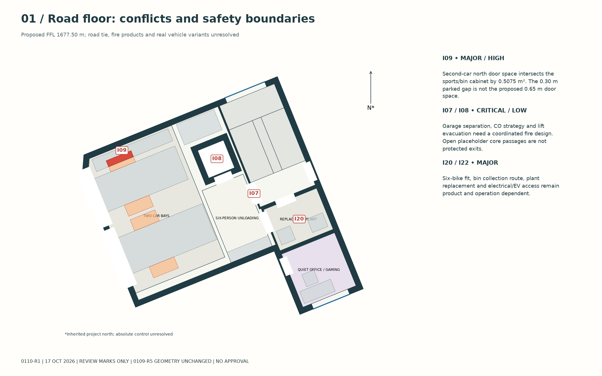

**Road / proposed 1677.50 m:** I09 marks the confirmed cabinet/second-car-door collision. I07 marks the required garage/core barrier and any penetration/door closure. I08 marks the essential lift. I20 marks plant replacement. Keep lockers and unloading, but test six people waiting, wet coats, groceries and two open doors together; a 0.85 m disc from a chosen unload point does not test passenger transfer or cabinet access. Six bikes share a 2.20×1.20 m reservation; no rack/products/use proof. EV cable, charger, bins and sports storage must not occupy the same pedestrian/door zone (I22).

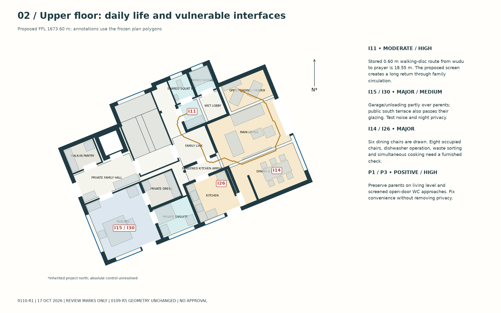

**Upper / proposed 1673.60 m:** I11 shows the actual stored wudu route. I14 marks eight-person dining as unproven. I26 marks fridge/cooking/clean-up operation and the pantry detour. I15/I30 mark parents under some garage/unloading uses and beside the common south terrace. Retain direct bedroom-to-ensuite/dressing access; the owner explicitly rejects a hall bypass. Independent disabled guest use therefore remains an unresolved requirement conflict, not a door that this review may silently add (I10).

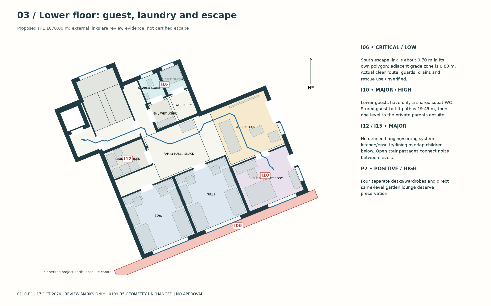

**Lower / proposed 1670.00 m:** I10 marks guest-to-lift dependency for seated toileting. I12 marks missing laundry operation; I15 marks overhead noisy/wet functions. I16 marks northern wet-room exposure. I06 marks the southern strip and onward escape. A bedroom window is not evidence of an operable rescue opening. Shared child desks/wardrobes are genuine allocations; furniture scales are not the main defect here (POSITIVE/HIGH P2).

**Kitchen test — I26/I14 (MODERATE/MEDIUM and MAJOR/MEDIUM):** Model fixture centres give sink–hob ≈1.05 m, sink–fridge ≈2.63 m and hob–fridge ≈3.03 m; these are straight-line comparisons, not walking paths or code limits. No island is drawn, so island-clearance testing is inapplicable. Test the actual counter aisle, fridge door, a selected dishwasher, hot-pan landing and rubbish pull-out with two cooks and a child passing. One 1.10 m dining portal also serves a screened connection and can become congested; the 5 m² pantry is near lift arrival but not directly beside the working fridge. Table seats six visibly; eight-seat pull-back/service needs proof. Kitchen terrace door supports outdoor dining, but seated sightline to the lower soil garden/children's play is unproved. Keep the two internal kitchen connections and open-state guest privacy; use extraction and closures without darkening the kitchen.

**Bedroom/bath test — I10/I13/I15–I17:** Two 20.64 m² child rooms each have two 1.0×2.1 m beds, two 1.4 m desks and two 1.5 m wardrobe fronts. Preserve these allocations while checking actual storage heights, growth and study-chair noise/privacy. Parents 22.08 m² + 7.20 m² ensuite + 5.72 m² dressing are a plausible one-level suite; fixture transfers remain unproved. Guest 17.48 m² has a 1.60 m daybed and independent garden door, not an independent seated WC. Children have one routine shared shower, one lower squat WC and the upper shared squat WC; the private ensuite is excluded from normal shared capacity. Plumbing above and night lighting/flush noise need design. There is no road-entry-level sleeping room; upper parents suite is reached from road by lift/stair.

## 4. Annotated sectional comments and site/structure test

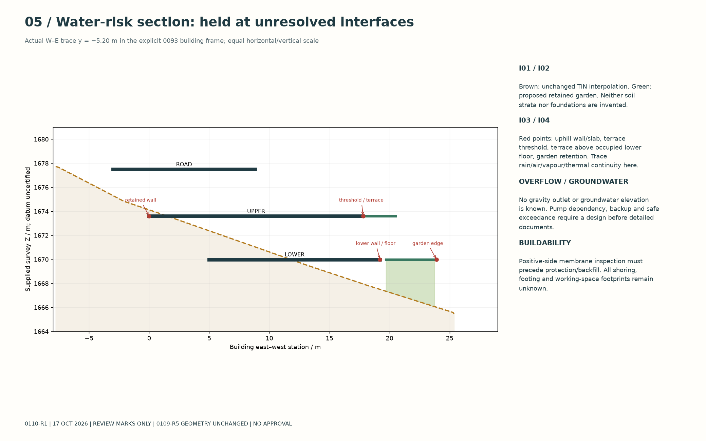

| Section / location | Classification | Comment and required action |
|---|---|---|
| S1 W–E, y=−5.20 | I01/I02 CRITICAL/LOW | House partly cuts uphill and partly bridges/fills downhill; it does not simply follow natural slope. Prove bearings below both cut and fill regions; no footing on unspecified garden fill |
| S1 east garden edge | I02 CRITICAL/LOW | Proposed 1670 garden versus natural ground under east retaining reservation ≈1665.405–1666.182 m; difference ≈3.82–4.59 m. Not design wall height: footing/embedment, retained-side levels and wall configuration unknown |
| S1 terrace/lower ceiling | I04 CRITICAL/LOW | Resolve deck/waterproofing/insulation/overflow/threshold stack without losing interior height or step-free usability |
| S2 N–S, x=6.00 | I01/I24 CRITICAL/LOW | Existing section shows actual core direction and floor gaps; beam, finish, handrail, guard and headroom products remain unknown |
| S3 arrival, y=−2.25 | I05/I07 CRITICAL/LOW | Garage FFL 1677.50 is not a surveyed road datum. Road/paving transition, garage flood bypass and barrier must be resolved together |
| S4 wet court, x=11.00 | I03 CRITICAL/LOW; I16 MAJOR/MEDIUM | Lower north window opens into court beneath upper wet extension for much of its depth. Need sky/drain/access section, not the assertion “naturally lit” |
| Unfolded stair / garden stair | I24 CRITICAL/LOW | B main lower: 22 rises/3.60 m; upper: 24 rises/3.90 m; going 280 mm; reserved clear flights 1.17 m. GS 22 rises with real 1.40 m landings. No decorative split levels, but safe build-ups/guards/ice and furniture carrying remain unproved |

**Earthworks evidence (HIGH for model arithmetic; LOW for engineering feasibility):**

| Separate prism | Cut m³ | Fill m³ | Interpretation |
|---|---:|---:|---|
| Lower soil-garden reservation, 68.99 m² to 1670.00 | 0.00 | 219.29 | Average geometric fill ≈3.18 m; usable soil area 61.18 m² after scheduled reservations |
| Upper arrival garden, 21.56 m² to 1673.60 | 29.69 | 0.00 | Uphill retaining/cut; ground there ≈1673.643–1676.690 m |
| South daylight grade | 1.47 | 15.97 | West end cuts, east end fills/retains; cannot call entire southern strip a trench |
| Lower enclosure to schematic slab underside 1669.70 | 190.11 | 92.84 | Mixed cut/fill; excludes foundations, working space, bulking and settlement |

**Do not sum these prisms.** Some overlap in plan, have different target planes, and omit rock, excavation support, footing depth, topsoil stripping, compaction, haulage and construction allowances. No net cut/fill balance or priced excavation quantity is established. Avoidable disturbance should be investigated in the size/position of courts, retained garden edge and arrival platform, but the owner requires two flat gardens; reducing that requirement needs an express owner decision.

**Retaining/interface inventory — I02/I03:** east-garden-retaining-reservation; garden-north-retaining; garden-south-retaining; upper-west-retaining; arrival-west-retaining; south-daylight-retaining; north-wet-retaining; core-north-retaining; plus lower uphill occupied-wall waterproofing, terrace/path support and any engineered garden/stair foundations. These are *every named retaining reservation*, not a claim that every future wall is yet identified. See [retaining evidence CSV](retaining-evidence.csv). Each needs retained-side levels, full wall ends, footing/anchor footprint, surcharge, drainage, inspection and construction sequence. Check building/garage/road, compacted garden and machinery surcharge, neighbouring land and temporary stockpiles. No pool is proposed; pool surcharge cannot be assumed zero if added later.

**Load path — I01:** roof/garage vehicle wheel and axle loads → actual slabs/beams/walls/columns → foundations in evidenced bearing → stable ground. The aligned core is useful, but no stiffness/capacity is established. The broader upper plan, north wet extension, covered lower porch (24.75 m²), terraces and staggered perimeters need explicit supports; a plan projection is not automatically a cantilever. Long cantilevers/transfer beams cannot be confirmed or ruled out. Confirm diaphragms, lateral/seismic resistance, connections and differential movement between retained fill and foundations. Trees, neighbouring foundations and drainage rights are unknown; do not invent clear construction space or permission for anchors outside private land.

## 5. Water-risk plan and “trace every drop” test

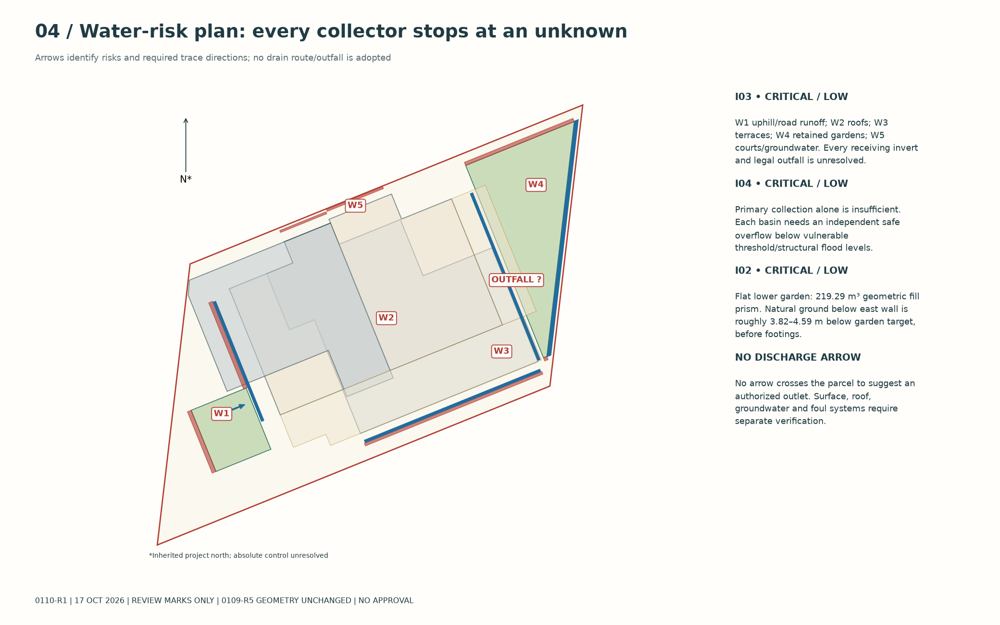

Every entry below is I03 CRITICAL/LOW unless I04 is specified. Collection/fall/overflow actions are required proposals; no designed pipe size, rain event, groundwater level or outfall is inferred. “Unknown” is a failed completion test.

| Stream / entry | Collected where? | Flows where? | If blocked / overflow | Cleaned how? | Legal discharge |
|---|---|---|---|---|---|
| Highest uphill catchment / road runoff, W1 | Upstream intercept and road-edge control needed; catchment outside parcel unsurveyed | Protected surface bypass isolated from garage, uphill occupied walls and cut faces; alignment/inverts unknown | Must not cascade into arrival/courts/lift; safe overland route absent | Reachable silt traps/grates and safe access required | Unknown; cannot divert road water onto neighbour/slope |
| Road/driveway and garage approach | Threshold-specific graded approach and primary interception needed | Bypass before garage; internal garage drainage/foul classification separately verified | Single trench blockage must not flood garage or lift; overflow level/destination unknown | Liftable debris/sediment access clear of parked cars | Unknown, including pollutants/approval |
| Road-tier and upper roofs, W2 | Defined basins, primary outlets/downpipes not yet scheduled | Separate sealed rainwater collector reservation | I04: independent visible overflow to safe route below door/structural flood level; no shared failure path with primary | Safe roof access; removable strainers and rodding points | Unknown |
| East/south roof terraces, W3 | Actual falls, threshold channels and accessible drains required | Waterproofed primary path independent of occupied interior | I04: ponding must escape before threshold, insulation or structural limit; no discharge onto occupied escape strip | Removable terrace finishes/grates; membrane inspection/flood-test plan | Unknown |
| Soil garden, planting and irrigation, W4 | Surface fall/soil drainage and retaining backdrain separately needed | Do not combine uncontrolled irrigation with foundation/roof system | Saturation + failed drain loads wall; safe shallow overland exceedance/erosion control unknown | Accessible irrigation isolations, filter/drain flush points; keep roots clear | Unknown; no concentrated slope discharge or assumed soakaway |
| Upper arrival garden | Positive local drainage away from door/cut wall required | Interceptor/collector to approved receiving point | Low arrival area may store runoff against upper wall; overflow unproven | Service access from garden without opening building | Unknown |
| South grade and north/core courts, W5 | Court drains/silt control at actual low points | Accessible drainage route to verified invert | Court fills against bedroom/wet/core apertures if drain blocked; bypass unknown | Reachable full-length strip and drain covers; guards/drains cannot consume escape width | Unknown |
| Retaining-wall drainage / perched flow | Filter/drainage plane and inspectable base collector at every wall | Groundwater system, not guessed connection to roof/foul pipes | Check hydrostatic design case and overflow without washing fines/support away | Flushing/inspection at bends/ends; buried blind drain not “maintenance free” | Unknown |
| Groundwater entering excavations | Site investigation; seepage capture and waterproofing strategy needed | Gravity only if lawful levels permit; otherwise engineered sump contingency | Pump/power failure: design water head, backup, alarm and storage/response needed | Safe pump removal/valves/high-alarm test; no inaccessible pit | Unknown |
| Sub-slab water / lift pit | Capillary break, sealed junction and collection as hydrogeology requires | Groundwater pathway; pit tanking/drainage must suit actual lift | No claim drainage alone prevents uplift or pressure; isolate occupied floors/pit from uncontrolled flood | Inspection/isolations accessible; pit service by supplier | Unknown |
| Laundry, wet rooms, plant or pipe leak | Local waterproofing/containment and leak detection/shut-off | Approved trapped discharge where permitted; foul separately classified | Leak must not enter bedroom ceilings, stair or electrics; containment unproved | Accessible valves, traps, appliances and replaceable connections | Foul connection/invert unknown |

No confirmed negative fall is measurable from the current unbuilt finish planes; **the absence of designed falls is unresolved, not a positive-grading pass**. Do not mandate a generic curb that defeats step-free access, nor universal pipe diameters, drain spacing or slopes. Rain intensity, catchment, legal outlet, available build-up and structural ponding capacity must drive actual design. Foundation drainage must have a verified receiving route; membrane alone does not remove water pressure. This scoped principle is supported by [PNNL footing drainage guidance](https://basc.pnnl.gov/resource-guides/footing-drain-pipe); its US prescriptive dimensions are not adopted as local code.

## 6. Family-of-six flow, stair and vehicle tests

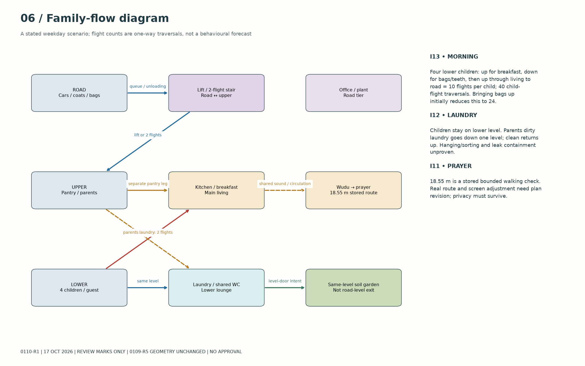

Walk-throughs use the drawn room relationships and explicit operating assumptions. They are not observed behaviour or human-movement simulation. All conflicts below inherit the referenced issue classification.

| Scenario | Conflicts / bottlenecks | Walking / stairs | Sound / privacy | Missing storage / action |
|---|---|---|---|---|
| 1 — 07:30 weekday, six dressing/bathing/eating/leaving | I13: four children share one routine shower and lower WC; parents use private ensuite; breakfast and exits concentrate around core/kitchen | Children lower→upper breakfast→lower teeth/bags→upper→road = 10 flights each; parents upper→road = 2 each | WC approaches screened, but shared bathrooms/flush and stair noise remain I15 | Stage bags/coats, grooming and breakfast before peak; do not add toilets contrary to brief |
| 2 — everyone returns in heavy rain with sports kit and groceries | I09/I22: car door/cabinet conflict, six lockers and lift queue; wet gear shares bin/sports reservation | Road→upper pantry→kitchen; children continue lower; lift size/cycle and cover not proved | Garage pollutants/wet shoes should stop before clean living; six people do not fit abreast | Drying hooks/drip trays/umbrellas/sports allocation absent or untested; I12/I22 |
| 3 — laundry day | Washer/dryer/sink drawn, 1 m folding surface; no verified sort/hang/dry system | Child rooms same lower level; stored bedroom→laundry sample 3.18 m. Parents dirty down 2 flights and clean up 2, or lift | Dryer/washer vibration beside core and bedrooms; clean/dirty staging crosses circulation | Hampers per room, airing/hanging, linen returns and leak containment I12 |
| 4 — homework + cooking + video call + TV | Four real desks help; open upper prayer/reading is not a quiet call room | Office at road requires 2 flights from living; homework downstairs separates uses | I15: open core, slab overlap and sliding-door seals; kitchen sound in main living | Headset/data outlets, closable quiet room and acoustic specification required |
| 5 — teenagers host friends; adults want quiet | Lower lounge works for teens; guest/quiet room may then be occupied | Teen guests move through lower family hall near child-room doors; snacks reduce kitchen trips | Parents upper can retreat, but stair carries sound and lower entertaining faces guest room; I15/I30 | Sports/gaming/guest coat storage untested; keep a usable closed quiet room |
| 6 — grandparents stay several days | Guest daybed 1.60 m may serve two mobile adults; no independent seated WC | I10: 19.45 m stored guest→lift, then one level to private ensuite; stairs if lift unavailable | Passing parents bedroom for toileting is a substantial privacy defect | Luggage and guest linen allocation not defined; temporary care arrangement is not a permanent solution |
| 7 — broken leg / temporary wheelchair | I08/I10: transfers, controls, kitchen use and shared squat toilets fail independent use proof | Upper parents suite potentially supports all essential daily functions; road connection and emergency exit remain lift-dependent | Temporarily moving an injured child into parents suite displaces privacy/care arrangements | Stage aid/commode/charging and safe care space by explicit plan; no accessible certification |
| 8 — parents remain after children leave | One-level upper suite/living is beneficial P1 | Lower laundry and soil garden still require one level; road remains one level above | Could use lower lounge/guest flexibly; no assumed separate rentable dwelling | I21/I29: paying to heat/clean/maintain ≈496 m², courts/terraces/retainers remains burdensome |

**Morning capacity illustration — I13 MODERATE/HIGH:** assume four children all request lower shower at 07:00; 10 min use + 2 min changeover each. Starts 07:00/07:12/07:24/07:36; last finishes 07:46, with 36 min wait for the last. For four simultaneous lower-WC requests at 5 min + 1 min changeover, last finishes after 23 min. Upper squat WC offers alternative capacity but adds travel and is not an accessible seated toilet. These durations are test inputs, not facts about this family. Waiting is owner-accepted; capacity alone does not authorise an additional toilet or child shower.

**Flight count illustration:** one flight means one run between landings. Main lower↔upper = 2 flights/22 rises per one-way level change; upper↔road = 2/24. In scenario 1 above: four children ×10 =40 and two parents ×2 =4: **44 person-flight traversals** to departure. Returning from road adds four flights per child and two per parent =20; subtotal **64** for this morning+return scenario only. Taking bags up at first breakfast ascent removes 4 flights per child: subtotal48. Meals, laundry, garden and office movements add more; no universal daily count is claimed. Garage→kitchen is one level/two flights; kitchen→soil garden one level/two flights (internal or garden stair); child beds→laundry zero; parents→laundry two; child beds→main family living two. There are no indoor decorative split levels, but parents’ one-level living does not eliminate the three-tier access burden.

**Vehicle/access simulation — I05/I09/I22/I24:**

| User/vehicle | Available evidence / simulation result | Unresolved/failing operation |
|---|---|---|
| Daily family LC300-sized car | 5.10×2.10 m allowance, wheelbase 2.85 m; static bay/doors shown | Actual grade/mirrors/overhang/ground clearance unknown; selected planar turn fails supplied-surface containment; gradient/transitions/bottoming-out not evaluated |
| Second car | 4.80×1.95 m parked proxy; simultaneous unload→lift route exists | I09 confirmed outer door/cabinet collision; complete road path and reverse departure unproven |
| Visitor | No dedicated visitor bay allocation | No right to park on public road assumed; pedestrian route/crossing, drop-off and gate queue need plan |
| Delivery van | No template/profile trial | Stop/unload/reverse/turn and carry route not established; do not send a large van into unverified garage |
| Rubbish collection | “Sports/helmets/bins” combined storage | Bin type/number, contaminated/clean separation, path/steps and legal collection point absent; no assumed truck entry |
| Fire/emergency vehicle | No actual authority vehicle template or vertical route | Width/gradient/turning/overhead clearance, load-bearing, stopping/rescue positions and water supply unresolved |
| Pedestrians / groceries / EV / bikes | Separate gate/core intent, 10.08 m² unloading, six lockers, bike reservation | Gate posts/motion, children alongside reversing cars, EV cable, bike removal and wet unloading conflict unproved; road snow/ice hazard conditional |

Both chosen trial records explicitly have `within_diagrammatic_road_and_private_paving=false` and `passed=false`. This is a **HIGH-confidence evidence finding**; whether the real access can be made safe is **LOW-confidence I05** until surveyed. Never fix it by expanding private works into the road.

## 7. Accessibility and ageing diagram

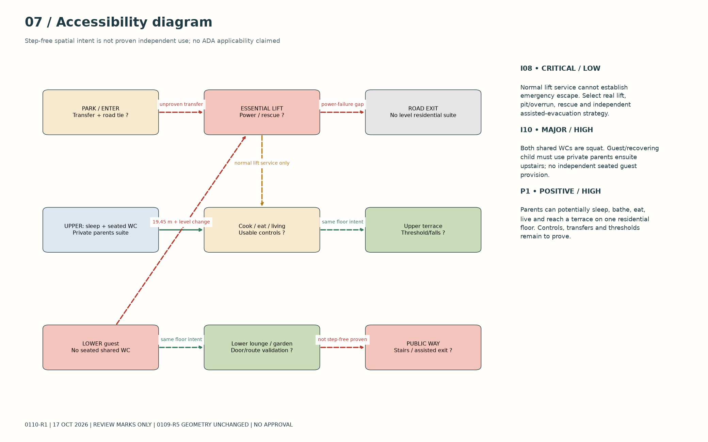

| Essential task | Without stairs? | Verdict / next proof |
|---|---|---|
| Park and transfer | Unproved | Door conflict, actual chair/companion transfer and road gradients unresolved I09/I08 |
| Enter residential level from road | Only via proposed lift | No demonstrated independent step-free exterior road→upper route; supplier/rescue/power strategy absent I08 |
| Toilet/full bath | Potentially upper parents suite only | Shared squat WCs do not meet seated mobility needs; private bedroom route and actual fixture transfers unresolved I10 |
| Sleep | Upper parents potential | Real bed transfer, caregiver, controls and escape required; lower guest has toileting dependency |
| Cook/eat | Same upper floor, use unproved | Knee/reach spaces, appliance controls and occupied dining routes not tested I14/I26 |
| Principal living | Same upper floor, route intent | Test actual door forces, thresholds, surfaces, furniture and companion manoeuvres I08 |
| At least one outdoor space | Upper terrace/arrival garden intent | Flush weather protection, falls, wheel turning, guard and emergency return unproved I04/I24 |
| Lower soil garden | Lift plus lower same-level door intent | A step-free garden is not a step-free public-way discharge I06/I08 |

Doors are generally reserved 1.0–1.2 m (large east slider wider); no actual frame clearances, handles, forces or thresholds certified. Nominal 1.50×1.60 m cabin and 1.525 m bathroom turn are spatial comparisons, not companion care/transfer evidence. Corridor pinch/approach/turning and shower drainage must be tested with the intended chair. Stair-lift fit has not been demonstrated and must not reduce required clear stair/escape width. Lift is essential on day one; a future shaft alone is inadequate. Select pit/overrun without changing unverified foundations or roof rights. Demonstrate carrying a real mattress/sofa/plant module around the 1.40 m landings and through doors; two-flight clear width alone is insufficient.

The distinction between turning space, fixture clear floor area and approach is supported by [US Access Board guidance](https://www.access-board.gov/ada/guides/chapter-3-clear-floor-or-ground-space-and-turning-space/). It is a voluntary comparison here; no ADA applicability/compliance is claimed.

## 8. Fire/emergency diagram

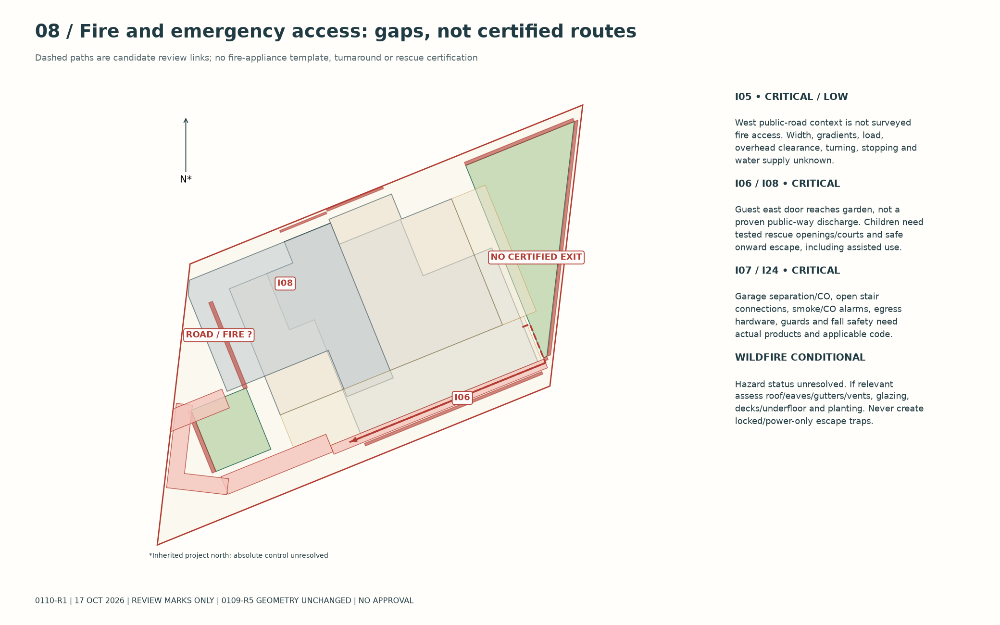

I05–I08/I24 remain CRITICAL/LOW holds. Confirm ordinary domestic fire strategy first, then any wildfire/WUI conditions. Specify alarm locations/interconnection and standby provisions, smoke/CO detection where applicable, garage barriers/penetrations, kitchen/garage exhaust separation, exit hardware, stair/guard/headroom and bedroom operable rescue openings/courts. A sliding door tagged “fire” is not a tested fire assembly. Do not infer ratings, minimum clear rescue areas or fire-vehicle dimensions without the applicable regime. Verify exterior stairs/gates are operable without keys or unavailable electrical power, while meeting security/child-protection needs. Establish a safe assembly/public discharge route and an assisted evacuation plan for every occupied tier; an ordinary lift cannot be assumed available in fire.

If WUI risk is established, inspect roof/eaves/gutters, vents, glazing, deck/underfloor, façade joints, landscape/fences and emergency water/access as one exposure system. Embers can enter openings or ignite accumulated fuel; this scoped concern follows [US Fire Administration guidance](https://www.usfa.fema.gov/blog/protecting-structures-from-wildfire-embers-and-fire-exposures/). No US designation, clearance distance or product rating is imposed on this unknown jurisdiction.

## 9. Daylight, overheating, views and privacy diagram

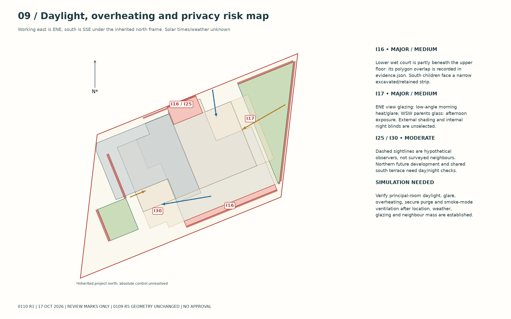

Directions below are working façade directions after the recorded rotation: east≈ENE, south≈SSE, west≈WSW, north≈NNW. Climate, true north/control and seasonal solar times are unverified. “External shade” means a reservation/proposal; no installed performance is evidenced. Mechanical fresh air and a safe smoke mode remain necessary design questions; open windows are not a complete ventilation system.

| Principal room | Orientation / qualitative glazing | Shade / glare / summer and winter sun | Ventilation / night purge | View and day/night privacy |
|---|---|---|---|---|
| Upper main living | ENE slider and adjacent glass; generous view frontage | External shade unselected; low-angle morning glare/gain likely; winter contribution unknown I17 | Operable area/secure opening, cross-flow and smoke mode unknown | Eastern view is owner-valued, not certified viewshed; night blinds required; downstairs/outside observers unknown |
| Upper dining | ENE gross 3.0×2.2 m pane spans dining/living edge | High qualitative exposure; exact glass/wall fraction not established; eight chairs must not block shade/door use | Shares public zone air; no separate purge proof | Terrace/table privacy and evening silhouettes untested |
| Kitchen | SSE 1.7×1.3 m gross window plus terrace door | Useful daylight potential; external shade unselected, glare at worktop/solar gain unresolved | Direct extract, make-up and secure opening unproved | Guest work-zone privacy has bounded seated-ray evidence; outdoor door and reflection/standing privacy unresolved |
| Parents | SSE window/terrace door + 3.2×1.5 m gross WSW window | WSW afternoon exposure is significant; roof/garage self-shade requires section; internal blinds/external shade unselected | Cross ventilation possible spatially, operation/secure purge unproved | Shared south terrace and arrival can see bedroom after dark I30; curtain/opaque-screen plan needed |
| Upper reading/prayer | NE/ENE bay near main glazing | Daylight borrowed through open public space, no dedicated performance result; glare on reading/mats possible | Shares living air and noise; no quiet secure purge proof | Open sitting/prayer shares guests/TV circulation; WC direct-seat screen is limited positive evidence |
| Boys, lower | SSE 3.0×1.65 m gross window | South strip≈0.80 m grade zone, with varied cut/fill and upper terrace effects; daylight/solar screen incomplete I16 | One principal exterior face; secure vent/rescue operation unknown | Window/beds low relative exterior route; night screen and fall/security coordination needed |
| Girls, lower | SSE 3.0×1.65 m gross window | Same narrow-strip issue; actual horizon/future context unresolved | Single-face ventilation and summer purge not proven | Similar route/security/night privacy conflict |
| Guest/quiet, lower | SSE 2.4×1.8 m + ENE 1.18×1.5 m + garden door | Better two-face opportunity; canopy/terrace shade and heat not quantified | Possible two-sided airflow, hardware/security unselected | Garden users can approach glass; night privacy needed; separate garden door useful but not accessible-toilet solution |
| Garden lounge, lower | ENE window + 1.80 m garden door | Covered porch/upper terrace may limit daylight despite view opening; quantify shade and glare | Doors/secure vents; no night purge model | Direct garden connection valuable P2; garden/guest users see room; blinds/screens needed |
| Office, road | SSE 2.1×1.4 m gross window | Glare on monitor, high-tier exposure; shade/build-up unknown | Garage separation prevents using garage air as fresh supply; filtered supply/extract needed | Upper tier may overlook terraces; actual sightlines unknown; closable office valuable |
| Shared WC/shower and stairs | NNW apertures | Lower wet court 11.70 m², **9.00 m² (≈77%) under upper footprint**; remaining sky is not a daylight PASS; core court narrow | Wet extraction/intake separation needed, not just windows | Future north building unknown; obscure glass must preserve light, ventilation, safety and escape function |

East/west glass can create difficult heat/glare/shade conditions; [DOE envelope/daylight guidance](https://www.energy.gov/cmei/buildings/zeb-technologies-building-envelope-architectural-considerations) supports testing these exposures and self-shading. It does not prescribe removing the owner's primary east view. Climate-dependent window selection and load sensitivity follow [DOE window guidance](https://www.energy.gov/cmei/femp/purchasing-energy-efficient-residential-windows-doors-and-skylights). No universal SHGC/U-value or energy saving is asserted.

**View-glass skepticism — I17/I25/I29/I30:** every potentially large opening group is accounted for below. The schedule describes gross apertures, not selected single panes or clear rescue openings; individual pane/door-leaf products are unknown.

| Aperture group | Useful view? / sun hits when? | Shade / night observer | Cleaning / replacement | Heating/cooling effect |
|---|---|---|---|---|
| Upper ENE living 3 m slider + 3 m fixed/slider-panel reservation | Family east view and terrace; morning sun plausible, exact hours unknown | Operable external shade + interior night blind needed; terrace/downhill observers unknown | Terrace-side access plausible, actual safety/replacement lifting route unproved | Large conductive/solar load potential; require selected U/SHGC/VT and hourly analysis |
| Parents SSE window 2.13×1.8 m + 1.2 m door; WSW window 3.2×1.5 m | South garden/possible western outlook; midday and afternoon exposure respectively | Shared south terrace/arrival requires night concealment; garage self-shade unquantified | Terrace/arrival reach must be safe; leaf weights/haul route unselected | Afternoon overheating risk and cold-surface comfort need simulation |
| Boys/girls SSE windows, each 3×1.65 m | Daylight and limited court/landscape view, not guaranteed broad outlook | Narrow strip/terrace/retaining obstruction; outward user can look in at night | No ladder/chair blocking escape; 0.70/0.80 m strip not proved maintenance platform | Shade may reduce gain but also light; no annual performance inference |
| Guest SSE 2.4×1.8 m and ENE 1.18×1.5 m + 1 m door | Garden/south view opportunity | Garden/porch and night privacy; shade unknown | Safe grade/porch access to prove; actual replacement glazing route unknown | Two-face exposure needs room load/glare test |
| Lounge ENE 0.98×2.1 m + 1.8 m door | Direct garden view | Covered porch self-shade; garden night view into lounge | Service route possible via garden but fall/edge handling unknown | Daylight/gain under canopy needs calculation |
| Kitchen SSE 1.7×1.3 m + 1.2 m door; ensuite SSE 2.2×0.9 m; office SSE 2.1×1.4 m | Work daylight, bath privacy, office daylight; useful view not independently surveyed | Shade/obscuring/blinds suited to use, not reflective glass alone | Access from terrace/grade only where verified; safe leaf removal unknown | Glare/solar/conductive effects are product/weather dependent |
| Core NNW 2.3×2.2 m on each tier; shared wet windows 1×0.8 m | Stair/court daylight, no guaranteed view | Court and future north building; privacy and accessible cleaning separate | Ladder/fall protection and court cleanout route unproved | Shaded apertures can still lose heat; no free-energy assumption |

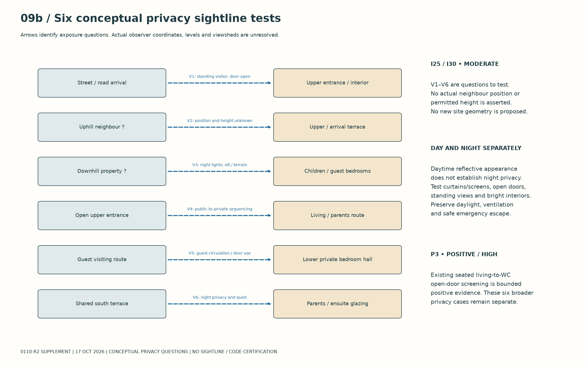

**Privacy sightlines:** figure 09 draws *hypothetical* north-neighbour→terrace/reading and common-terrace→parents lines, plus east exposure; observer locations/heights are not site facts. Street→upper hall is screened by arrangement but gate/door-open standing views require testing. Uphill neighbour→terrace and downhill property→bedrooms cannot be concluded without context levels. Entry→living may reveal shared public space, not automatically a cultural failure; entry→parents/ensuite and guest→private child halls require scrutiny. Terrace→parents/guest glazing needs curtains/screens at night. Existing direct living-seat→WC door-use screening is POSITIVE/HIGH P3 within sampled positions; preserve it while testing standing users, mirrors and changed furniture.

## 10. Storage audit

No location shown = FAILED ALLOCATION, as requested. ALLOCATED/UNPROVEN means a real location exists but capacity/use is not demonstrated; it is not a pass. All rows are I22 MAJOR/HIGH for allocation findings, I09 where physically conflicting.

| Inventory | Drawn location | Verdict / missing proof |
|---|---|---|
| Six coats | Road six lockers: 2.40 m total front ×0.60 m deep; upper 2 m coat/shoe run | Allocated/unproven: internal hanging height, winter volume and simultaneous wet coats |
| Six everyday shoe pairs + outdoor shoes | Upper shoe bench/coat run; road lockers | Allocated/unproven: actual pairs/ventilation and wet-sole separation |
| Four school bags / six personal bags | Road six lockers | Allocated/unproven: bag depth/hooks and daily lower-bedroom retrieval |
| Sports equipment | Combined 4.45×0.70 m road sports/helmets/bins cabinet | I09 FAILED operating layout; separate dirty kit and bins, enumerate volume |
| Six helmets | Same road cabinet | Allocated/unproven; cannot double-count occupied bin/sports shelves |
| Six bikes | 2.20×1.20 m staggered rack reservation | Allocated/unproven; 0.37 m average front per bike is not a rack/handlebar/removal demonstration |
| Umbrellas | No explicit holder/drip position | FAILED allocation; propose near wet entry outside escape width |
| Bulk groceries | 5.00 m² upper pantry, 1.80 m shelf run and 0.70 m freezer reservation | Allocated/unproven volumes; initial drop convenient, kitchen/fridge leg longer |
| Luggage | No explicit B allocation | FAILED allocation; guest wardrobe is not automatically luggage storage |
| Cleaning equipment | Lower 0.60×0.60 m linen/cleaning cupboard | Allocated/unproven: vacuum/mop/bucket height, sockets and chemical child safety |
| Linen | Laundry 1 m folding/linen and lower 1.4 m linen shelves | Allocated/unproven per beds/towels/guests; keep folding free |
| Seasonal clothing | Parents dressing and child wardrobes shown, no seasonal reserve identified | FAILED distinct allocation; do not silently consume daily clothing space |
| Recycling | Combined road bins/sports | Allocated/unproven and conflicting I09; kitchen separation and collection route absent |
| Garden equipment | 0.60×1.50 m garden tool locker footprint | Allocated/unproven: tools, chemicals, door opening, weather/lock and safe access |
| Outdoor cushions | 1.30×0.60 m upper outdoor locker | Allocated/unproven: actual cushion sets, waterproof/ventilated storage |
| Bedroom clothing/study | Four separate 1.5 m child wardrobe fronts, parents dressing; guest wardrobe | POSITIVE/HIGH P2 for real allocation, capacity still unproven |

Do not solve these allocations by adding unrequested outbuildings or leaving storage in car doors, stair landings, plant working clearances or the south escape strip. I22 correction must be redrawn and rechecked inside the strict site boundary.

## 11. Maintenance-access, envelope and services audit

I29 MAJOR/MEDIUM applies unless another issue is given. “Intent” is not a demonstrated access route. Buried waterproofing cannot honestly be called readily replaceable.

| Element | Inspect / clean | Repair / replace without damaging more expensive work? | Review result |
|---|---|---|---|
| Retaining drains | End/bend flush and camera points needed; none fully scheduled | Pipe replacement may require excavation; reserve access before planting | Unproved; I03/I29 |
| Downpipes | Accessible leaves/silt/rodding points, separate from electrical/escape | External replaceable route preferred; concealed joints and access unknown | Unproved |
| Terrace/court drains | Lift-out grates; reach through narrow court not demonstrated | Removable paving/inspection boxes required | Unproved; guard/drain cannot consume escape width |
| Terrace waterproofing | Inspect terminations, test before cover; detect leaks | Removable finish helps, permanent screeds/planters complicate renewal | Unproved I04; no universal membrane guarantee |
| Buried wall membrane | Inspect/protect before backfill; thereafter mostly inaccessible | Usually destructive excavation/shoring; narrow boundaries may prevent easy access | Major residual whole-life risk |
| Pumps/sumps, if required | Alarms, duty/backup and discharge check; safe access | Removable module, isolations and power contingency needed | Product/location absent I03/I20 |
| Mechanical plant/cylinder | Proposed 7.44 m² room, service faces unselected | 1.20 m replacement aperture to garage only a reservation; full largest-module path unproved | I20 HOLD |
| Ventilation filters | Front service aisle, storage and ladder-free reach needed | Standard replaceable filter products/dirty handling route absent | I19/I20 |
| Valves/manifolds | Reach without removing occupied furniture; label/isolate | Removable panels plus safe drain-down needed | Unlocated in detailed routing |
| Battery/backup system | No battery placed | Fire/ventilation/maintenance/product and replacement route first | Unresolved; no permission implied to place it in escape/core |
| Electrical panels/meter | Safe working space and utility access needed | Replace without dismantling kitchen/storage; positions unplaced | I27; no invented amperage |
| Glazing/high windows | Safe access from verified terrace/grade or designed inward cleaning | Pane mass, removal lifting, gate and route need proof | I29; narrow court is not a work platform |
| Exterior shade | Reach drive/hinges, wind-safe maintenance | Modular repair without removing façade desirable; products absent | I17/I29 |
| Roof/PV/gutters | Safe protected access/anchors and debris inspection | Fall-safe module/membrane handling, rescue and drain access unknown | I24/I29; no assumed ladder on steep slope |
| Green roof | Not proposed in this B package | If added, saturated loads/root/drain/inspection and replacement cost required | Not applicable now; no hidden scope addition |
| Façade | Ground/terrace reach versus high/retained walls assessed with actual system | Replaceable panels/joints and corrosion-compatible fixings unselected | Unproved |
| Landscape against house | Keep terminations/drains/vents visible; irrigation isolated | Roots/soil must not bury waterproofing or require damaging excavation | I02/I03/I29 |
| Garden/arrival stairs | Inspect corrosion/fixings, drains, guards, ice/slip surfaces | Modular replacement/access desirable; supports/products unselected | I24/I29 |

**Continuous-envelope trace — I18:** section 05 identifies critical interfaces, but no layer continuity is yet designed. Start at roof and trace rain shedding/drainage to façade/threshold/retained waterproofing; separately trace air seal, climate-appropriate vapour control and continuous insulation to below-ground slab and back to roof. Do not assume a universal vapour retarder or insulation value from the old handbook.

| Junction | Rain / water | Air / vapour | Thermal / structural interface |
|---|---|---|---|
| Retained wall–floor / foundation | Positive-side membrane/drainage, capillary break, joint/waterstop and water-head design | Continuous sealed floor-wall connection, vapour/radon assessment if relevant | Insulation continuity and footing/slab edge bridge; compression/wet exposure |
| Terrace / balcony over occupied room | Falls, outlets, independent overflow, upstands/flush threshold, protected membrane | Airtight connection behind opening; climate-dependent condensation strategy | Roof insulation thickness/headroom and engineered support/break solution |
| Roof/parapet | Coping, lap/termination, ponding and overflow | Continuous air seal at roof/wall and penetrations | Parapet/slab bridge; PV/anchor penetration and fire/wind restraint |
| Large openings | Drained sill/head/jamb; glass water/air performance | Continuous perimeter seal independent of decorative finish | Frame U-value, spacer/edge and local surface condensation |
| Garage/living | Separate garage rain/pollutant/fire boundary | Airtight separation without transferring garage air; fire stopping | Floor/wall insulation and vibration/penetration coordination |
| Cantilever/porch edge | Drainage at movement/edge connections | Seal around connectors without trapping moisture | Cantilever existence/system unproved; calculate bridges and structural loads, no compulsory brand |
| Green roof | Not in scope | If later added, root/drain/moisture strategy | Saturated load/thermal/fire/access assessment first |

**Services and energy — I19/I20/I27/I17:** R1/R2 are each nominal 0.20×0.20 m gross reservations; they are not structural columns and not proof that ducts, insulated pipes, drains, bends, cleanouts and fire stopping fit. Bathrooms upstairs/downstairs overlap only partly; kitchen/ensuite and shared wet functions are separated. Require a real diagram of wet stacks, vents, gradients, horizontal branches and floor/beam penetrations. Measure actual hot-water branch lengths and choose DHW recovery/storage/recirculation after six-person and visitor demand, rather than prescribing universal recirculation. Locate ventilation fresh-air intake/exhaust away from garage/kitchen exhaust and polluted air; size separate extract and acoustic attenuation. Show exterior plant with noise, frost/defrost water, service aisle and replacement route, not just indoor hydrobox/cylinder symbols.

Confirm incoming electrical capacity, accessible panel/meter, data cabinet and wired backhaul across levels, Wi-Fi coverage, EV charging/cable location, PV shading/roof access, optional battery and backed-up load priorities. Do not assume a battery automatically supports lift, heating and pumps together. Request climate zone/weather, selected U/R/SHGC/VT, airtightness target/test method, thermal-bridge analysis, room heating/cooling loads, ventilation airflows/filtration, DHW capacity, annual energy/PV, dynamic overheating/daylight and commissioning/balancing/controls plan. All numerical performance targets remain unselected; an emitter count or all-electric preference is not capacity evidence.

**Acoustic map — I15 MAJOR/MEDIUM:**

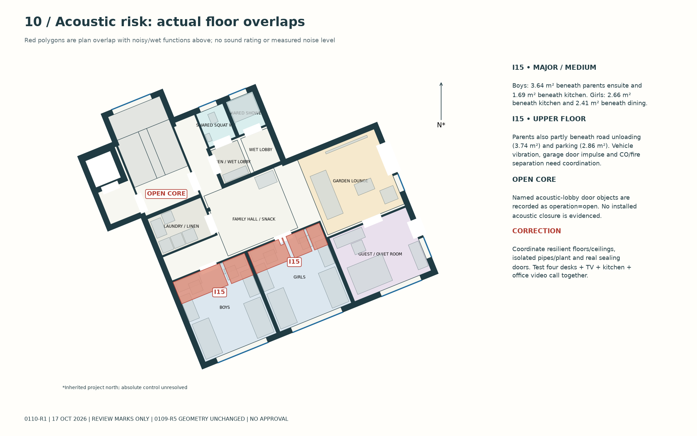

| Noisy source → quiet receiver | Actual relationship | Required strategy |
|---|---|---|
| Garage/unloading → parents | Parking 2.86 m² and unloading 3.74 m² overlap parents room in plan | Garage door/motor/vibration isolation; fire/air barrier; floor impact/airborne isolation |
| Ensuite/kitchen → boys | 3.64 m² ensuite and 1.69 m² kitchen overlap | Avoid waste stack at bedhead; isolated pipes, resilient floor/ceiling, maintainable quiet fittings |
| Kitchen/dining → girls | 2.66 m² kitchen + 2.41 m² dining overlap | Impact and chair-scrape isolation, duct/pipe separation and real operating test |
| Dining/main living → lower lounge | 8.64 m² dining + 5.44 m² main living overlap | Two TV/music zones require floor/ceiling isolation and closed core paths |
| Laundry/plant/plumbing → bedrooms/office | Laundry near lower circulation/children; road plant beside office and above suite-service zone | Anti-vibration mounts/pipe isolation, attenuated ducts, sealed doors; confirm mounts do not defeat waterproof/fire layers |
| Teen TV/play/outdoor entertaining → guest/study/prayer | Lower lounge shares adjacency with guest; prayer open to upper living | Closable quiet room, sealed partitions/doors, soft absorption in open public spaces; no promised dB rating |

No roof/open-void assembly has acoustic proof. Provide actual door seals/threshold coordination and avoid calling open portals acoustic lobbies. Rugs/curtains reduce reverberation but do not replace slab/partition isolation.

## 12. Cost-risk matrix and constructability

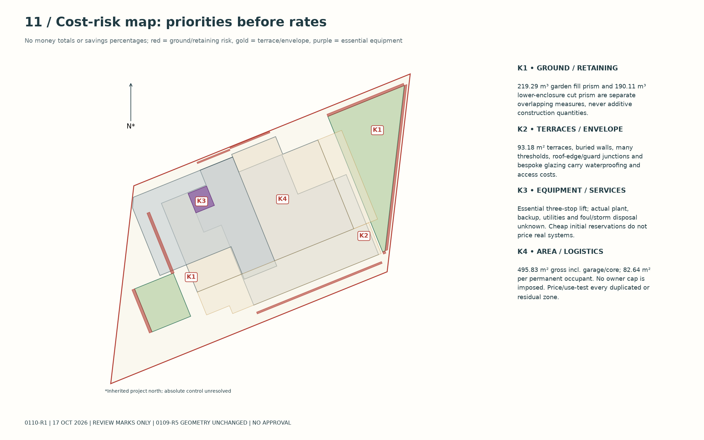

All ratings are relative exposure, not a cost estimate. I21/I23 are MAJOR/LOW; geometry observations are HIGH, consequences/product costs depend on missing evidence.

| Cost risk / map | Design value | Simpler alternative to test | Consequence of simplification |
|---|---|---|---|
| K1 excessive retaining / high flat fill | Owner's useful level soil garden | Reduce only redundant retained pockets/edge length; investigate smaller useful garden within brief | Less play/planting; changing flat garden principle needs owner approval |
| K1 excavation, rock, road surcharge and shoring | Fits two living levels below arrival | Align/support on investigated geology; rationalise courts/cut returns | May change room/window exposure and need another concept review |
| K1 garden and path settlement | Same-level outdoor connection | Keep foundations independent of unspecified fill; engineered drainage/fill sequence | More visible supports/edge or reduced soil depth, subject to engineering |
| K2 terraces above occupied rooms, 93.18 m² | Strong east/south living/outdoor brief | Retain useful furnished depths, remove residual perimeter area and standardise build-up | Less outdoor area; must preserve core terrace function |
| K2 possible long cantilevers/transfer structures | Broad upper rooms and staggered floors | Align supports/spans and reduce unsupported projection after structural concept | Columns/walls may affect car turning, views and clear rooms; must redraw, not assume |
| K2 fragmented roofs/corners/level junctions | Lets garage/living/sleep respond to slope | Simplify roof-edge and façade junction families, repeat windows/details | Less formal articulation; no automatic footprint reduction |
| K2 buried waterproofed area | Lower bedroom/laundry/garden level | Keep dry rooms away from most pressured interfaces; assess service buffer and court necessity | More route/daylight trade-offs; cannot claim tanking eliminated |
| K2 large/custom glazing | Owner east view and brightness | Standard repeatable panes/doors with serviceable shade | More mullions and possibly smaller uninterrupted view; load/energy/access may improve |
| K3 essential three-stop lift and backup/rescue | Normal mobility and groceries | No deletion while road/residential levels remain separated; compare reliable local standard product | Shaft/clearances may change; must retain safe transfers and evacuation |
| K3 remote/unknown utilities and sewage | Serviced six-person home | Resolve connection feasibility early; avoid scattered wet functions | Layout/plant/outdoor area may need change; no savings guarantee |
| K3 over-automation | Convenience/security | Simple locally serviceable controls with manual safe release | Less automation; easier outage operation, but critical alarms remain |
| K4 crane/staging/spoil and difficult replacement | Enables heavy structure/glass/retaining | Lighter/repeatable components and planned deliveries after engineer assessment | Different spans/material expression and procurement; no assumed cheap light system |
| K4 495.83 m² gross plus terraces | Parents level, children/study, guest, two lounges, garage/office | Area/use-price audit of halls, porch, guest and overlapping service circulation before shrinking bedrooms | Potentially fewer flexible/quiet areas; verify daily value and owner priorities |
| Pool / green roof / bespoke façade | No pool or green roof proposed; façade system unselected | Keep out of base cost/scope unless separately chosen | No lost current brief function; future addition requires fresh structure/site/water gates |

**Construction sequence test — I01–I04/I23/I24:** no demonstrated impossible structural system can be declared from schematic drawings alone, but the following unresolved dependencies can make this layout impractical to build. No excavation/backfill is authorised.

| Step | Missing prerequisite / possible sequence failure | Required hold point |
|---|---|---|
| 1 Site access | Unsurveyed approach, narrow parcel, no crane/spoil/stockpile plan | Road/rights/safe traffic and staged private workspace accepted |
| 2 Excavation | Cutting below road/neighbour support without geology/breaklines | Survey/ground investigation and excavation limits approved by engineers |
| 3 Temporary stabilisation | Shoring/anchors/plant may need space outside parcel | Complete shoring footprints and lawful rights; no presumed off-site anchor |
| 4 Retaining | Wall ends/drains/footings conflict with court/path widths | Staged stability, wall geometry, drainage and inspection access |
| 5 Foundations | Cut/fill differential support, uplift and lift pit unknown | Bearing/piles/footings and settlement/water design, no guessed soil |
| 6 Structure | Garage wheel loads, offsets, terrace/porch and stair openings unresolved | Complete gravity/lateral/support strategy and vehicle/route clearance recheck |
| 7 Waterproofing | Positive side may become inaccessible after structure/backfill | Substrate/joint/waterstop inspection and compatible membrane/protection tests |
| 8 Backfill | Damages membrane; heavy compaction surcharges retaining; garden settles | Protection sign-off, drainage testing, specified fill/lifts/compaction monitoring |
| 9 Enclosure | Threshold/insulation/glass/guard interfaces not coordinated | Four-layer continuity and selected products; no sealing behind inaccessible finish |
| 10 Services | Shafts underspecified; later holes through beams or fire barriers | Sized coordinated routes/penetrations, access and commissioning plan |
| 11 Terraces | Waterproof/falls/overflow could be hidden by paving/guards | Flood/drain test before removable finishes and edge protection completion |
| 12 Landscape | Roots/irrigation/soil block drains, hide terminations or load walls | Retaining/settlement and drainage acceptance; as-built access/maintenance handover |

## 13. Code-verification matrix

No jurisdictional minimum, exemption, rating or dimensional rule is invented. International references are quality comparisons only. Current parcel containment is not planning or building approval. Every row is an unresolved verification topic, with severity/confidence inherited from the issue IDs.

| Item | Likely code topic | Information needed | Professional to verify |
|---|---|---|---|
| Planning/zoning/setbacks/height/area | Land use, heights, boundary openings/rights | Jurisdiction, certified boundary/datum/road, planning status and permitted envelope | Local architect/planning + surveyor I01/I05/I25 |
| Retaining structures | Permit thresholds, structural/geotechnical design, neighbouring property | Actual wall/footing/anchor and retained levels, loads, groundwater and sequence | Structural/geotechnical + authority I02 |
| Structural design | Gravity, seismic, wind/snow, durability | Hazard/site class, soil, system/materials, loads incl. garage wheel/axle, checks | Licensed structural/geotechnical I01 |
| Stairs/guards/glass | Rise/going/headroom/handrails/fall protection/safety glazing | Finished dimensions, products, openings/climbability and drops | Architect/structural + fire/access I24 |
| Bedroom egress | Exits/rescue openings, courts and path discharge | Actual operable clear opening, sill, hardware, exterior court and public-way route | Architect + fire authority I06 |
| Garage separation | Fire/smoke/CO, connecting openings, penetrations | Applicable ratings, assemblies/doors, ventilation and detectors | Architect + fire + MEP I07 |
| Fire/emergency | Access, evacuation, alarms, firefighting water | Road profile/vehicle template, stopping/turning, fire strategy, mobility plan | Fire authority/consultant I05/I08 |
| WUI, if applicable | Exposure, roof/eaves/vents/glass/decks, fuels | Actual hazard designation/vegetation and access/water requirements | Fire authority/WUI specialist I05/I07 |
| Energy | Envelope/services/performance testing | Climate/edition, U/R/SHGC/VT, loads, airtightness/commissioning | Energy assessor/MEP I17/I18 |
| Ventilation | Fresh air, wet/kitchen/garage extract, combustion/smoke | Occupancy, flows, terminals, system/filtration and intake separation | MEP + authority I19 |
| Drainage/stormwater | Catchment, design event, exceedance/overflow, legal outlet | Rainfall/catchment/inverts/downstream consent and soil response | Civil/drainage + authority I03/I04 |
| Wastewater | Sewer/septic and disposal setbacks/health | Capacity/invert/connection rights or parcel-specific treatment feasibility | Civil/public-health + utilities I27 |
| Accessibility, if applicable | Applicable dwelling access provisions and owner goals | Legal scope, real products/transfers/thresholds and assisted escape | Architect/access specialist/authority I08/I10 |
| Pools | Future structural, barrier, drainage/electrical safety | No current pool; verify only if later proposed | Architect/structural/civil + pool specialist |
| Terraces/decks | Structural loads/guards/waterproofing/fire/thresholds | Actual support, use, levels, build-up, drains and safe access | Architect/structural/envelope I04/I24 |
| Geotechnical approvals | Slope/cut/fill/shoring/site classification | Parcel investigation, global stability, construction monitoring and sign-offs | Geotechnical + authority I01/I02 |
| Utility/EV/PV/battery | Electrical/fire/connection and service clearance | Utility supply, selected systems, protection, isolation and replacement | MEP/electrical/fire + utilities I19/I27 |

## 14. Keep / Change / Delete / Investigate

| Action | Classification | Item / reason |
|---|---|---|
| KEEP P1 | POSITIVE/HIGH | Parents suite on the daily living level, with direct private bedroom→ensuite and dressing; reduces ordinary ageing-related internal level changes |
| KEEP P2 | POSITIVE/HIGH | Four real child desks/wardrobes, two useful shared bedrooms and lower lounge directly at proposed soil-garden level |
| KEEP P3 | POSITIVE/HIGH | Bounded direct living-seat→WC approach/door-use screen with doors open; preserve the actual privacy returns when simplifying routes |
| KEEP P4 | POSITIVE/HIGH | Aligned main stair/lift, no indoor half-levels, separate road office and concept of replaceable plant |
| CHANGE | MAJOR/HIGH I09 | Cabinet/bin allocation and second-car outer door operation |
| CHANGE | MAJOR/HIGH I10 | Resolve independent guest/injury seated toileting with explicit owner decision within the conflicting three-WC/private-suite brief |
| CHANGE | MODERATE/HIGH I11/I13 | Shorten wudu path; reduce routine bag/teeth stair trips through staging, without destroying privacy |
| CHANGE | MAJOR/MEDIUM I12/I14–I17 | Furnish laundry/8-seat dining and acoustic/shade/court solutions with real products and operational tests |
| DELETE | MODERATE/HIGH I28 | Unqualified semantic elevation use and any implication that generic works_z fields are coordinated vertical geometry |
| DELETE | MAJOR/HIGH I22 | Double-counted storage capacity; assumption that one bin/sports cabinet meets all functions; unsupported “six bikes fit” claim |
| DELETE | CRITICAL/LOW I03/I05/I08 | Any unconditional gravity-outfall, complete vehicle access, normal-lift fire evacuation or engineering PASS statement |
| INVESTIGATE | CRITICAL/LOW I01–I08/I24/I27 | Ground, retaining, drainage/outlet, road/fire, assisted escape, utility/sewage and safety products before detailed design |
| INVESTIGATE | MAJOR/LOW I21/I23/I29 | Area/value, local budget, build sequence and destructive-repair exposure |

## 15. Three levels of redesign

These are scopes for a future authorised revision, not newly authored alternative plans or changes to the registered house. This review request does not select a concept or waive the visual approval checkpoint. Every scope must preserve current survey/parcel and current owner requirements unless expressly changed.

**A — Minimal intervention (MAJOR/MEDIUM):** Keep B's footprint/levels/parents/children/core. Relocate conflicting garage storage, prove full vehicle operation; correct elevation metadata; furnish exact laundry sorting/hanging and eight-chair dining; simplify the wudu return while retesting privacy; select real acoustic closures/shade/plant/lift; resolve guest temporary injury/care limitations explicitly. Close water/fire/geotechnical feasibility holds with drawings/calculations, not generic notes. This scope is sufficient only if engineering shows existing footprint/levels can be made safe. It cannot solve an impossible legal outfall, global instability or missing escape footprint by detail alone.

**B — Recommended intervention (MAJOR/MEDIUM):** Preserve B's one-level parents/day living and direct lower garden while jointly revising court/escape widths, retaining/terrace/threshold arrangements and support axes using geotechnical, civil/fire/access input. Fix long guest/wudu paths and north-court light, rationalise wet routes and repeated roof edges, and reallocate underused halls/service space before enlarging anything. Document an owner-approved independent seated-toilet/care strategy within exactly three WCs; if that cannot coexist with two squat WCs and a private parents-only ensuite, present the conflict for explicit selection rather than quietly overruling it. Recheck all furnished routes, sightlines, car doors, construction/replacement access, total area and whole-works containment. Bring the new revision back for visual owner approval. This is the preferred scope because architectural merit exists but several risks cross plan/section boundaries.

**C — Fundamental rethink (CRITICAL/LOW, conditional):** Trigger only if investigations find no safe/economic retained-garden/foundation solution, no lawful drainage/wastewater strategy, no viable road/emergency access or no assisted escape solution inside the parcel. Then compare a genuinely different sectional/site strategy, potentially moving the road/residential relationship or supported garden/structure. Do not prescribe piles or delete tanking as a universal cure. The old C bridge proposal is **not** a solution: its lower sleeping floor is 3.60 m above the required garden. Owner flat-garden, primary-view, privacy and fixture requirements must be explicitly reconciled if they prevent feasibility. Evidence currently justifies keeping this option open; it does not establish that B's whole core section is defective.

## 16. Room/area schedule and size implications

This review has **no adopted size change**. Therefore a fabricated revised total would mislead. The schedule below states the current B baseline and what the recommended correction must accommodate by reallocation. Future changed areas/gross total remain **null / unresolved** until a revised plan exists. Full baseline is supplied as [room-area-schedule CSV](room-area-schedule-baseline-B.csv).

| Floor / programme | Current clear area m² | Proposed change in this review | Revised area m² |
|---|---:|---|---|
| Upper parents bedroom / ensuite / dressing | 22.08 / 7.20 / 5.72 | Preserve private direct doors; prove care transfers and terrace privacy | null |
| Upper pantry | 5.00 | Preserve initial grocery drop; test kitchen work distance/storage | null |
| Upper shared squat WC / shower / wudu | 3.20 / 3.20 / 3.20 | Preserve count/light/privacy; simplify wudu route | null |
| Upper wet lobby / kitchen arrival / family link / private hall | 3.20 / 3.07 / 6.72 / 11.04 | Seek useful reallocation first; do not shrink protected routes blindly | null |
| Upper kitchen / dining / main living / reading-prayer | 11.07 / 16.965 / 21.46 / 7.92 | Real appliance/waste states, eight diners and quiet use/shade | null |
| Lower boys / girls | 20.64 each | Preserve two desks, beds and individual wardrobe fronts | null |
| Lower guest / quiet | 17.48 | Resolve care/seated-WC independence and acoustic separation | null |
| Lower laundry | 7.04 | Fit hamper/sort/hang/fold/leak/ventilation with products | null |
| Lower shared squat WC / shower / linen lobby / screened lobby | 3.20 each | Count unchanged; seated guest requirement conflict remains | null |
| Lower garden lounge / family hall-snack | 21.16 / 15.11 | Preserve useful lounge excluding through-route; quiet/guest path and storage | null |
| Road office / plant / unloading / two-car zone | 9.61 / 7.44 / 10.08 / 39.88 | Cabinet/doors/bikes/bin and real equipment/replacement test | null |

| Gross reconciliation | Upper | Lower | Road | Total |
|---|---:|---:|---:|---:|
| Current gross enclosure m² | 196.07 | 183.66 | 116.10 | 495.83 |
| Wall reservation | 21.1355 | 20.5100 | 13.8547 | 55.5002 |
| Clear scheduled programme | 131.0450 | 114.4100 | 67.0100 | 312.4650 |
| Clear core/lift | 21.3300 | 21.3300 | 21.5000 | 64.1600 |
| Other clear circulation | 22.5595 | 27.4100 | 13.7353 | 63.7048 |

Scheduled programme includes some named hall/lobby zones; do not present its total as net habitable room area or treat the last row as all circulation. Wall/core/circulation categories sum to gross using the original disjoint accounting. Proposed terraces 93.18 m² and lower covered porch 24.75 m² are separate spatial measures; do not add them indiscriminately to a new “building area” definition. Soil garden reservation68.99/usable soil61.18 m². B total is 82.64 m² per permanent occupant including road garage/office/core; it is a scale warning, not an invented owner area limit.

**A/B/C comparison:** A472.85 m², all permanent sleep below; B495.83 m², parents with daily living; C423.53 m² unique gross (shared road/living overlap deducted once), lower floor1673.60 versus garden1670.00. A is 22.98 m² smaller than B but has weaker parents’ ordinary ageing logistics; all share major retaining/garden/drainage dependencies. C's smaller figure cannot outweigh its directly demonstrated garden-level mismatch (MAJOR/HIGH). No percentage money saving follows from these areas.

## 17. Outstanding information request and red-team test

The following is an actionable information schedule, not a requirement for the owner to answer every engineering question personally. No user reply was necessary to complete this critique; the missing answers prevent design release, not the review.

| Priority | Required information / decision | Obtain from | Closes |
|---|---|---|---|
| Before detailed design | Jurisdiction/site address and legal planning/height/setback/window/fire requirements | Owner + local architect/authority | I05/I07/I25/code matrix |
| Before detailed design | Certified boundary/north/datum, road/asphalt profile, breaklines/courts/adjacent ground, utilities/trees | Surveyor | I01/I02/I05/I16/I27 |
| Before detailed design | Parcel geotechnical, groundwater and global/staged slope stability; rock/soil design data | Geotechnical engineer | I01/I02/I03/I23 |
| Before detailed design | Actual full retaining/support/load path, garage loads and construction footprint; no off-site assumptions | Structural + geotechnical | I01/I02/I24 |
| Before detailed design | Lawful storm/overflow outlet and inverts, upstream catchment, storm event/exceedance, groundwater/pump failure, foul/utility capacity | Civil/MEP/utilities | I03/I04/I27 |
| Before detailed design | Continuous road/vehicle/fire access, emergency water, assisted evacuation, rescue openings and security release | Civil/fire/access + architect | I05–I08/I24 |
| Before approving revised concept | Independent guest/injured-child seated WC/care strategy under three-WC/private-suite constraints | Owner + architect/access specialist | I10 |
| Before approving revised concept | Actual car variants, six-bike rack, sports/bin/umbrella/luggage/clothing inventory, appliance/dining operations | Owner + architect/suppliers | I09/I12/I14/I22/I26 |
| During coordinated concept resolution | Local climate/weather, neighbour mass/rights, shading, envelope/plant/lift products, noise and replacement route | Survey/architect/MEP/energy/acoustics/suppliers | I08/I15–I20/I25/I29 |
| Before procurement/size commitment | Budget/currency/programme and local cost-risk plan; contractor access/sequence | Owner + QS/contractor | I21/I23 |
| Records resilience | Independent separate-storage backup destination | Owner/project custodian | Original-source loss risk |

**Red-team test:** failure outcomes are conditional risk analysis. No proposed resilience feature is counted as installed. “Graceful” requires demonstrated redundancy and safe consequence, not a backup word in a note.

| Stress case | Present graceful response? | Severe/catastrophic failure pathway | Required response / classification |
|---|---|---|---|
| 1-in-X extreme storm | Not demonstrated; X, rainfall and exceedance level unknown | Court/garage/terrace flooding, water loading retaining/foundations or erosion | I02–I04 CRITICAL/LOW: authority/design storm plus exceedance scenario and safe receiving system |
| One drain blocks | Independent visible overflow is narrative intent only | Water enters flush threshold, bedroom court or loads deck/wall | I03/I04 CRITICAL/LOW: independent capacity/path below vulnerable level with cleanout access |
| Electrical power fails | Parents can stay on upper living level if already there, P1 | Road/garden-level person stranded; sump/filter/heat/security failure; fire evacuation unavailable | I08/I03 CRITICAL/LOW: real backed-up priorities, manual release/rescue and independent evacuation |
| Pump stops | No known pump/gravity system selected | Rising groundwater/flooded lift pit and occupied floor; loss of drainage pressure relief | I03 CRITICAL/LOW: groundwater loading plus duty/backup/alarm/storage/response design; no pump-only unmitigated dependence |
| Teen leaves window open | No automatic safe outcome established | Rain/smoke intrusion, heat loss, fall/security/ember exposure | I17/I24 MAJOR/LOW (fire exposure I07): safe hardware, sensors only optional, physical detailing and smoke mode |
| Laundry doubles for one week | Separate washer/dryer and nearby child rooms help | No hang/sort space → damp kit in halls, humidity and blocked routes | I12 MAJOR/MEDIUM: inventory, throughput, ventilation and leak/containment test |
| Grandparents visit | Separate quiet/guest room P2 | No seated shared WC; private suite dependency, stairs during outage | I10 MAJOR/HIGH; I08 CRITICAL/LOW contingency |
| One adult cannot use stairs | Upper parents/day living is beneficial P1 | Road entry/exit and lower laundry/garden become lift-dependent; emergency escape unproved | I08 CRITICAL/LOW; prove every essential activity and evacuation |
| Severe wildfire smoke | No verified filtered-ventilation/closed-window comfort mode | Natural ventilation unusable; poor air and overheating; embers if hazard applies | I17/I19 MAJOR/LOW; I07 conditional CRITICAL: filtration/intake/closed-house comfort and hazard response |
| Larger vehicle than expected | Static design allowance does not prove robust access | Door/turning/roof/gate clearance failure and reversing conflict | I05 CRITICAL/LOW; I09 MAJOR/HIGH: real envelope and continuous vertical sweep, visitor alternative |
| Exterior maintenance delayed five years | No robust neglect tolerance demonstrated | Blocked court/roof drains, unseen membrane damage, guard corrosion/ice; potential serious water/fall consequences | I03/I04/I24 CRITICAL/LOW: accessible visible overflow, durable details and inspection plan; no maintenance-free claim |

## 18. Final 1–5 scorecard

Scores assess **demonstrated concept quality and evidence maturity**, not calculated safety probabilities or code compliance. 1 = major blocker/unproved essential system; 2 = weak/incomplete; 3 = credible but significant unresolved trade-offs; 4 = convincing within reviewed scope; 5 = exceptionally robust, demonstrated. Unknown safety systems cannot earn a speculative high score. No arithmetic average hides critical holds.

| Category | Score | Confidence | Reason / improvement needed |
|---|---:|---|---|
| Site response | 2 | MEDIUM | Stepped occupation useful, but substantial artificially retained garden/cuts; I01/I02 |
| Slope stability concept | 1 | LOW | No global/staged ground or retaining evidence; I01/I02 |
| Water robustness | 1 | LOW | Outfall, overflow and groundwater/power-failure unproved; I03/I04 |
| Structure | 2 | LOW | Core aligned, offsets/vehicle loads/support/foundations unresolved; I01 |
| Vehicle access | 2 | HIGH | Internal fit evidence limited, selected approach trials fail surfaces and cabinet overlaps door; I05/I09 |
| Emergency/fire | 1 | LOW | Road response, lower/assisted escape and garage barriers unresolved; I05–I08 |
| Six-person functionality | 3 | MEDIUM | Four desks in two child rooms, parents level and garden lounge; morning/guest/wudu/laundry defects remain |
| Accessibility | 2 | MEDIUM | One-level parents daily use possible; guest toilet and emergency/lift dependency material I08/I10 |
| Storage | 2 | HIGH | Real allocations but missing categories, capacity and physical car-door conflict I09/I22 |
| Acoustics | 2 | MEDIUM | Noisy/wet functions above sleepers and open core; assemblies absent I15 |
| Privacy | 3 | MEDIUM | Seated WC screen valuable; guest seated-WC route, terrace/night/neighbour conditions unresolved I10/I25/I30 |
| Daylight | 2 | MEDIUM | Good east/south opportunities; covered wet court and narrow child exposure unvalidated I16 |
| Overheating | 2 | LOW | No weather/product/shade/operative-temperature evidence I17 |
| Envelope | 2 | LOW | Coherent intentions, untraced junction assemblies I18 |
| Maintenance | 2 | MEDIUM | Plant access intent helps; buried membranes, roof/glass/court access unproved I20/I29 |
| Energy | 1 | LOW | No actual envelope, loads, ventilation/energy model or commissioning basis I17–I19 |
| Adaptability | 3 | MEDIUM | Parents/day living and flexible guest room useful; three-tier dependence and toileting constrain I08/I10 |
| Construction simplicity | 2 | MEDIUM | Two-flight core helps; cut/fill/retaining/waterproof terraces/staging complicate I01–I04/I23 |
| Cost predictability | 1 | LOW | No local priced plan, ground/outfall/utility certainty or budget I21 |
| Architectural quality | 3 | MEDIUM | Coherent view/living/parents/garden direction; large area, long routes and unresolved section interfaces limit quality |

**Overall: 2/5, capped by unresolved CRITICAL slope, water, fire/egress and mobility-contingency issues.** This is not a claim that the unbuilt house has experienced a failure. It is a refusal to reward architectural presentation before essential risks are resolved.

## Evidence, references and review limits

The frozen candidate is [0109-R5 geometry](../redesign-0109-r5/geometry.json), SHA-256 `2b2b72c7187180d145b8f52f290594879797af8e2cd80887cb300a8b06b44836`. Source/derivation metadata, measured overlaps, route lengths, court cover, retaining samples and rerun supplied parcel gates are in [evidence.json](evidence.json). Baseline source IDs: `survey-height-points-r2/r2`, SHA-256 `9689880c47d9d0780089c5d4077f9396f5c29a2feeb298fafb86840bbae02f02`; `survey-field-separated-r2/r2`, SHA-256 `27624ba14003e3d898143a9d86985d50d3d7098db0a45b94ae2dd999571519ed`. Derived boundary SHA-256 `70f71f06e32cdf32a2c877a743bdeaf90be88e41d2f6c9041009854bae676c6a`; terrain SHA-256 `30ac658ec5aa90d3ffc61e02003634e2e4501c8f638eb162f222dfeb169aa63b`. The latest review request was ingested as `independent-review-request-20261017-r1`, SHA-256 `ff471484a13668cc28a2dc909d8990a1d7eff1e4fd8b7fabd9b89983dd4e5088`.

Previously supplied plans, sections, survey/TIN, lift reservation and storage do exist; this review does not repeat inaccurate claims that they are absent. Their presence does not resolve engineering adequacy. Existing A/B/C241/280/220 bounded checks are historic results, not newly certified engineering. Rechecked supplied footprints A59/B59/C64 stay within the registered strict parcel; 15 engineering groups per concept are still missing and complete clearance remains INCOMPLETE. No new works were proposed or clearance obtained. Some TIN-edge evaluations return null; no extrapolation, tolerance relaxation or invented ground is used. Exact geometric prisms and floor overlaps carry computational precision, not survey accuracy or sound transmission predictions.

Primary reference scopes, checked 17 October2026: PNNL (drainage/receiving-route principle); Access Board (turn/approach/fixture distinctions); DOE (glazing/climate/shade questions); USFA (conditional ember/exposure pathways). The earlier package also lists [MBIE/NZGS retaining guidance](https://www.building.govt.nz/building-code-compliance/b-stability/b1-structure/module-6-earthquake-retaining-wall-design); article retrieval timed out during this recheck, so no new technical or numerical conclusion relies on that reference. These are limited technical comparisons; no reference establishes this project's jurisdiction or substitutes for parcel-specific engineers. No building design/engineering licence or claimed professional years are asserted.

### Would I recommend proceeding to detailed design with this concept?

**YES, AFTER THE FOLLOWING MAJOR CHANGES.**

Resolve the critical ground/retaining, lawful water/outfall, road/fire access, garage separation and assisted-escape feasibility first. Correct the confirmed car-door/storage collision, long wudu route, independent guest/injury toileting conflict, unproved eight-person dining/laundry/storage and acoustic/daylight/service interfaces. Produce a costed, coordinated revised B concept and obtain explicit owner approval of that revision. B has enough architectural merit to justify this work; the evidence does not yet prove that its entire core sectional concept must be discarded. If critical feasibility cannot be achieved inside the parcel and owner requirements, move to the fundamental rethink scope before detailed design.
