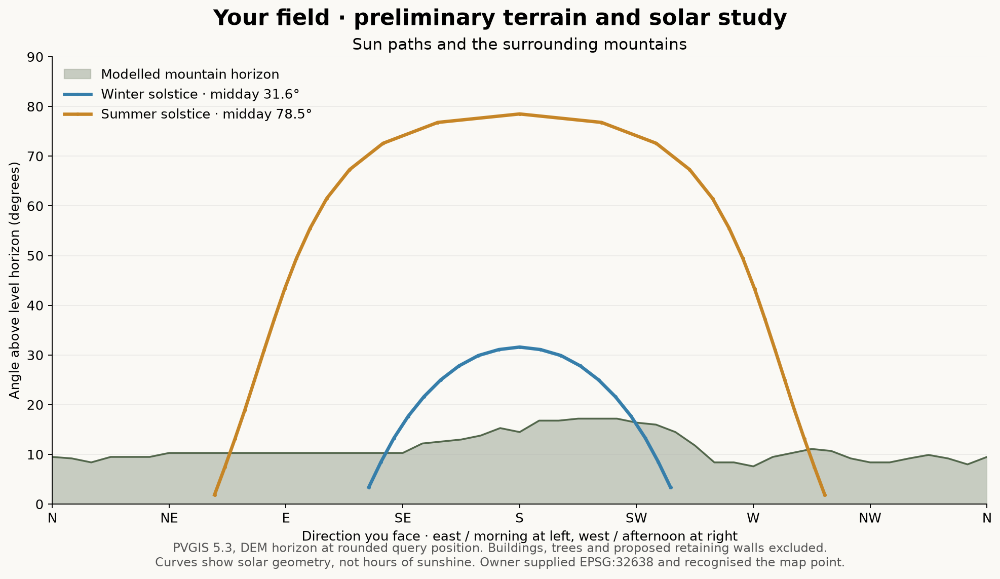
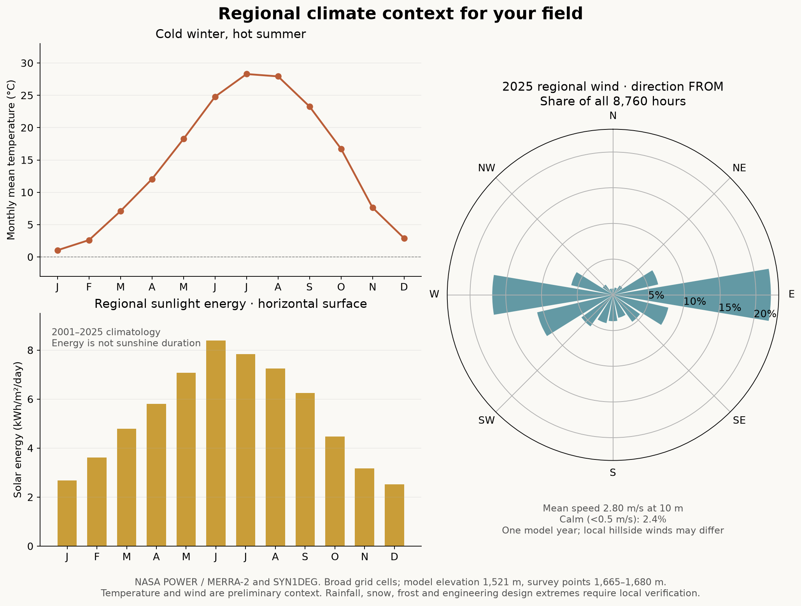

# Field location and preliminary environmental assessment

2026-10-20 · agent:codex · private homeowner research export

The owner supplied **EPSG:32638 — WGS 84 / UTM zone 38N**, then recognised the
calculated parcel-centre map point: **“Yes, that is my field”**. These exact words
are retained in owner statements v10 and v11. This resolves the missing location
context for preliminary environmental research. Formal site confirmation and the
site approval gate remain pending; the canonical site has not been modified.

## Location, coordinates and elevation

| Item | Result | Evidence/status |
|---|---|---|
| Candidate parcel centre | **34.9692467° N, 46.3564133° E** | Calculated from survey polyline D7 using owner-reported CRS; map point recognised by owner |
| Source-frame centre | E 623825.2529, N 3870472.7912 m | Calculated polygon centroid; boundary legality not confirmed |
| Regional place context | Paveh County, Kermanshah Province, Iran | OpenStreetMap reverse geocoder; indicative place context, not a legal address |
| Survey point heights | **1664.884–1680.071 m** across all 27 points | Extracted source Z; owner reports metres above sea level; precise vertical datum unknown |
| Surveyed points inside the parcel | **12.554 m** height difference | Prior survey audit; all-survey height range is a different quantity |
| Grid/true north difference | True north about **0.778° counterclockwise from grid north** at the centre | Calculated with project geospatial helper from supplied CRS; pending formal CRS confirmation |
| Independent terrain-model elevation | PVGIS **1664 m** at the rounded query point | DEM simulation; does not establish the survey's vertical datum |

[Open the owner-recognised map point](https://www.google.com/maps/search/?api=1&query=34.9692467,46.3564133).

All **27** survey POINT coordinates have been transformed for the research preview:
[WGS 84 coordinate table](point-coordinates-wgs84.csv) and
[parcel/points GeoJSON](survey-preview.geojson).
The GeoJSON geometry is 2D. Original survey heights remain properties with an
unknown vertical datum; they are not presented as WGS 84 ellipsoidal heights.
Coordinate decimal precision is not positional accuracy. Numerical inverse
transformation error below 1e-8 m checks arithmetic only.

The original drawings contain point coordinates but no usable declared global
CRS. The owner-supplied EPSG supplies the missing context; it was not discovered
inside the DWG. The independent native-reader investigation remains valid.

## Sun and mountain shading

**Simulation results:** PVGIS 5.3 gives solar-noon heights of about **31.6° at the
winter solstice** and **78.5° at the summer solstice**. Its terrain horizon spans
**7.6–17.2°** above a level horizon: about 10.3° east, 14.5° south, 7.6° west,
and a maximum 17.2° south-southwest to southwest. The winter noon sun clears this
modelled mountain horizon. Low morning/evening sun is obstructed.

These are DEM-based estimates at latitude 34.969, longitude 46.356, approximately
47 m from the calculated parcel centre. Buildings, trees, nearby walls and
future excavation/retaining walls are excluded. No claim is made about exact
hours of direct sunshine on the ground or inside a future room. The returned
sun-path samples have no timestamps, so they were not converted into sunshine
hours. [PVGIS horizon documentation](https://joint-research-centre.ec.europa.eu/photovoltaic-geographical-information-system-pvgis/using-pvgis-5/pvgis-5-user-manual_en).

**Design judgment:** give principal living spaces and a useful part of the flat
garden access to winter sun where parcel geometry and views permit. Test the
proposed house, terrace levels and retaining walls together for self-shading.
Summer shading should be adjustable or geometrically checked so it does not
unnecessarily remove winter light. Low western sun needs a different shading
response from high midday summer sun.

## Regional temperature and solar energy

NASA POWER returned a **2001–2025** climatology. Its meteorology is a broad
MERRA-2 grid estimate (0.5° latitude × 0.625° longitude); the solar source is
SYN1DEG at approximately 1° × 1°. These describe regional conditions, not a
weather station on the parcel. Model elevation is **1520.52 m**, about
144–160 m below the survey points. No automatic temperature lapse-rate adjustment
has been applied. [NASA data-source definitions](https://power.larc.nasa.gov/docs/methodology/data/sources/).

| Selected month | Mean temperature, °C | Solar energy on horizontal surface, kWh/m²/day | Relative humidity, % |
|---|---:|---:|---:|
| January | 1.0 | 2.69 | 69 |
| April | 12.1 | 5.80 | 57 |
| June | 24.8 | 8.39 | 25 |
| July | 28.3 | 7.84 | 20 |
| October | 16.7 | 4.47 | 36 |
| December | 2.9 | 2.52 | 67 |

Source: saved [NASA climatology response](nasa-climatology.json), with all months
in [CSV](monthly-regional-climate.csv). These temperature values are monthly
means, not typical daily highs or lows and not heating/cooling design extremes.
The solar values are daily energy averages, **not sunshine hours** and not
predicted photovoltaic electricity output. They are not a parcel-specific
terrain-shadow correction.

**Design judgment:** the seasonal contrast supports a well insulated envelope,
controlled summer solar gain and operable ventilation. Night ventilation is an
option to test with hourly temperature, air quality and security conditions; it
has not been demonstrated by this monthly dataset. Garden planting and irrigation
should account for the dry summer season. Snow, frost and extreme temperatures
remain to be checked against suitable local records before specification.

## Regional wind — one model year, 2025

All **8,760 hourly speed/direction pairs** were present and valid. Direction means
the direction wind comes **from**, clockwise from true north. Sixteen sectors
are centred every 22.5°. Calm is defined here as speed below 0.5 m/s; directional
percentages use all valid hours, including calm, as their denominator.

| Period | Mean modelled speed at 10 m, m/s | Most frequent individual sector | Share of all hours |
|---|---:|---|---:|
| Full year 2025 | 2.80 | E | 22.1% |
| Dec/Jan/Feb within 2025 | 2.64 | E | 26.4% |
| Mar/Apr/May | 2.78 | E | 14.7% |
| Jun/Jul/Aug | 3.19 | W | 27.7% |
| Sep/Oct/Nov | 2.59 | E | 23.3% |

Annually, W contributes 16.9% and WSW 10.9%; the regional distribution is
strongly east/west oriented. Calm accounts for 2.4%. This is **one regional model
year**, not a multi-year on-site prevailing wind study. The DJF grouping combines
January/February and December of the same calendar year.

NASA explicitly limits these wind estimates to regional flow because buildings
and local topography alter local winds. The model cannot establish which side
of the garden will feel sheltered or predict wind accelerated through a nearby
valley. [NASA wind methodology and direction convention](https://power.larc.nasa.gov/docs/methodology/meteorology/wind/).

**Design judgment:** investigate controllable ventilation paths and flexible
wind protection for the outdoor dining terrace. Avoid assigning a permanent
windbreak or orienting every opening solely from this wind rose. Roof uplift,
structural wind pressure and gust design values are not established here.

## Rainfall cross-check and drainage

The regional NASA response estimates 0.89 mm/day annually, approximately
**325 mm/year** when multiplied by 365. This is an unvalidated grid estimate.
It should **not** be used as the parcel's rainfall normal or to size drainage.

The primary [Kermanshah Meteorological Office statistics form](https://www.kermanshahmet.ir/met/amar)
was queried for Paveh (پاوه), rainfall (بارندگی), Solar Hijri years **1371–1400**.
Its displayed table was saved in [paveh-rainfall-table.json](paveh-rainfall-table.json).
The published station table suggests substantially wetter conditions than the
NASA grid, but includes incomplete records and internal inconsistencies:

- Year 1371 has missing monthly entries.
- Year 1397 displays an annual total of 120.9 while its twelve numeric monthly
  entries sum to 1340.78.
- Years 1388 and 1389 repeat the same twelve entries.
- Year 1394 has no annual total; year 1393 contains a malformed monthly string.

These are observations of the source table, not corrections to meteorological
records. No cleaned station normal was invented or substituted. The form does
not display explicit units alongside its rainfall table; use millimetres only
after source metadata/official records are verified. The service's
[separate daily-summary page](https://www.kermanshahmet.ir/practicalweatherinformation/dailystate)
also warns its daily summaries have not been quality controlled and directs
official requests to the national data portal. That warning is not evidence of
the monthly table's specific quality-control procedure.

**Design judgment:** plan positive surface drainage, drainage behind retaining
walls, accessible inspection/maintenance, and an overflow route that protects
the house and neighbouring land. “Flat outdoor space” means comfortably usable
space with designed drainage falls; it should not become a basin. Actual storm
intensities, catchment areas, outlet permissions and geotechnical conditions
remain necessary before drainage or retaining structures can be sized.

## Implications for the homeowner's brief

These are preliminary architectural judgments, not an approved layout:

1. Keep the spacious living area, views and daylight priorities together when
   comparing possible positions. Check winter mountain shade and the new house's
   own shade before choosing the main garden terrace level.
2. Compare one generous flat outdoor platform with several useful flat terraces.
   Retaining walls and excavation remain acceptable options under the owner's
   preference. Their feasibility, costs and safety are still unknown; climate
   research cannot establish soil or rock stability.
3. Avoid deep, narrow outdoor cuts that lose daylight without measuring that
   trade-off. Keep the garden/play area and outdoor dining terrace connected
   through step-free routes where feasible, consistent with the lift and
   accessibility brief.
4. Protect summer seating from high sun and evaluate low afternoon sun; retain
   a sunny winter seating option. Compare sheltered and open views instead of
   assuming one exposed terrace will suit every season.
5. Carry heating/cooling, snow/frost, water management and summer garden water
   needs into the next program and concept comparisons. No equipment or
   structural loads are selected from this preliminary report.

## Remaining evidence and approval work

- Formal human confirmation of drawing/elevation units and EPSG in the tool;
  precise vertical datum or explicitly adopted local benchmark.
- Legal boundary, actual road/access side, setbacks and building restrictions.
- Site photos or an obstruction survey for buildings, trees and nearby walls;
  photographs cannot establish soil or structural adequacy.
- Quality-checked representative station records and design extremes for rain,
  snow, frost, heat and wind, with station distance/elevation and record period.
- Geotechnical investigation, slope stability, retaining-wall and drainage
  design; earthquake ground conditions and applicable structural parameters.
  None has been determined from this environmental screening.

Location research can now proceed without another map pin. Owner recognition of
the field does not by itself verify every boundary vertex or resolve height
datum accuracy. The site remains `SITE_NEEDS_VERIFICATION`.

## Reproducibility and checks

Public-service requests used coordinates rounded to **34.969, 46.356** as
authorised by the owner. No survey DWG was uploaded. Service URLs, retrieval UTC
times and response hashes are in [data-retrieval.json](data-retrieval.json).
OSM context is saved separately; it is not a cadastral authority.
[analyse.py](analyse.py) reproduces the summaries and figures from saved responses,
with 8,760-hour completeness/range checks. Matplotlib was installed in a temporary
directory for plotting; no repository dependency change was made. Both PNG
figures were visually inspected for labels, legends and legibility.

Project verification after the owner map reply: **57 events, 54 artifact versions
intact**. During this investigation the full repository suite passed: **867 tests
in 443.64 s**, Ruff clean, **29 schemas current**, tracker checker passed. These
checks verify software/store consistency, not climate accuracy or site approval.

Original SHA-256 values remain unchanged:

- seperated.dwg: `27624ba14003e3d898143a9d86985d50d3d7098db0a45b94ae2dd999571519ed`
- elevation.dwg: `9689880c47d9d0780089c5d4077f9396f5c29a2feeb298fafb86840bbae02f02`
